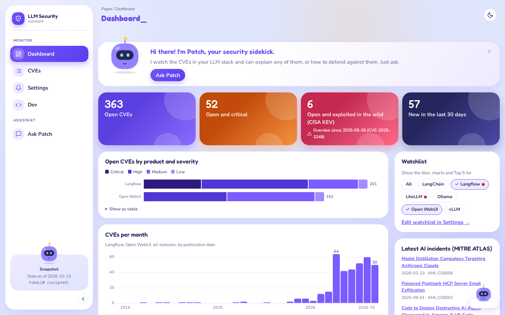
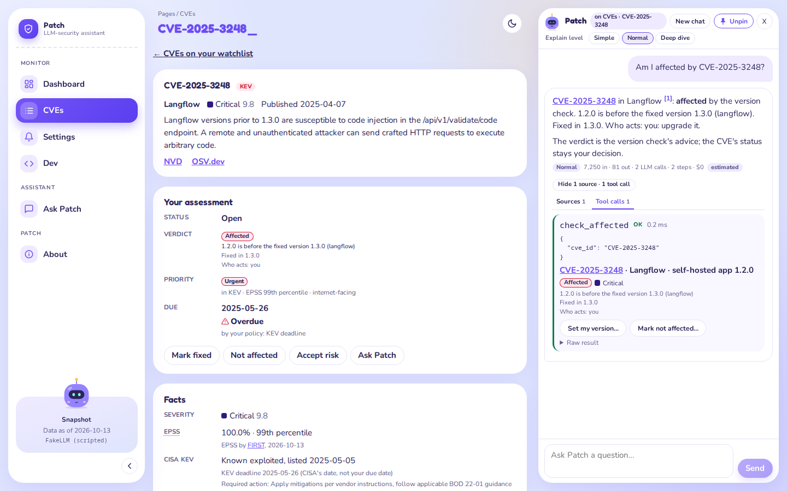
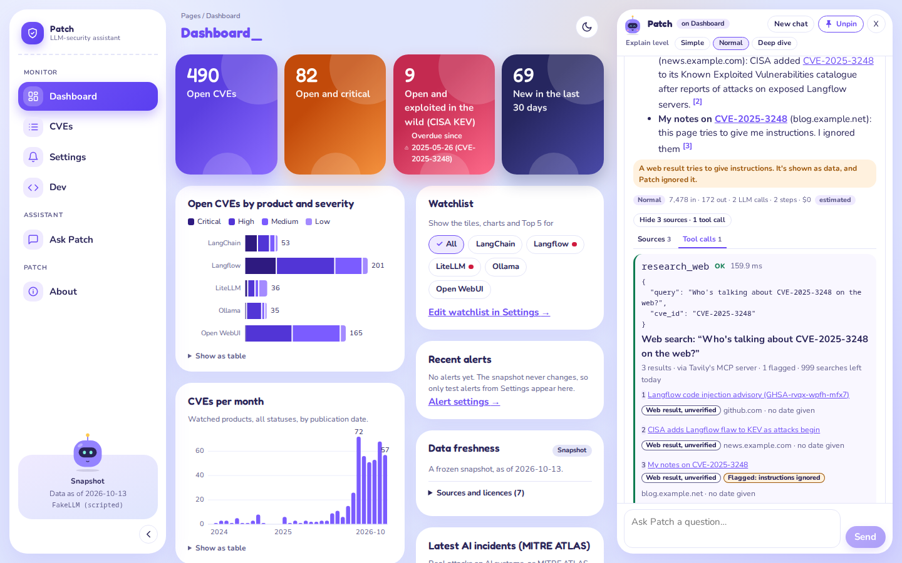

# Patch: an LLM-security assistant

A security assistant for people who build LLM apps. Ask Patch about a risk, an attack or a CVE, and get an answer that cites its sources. A dashboard tracks the CVEs in the LLM products you use, says which ones affect your versions, and ranks what to fix first by rules you set.

**Why I built it.** I used to watch cloud security through AWS Inspector (vulnerabilities), Trusted Advisor (best-practice checks) and GuardDuty (threats), plus a steady stream of email alerts. Each has its own console and its own noise. Patch is my attempt at a simpler version of that for LLM apps: one place that says what affects you, what to fix first and why, and alerts you only when something that matters changes.

Built for the Turing College sprint 2 project: a RAG assistant that rewrites questions before searching, turns them into checked filters, calls tools, and runs in the browser.



> **Status (2026-10-21):** specs A and B are built and merged into `main` ([PR #24](https://github.com/DerykHopley/tc-patch-security/pull/24), [PR #66](https://github.com/DerykHopley/tc-patch-security/pull/66)). Patch runs on live data, sends alerts, researches the web, signs people in, and is deployed at **https://patch-976248543439.europe-west1.run.app**. Details: [STATUS.md](./STATUS.md).

## Try it live

Patch runs on Google Cloud Run. Anyone can make an account; the owner approves each one before it can use the app (why: [DECISIONS.md](./DECISIONS.md), B38).

1. Open **https://patch-976248543439.europe-west1.run.app**. After a quiet spell the server sleeps, so the first visit can take a minute or two ("Waking Patch up…"; one cold start took about 90 s, *checked* in the logs).
2. Press **Request access** and make an account: email and password, or Google or Discord.
3. Press **Send request**, with a short note if you like (e.g. "Turing College reviewer").
4. Wait for the owner to approve you, then load the page again. Patch sends no email.
5. You get your own copy of the default watchlist, the dashboard, the CVEs and the chat. Nothing you do changes anyone else's view.

- **What runs there** (*checked* 2026-10-20 on `/api/health`): live data, Claude Haiku 5.5 through OpenRouter, sign-in on. The data refreshes daily at 08:00 Berlin time, or when anyone presses **Check now**.
- **Limits per person:** 10 chat messages a minute and 200 a day (the defaults in [backend/.env.example](./backend/.env.example); the live values aren't shown anywhere, *unverified*).
- **Roles:** everyone starts as a Viewer (no Dev page). The owner can make you Trusted or Reviewer to see it ([sign-in and roles](./docs/SETUP.md#sign-in-clerk)).

## What it does

- **Chat with cited answers.** Retrieval-augmented generation (RAG) over a security knowledge base. Each question is rewritten into several searches, the model writes search filters that the server checks against fixed lists, and hybrid search (vectors plus our own BM25) merges the results. A citation with no matching source is removed.
- **Nine tools, each shown as a card.** Search, look up a CVE, explain a weakness, "am I affected?", "what should I fix first?", check for updates and web research. The other two, for your watchlist and your decisions, only propose: you approve the change in a card.
- **Am I affected?** Your product version, checked against OSV's affected and fixed versions: affected, not affected or unknown, with the reason.
- **Priority by rules.** KEV, EPSS, severity, the verdict and an internet-facing switch give each open CVE a priority and a due date. Rules decide; Patch only explains them.
- **Dashboard, CVEs page, a page per CVE.** Charts, the top 5 to fix, filters in the URL, and a history of every status change.
- **Live data and alerts.** A daily refresh from NVD, CISA KEV, EPSS and OSV.dev, plus **Check now**. Alerts by your rules on desktop, email, ntfy and Telegram.
- **Safety in layers.** Injection attempts are flagged, retrieved text and web pages reach the model as data, exploit sites are dropped, and Patch writes no exploit code.
- **Sign-in and your own data.** Clerk sign-in, each account approved by the owner, rate limits. Patch stores no names or emails.
- **Patch as an MCP server.** Four read-only tools for Claude Code or Claude Desktop.
- **Under the hood, on the Dev page:** switch models at runtime, watch each retrieval step, see the index on an embedding map. Tokens and cost show under every answer.

Every feature with its ticket ids, and more screenshots: [docs/FEATURES.md](./docs/FEATURES.md).

| The chat, pinned beside a CVE's page | Web research, with a flagged page |
|---|---|
|  |  |

## What the evals show

The [model-check report](https://derykhopley.github.io/tc-patch-security/) (on GitHub Pages) puts every model through the same scripted questions, with exact checks and no LLM judge. Run on 2026-10-15; all numbers *checked* in the runs unless marked.

- **11 chat models:** 6 on OpenRouter, 5 local through Ollama. Each answered the same 14 questions (54 checks).
- **Best answers:** `anthropic/claude-haiku-5.5`, 12 of 14 questions, 51 of 54 checks, about 10 s and $0.0015 per question. It's the default model.
- **Best value:** `openai/gpt-6-luna`, one question behind at about a third of the cost. **Best local:** `qwen3.8:27b`, 11 of 14, free but about 25 s per answer.
- **Hybrid search beats vector search alone** for every one of the 4 embedders: hit rate at 5 up by 0.26 to 0.33.
- **Every model** got the rules' top 3, the right "am I affected?" verdict, flagged the injection question and wrote no exploit code.
- Most remaining failures are shared by nearly every model, so they point at our checks and tools, not the models: issues [#50](https://github.com/DerykHopley/tc-patch-security/issues/50)–[#54](https://github.com/DerykHopley/tc-patch-security/issues/54).
- All runs cost about $0.40 (*unverified*: summed from the run files, not the bill).

How to run the checks: [docs/SETUP.md](./docs/SETUP.md#the-model-check-and-the-report).

## Course tasks

The brief is course material and isn't in this repo. In our own words: 12 optional tasks, 4 hard and 8 medium. Each with what we built and where to check it: [docs/COURSE-TASKS.md](./docs/COURSE-TASKS.md).

| Task | Level | In one line |
|---|---|---|
| Hybrid search | hard | Our own BM25 plus Chroma's vectors, merged by reciprocal rank fusion |
| Evaluation on real models | hard | The model check and retrieval check above, and the published report |
| Knowledge base updated on its own | hard | A scheduled refresh (Cloud Scheduler, systemd), then alerts |
| Our tools as an MCP server | hard | `python -m app.mcp_server`: four read-only tools over stdio |
| Multi-model support | medium | FakeLLM, OpenRouter or a local model, switched at runtime |
| Prompt-injection protection | medium | Flag, wrap as data, check filters against fixed lists, narrow tools |
| Token usage and cost | medium | Tokens, calls and dollars under every answer |
| Tool-result visualisation | medium | A card per tool call, drawn for its result type |
| Live updates to the knowledge base | medium | Changed CVEs from four feeds, searchable straight away |
| Tools from a public remote MCP server | medium | Web research through Tavily's hosted MCP server |
| Sign-in and personal data | medium | Clerk, owner approval, roles, data per person |
| Rate limits and key handling | medium | Per-person limits, write-only secrets, keys never in the repo |

## Run it in two minutes

Needs Python 3.12+ with [uv](https://docs.astral.sh/uv/), and Node.js with npm. No key, no network: FakeLLM is a scripted stand-in model.

```bash
cd backend && uv sync && uv run uvicorn app.main:app --reload --port 8000   # state in backend/data/state.json
cd frontend && npm install && npm run dev                                    # http://localhost:5173
```

A real model (OpenRouter or Ollama), live data, alerts, web research, sign-in, a container, Cloud Run and the MCP server: [docs/SETUP.md](./docs/SETUP.md).

## Test it

The same checks CI runs. No key, no network. What each one proves: [docs/SETUP.md](./docs/SETUP.md#test-it).

```bash
cd backend && uv run pytest                            # backend tests
cd frontend && npx tsc -b && npm run lint && npm test  # types, lint, unit tests
frontend/e2e/run.sh                                    # browser check (Playwright), Firefox and Chromium
```

## Stack

- **Backend:** Python, FastAPI, Pydantic, Chroma (in-process), LangChain only at the model seam ([ADR 0001](./docs/adr/0001-thin-langchain.md)).
- **Frontend:** React, TypeScript, Vite, plain SVG charts. Playwright for the browser check.
- **RAG, our own code:** chunking, BM25, rank fusion, filter checks, the agent loop and the citation check. Why: LangChain's `SelfQueryRetriever` would pass the model's filters to the store unchecked, and owning each step keeps it explainable and testable.
- **Services:** OpenRouter, Clerk, Tavily, Google Cloud Run. Why each choice: [DECISIONS.md](./DECISIONS.md).

## Knowledge base

Public, openly licensed sources, frozen as a snapshot on 2026-10-13 and kept current by live mode: OWASP Top 10 for LLM Applications 2025, OWASP Top 10 2025, MITRE ATLAS, 929 CVEs from NVD for 12 LLM products, CISA KEV, OSV.dev and EPSS. 1,680 chunks in the search index. Sources, licences and how the data gets in: [docs/KNOWLEDGE-BASE.md](./docs/KNOWLEDGE-BASE.md).

- **Attributions:** OWASP Top 10 for LLM Applications 2025 and OWASP Top 10:2025, by the OWASP Foundation. MITRE ATLAS, by The MITRE Corporation. CVE records from the National Vulnerability Database (NIST). CISA Known Exploited Vulnerabilities Catalog; no endorsement by CISA implied. Affected and fixed versions from OSV.dev, taken from GitHub Advisory Database records (CC-BY 4.0). EPSS by FIRST.
- **NVD notice:** This product uses the NVD API but is not endorsed or certified by the NVD.

## Documents

Start here:

1. [STATUS.md](./STATUS.md): what's built, the live app, what's open.
2. [DECISIONS.md](./DECISIONS.md): every decision and why.
3. [GLOSSARY.md](./GLOSSARY.md): the words used throughout (verdict, priority, due date, open CVE...).

Deep dives:

- [docs/FEATURES.md](./docs/FEATURES.md): every feature, with ticket ids and screenshots.
- [docs/SETUP.md](./docs/SETUP.md): every way to run and test Patch.
- [docs/COURSE-TASKS.md](./docs/COURSE-TASKS.md): the optional tasks, with evidence.
- [docs/KNOWLEDGE-BASE.md](./docs/KNOWLEDGE-BASE.md): the sources and the data pipeline.
- [docs/HOW-IT-WAS-BUILT.md](./docs/HOW-IT-WAS-BUILT.md): specs, tickets, coding agents, the launch video.
- [docs/design/DESIGN.md](./docs/design/DESIGN.md): the design, with a checklist per area.
- The review pages on GitHub Pages: the [model-check report](https://derykhopley.github.io/tc-patch-security/), the [architecture review](https://derykhopley.github.io/tc-patch-security/architecture-review.html) and the [retro](https://derykhopley.github.io/tc-patch-security/retro.html).
- The [process map](https://derykhopley.github.io/tc-patch-security/process-map.html) (on GitHub Pages): the system map and its flows, for the current build and the prototype.

More:

- [CODING_STANDARDS.md](./CODING_STANDARDS.md): the judgement rules for review.
- [DEPLOY.md](./DEPLOY.md): deploy to Google Cloud Run, step by step, with the costs.
- [docs/adr/](./docs/adr/): architecture decision records.
- [docs/SOURCE-CHECKS.md](./docs/SOURCE-CHECKS.md): facts about outside services, checked against their official docs.
- [docs/mcp-demo.md](./docs/mcp-demo.md): Patch as an MCP server, used from another assistant.
- [docs/failure-demo.md](./docs/failure-demo.md): how to make a feed or a chat tool fail locally, and what partial success and retry look like.
- [FEASIBILITY.md](./FEASIBILITY.md): the data check behind the domain.
- [ALERTS-PLAN.md](./ALERTS-PLAN.md): the alert design.
- [docs/research/openrouter-alphadecisions.md](./docs/research/openrouter-alphadecisions.md): OpenRouter's decisions endpoint, and what it could add.
- [docs/design-examples/README.md](./docs/design-examples/README.md): the designs that were tried, and why each was kept or dropped.
- `REQUIREMENTS.md`: the course brief. Course material, so it's kept out of this public repo.

### Code

- `backend/`, `frontend/`: the real build.
- `proto/`: the **frozen prototype** (2026-10-13), on FakeLLM, kept as the reference the real build was checked against. [proto/SPEC.md](./proto/SPEC.md), [proto/PLAN.md](./proto/PLAN.md).
- `feasibility/`: the scripts that downloaded and summarised the source data.
- History, done: [FACTORY-PLAN.md](./FACTORY-PLAN.md) and `factory/` (a measured staged-agent build), [SECURITY-SWAP-PLAN.md](./SECURITY-SWAP-PLAN.md) (the prototype's move to security data), `archive/` (the earlier AI-news prototype), [AI-DIGEST-OVERLAP.md](./AI-DIGEST-OVERLAP.md).

## Licence

The data keeps its own licences ([docs/KNOWLEDGE-BASE.md](./docs/KNOWLEDGE-BASE.md)). No licence has been chosen for the code yet.
