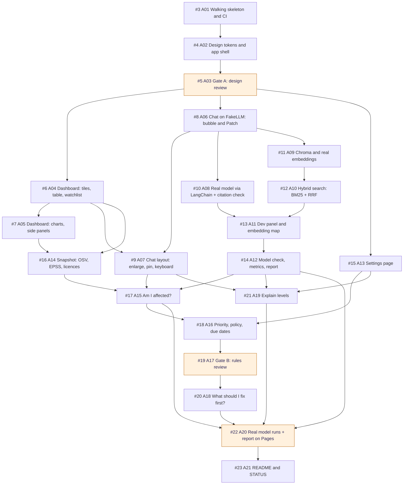

# Patch: an LLM-security assistant

A security assistant for people building LLM apps. Ask Patch about a risk, an attack or a CVE, and get an answer that cites its sources. A dashboard tracks the CVEs in the LLM products you use, and alerts can reach your phone, desktop or inbox.

Built for the Turing College sprint 2 project: advanced RAG with query translation and structured retrieval, tool calling, and a web UI.


> **Status: a working prototype.** It runs on a frozen snapshot of public data (2026-10-13). Answers come from a scripted stand-in model (FakeLLM) by default; local models and OpenRouter are wired in but haven't answered for real yet. The plan for the real build is in [DECISIONS.md](./DECISIONS.md) and [STATUS.md](./STATUS.md).

## What it does

- **Chat with Patch.** Retrieval over the knowledge base, with query translation (multi-query rewrites, reciprocal rank fusion) and structured retrieval (the model writes metadata filters; the server checks them). Answers cite numbered sources and show every tool call and the query plan.
- **Four tools:** `search_security`, `lookup_cve` (with KEV and your watchlist status), `explain_weakness` (CWE → OWASP category, ATLAS technique → mitigations), `update_watchlist`.
- **CVE dashboard:** open CVEs for your watchlist, by product and severity, per month and by OWASP category. Mark CVEs fixed or not affected; "Ask about this" opens Patch on any row.
- **Alerts:** desktop, email and ntfy notifiers with test sends and a log. The scheduled refresh that triggers them is planned.
- **Dev panel:** switch models at runtime (FakeLLM, OpenRouter, or any local OpenAI-compatible server: Ollama, LM Studio, llama.cpp), tune search, watch each retrieval step in a playground, see the index on an embedding map, and score a model on 11 questions with exact checks.
- **Security for this domain:** injection phrasing is flagged, not blocked (talking about attacks is the point); tool output and retrieved text are delimited and escaped; the model's filters are validated; no working exploits.

| Patch's moods | The chat, pinned beside the page |
|---|---|
|  |  |

## Knowledge base

All public and openly licensed, frozen on 2026-10-13:

| Source | What | Licence |
|---|---|---|
| OWASP Top 10 for LLM Applications 2025 | Risks and how to prevent them | CC BY-SA 4.0 |
| OWASP Top 10 2025 | Web risks; the bridge to CVEs through CWEs | CC BY-SA 4.0 |
| MITRE ATLAS 5.6.0 | Attack techniques, mitigations, case studies | Apache 2.0 |
| NVD | 929 CVEs for 12 LLM products | US government, public |
| CISA KEV | 9 of them exploited in the wild | US government, public |

1,680 chunks in the index. How they're linked and why this domain: [FEASIBILITY.md](./FEASIBILITY.md).

## Run it

Needs Python 3.12+ with [uv](https://docs.astral.sh/uv/), and Node.js with npm.

```bash
# Backend: FakeLLM by default, no key, no network. State in proto/backend/data/state.json
cd proto/backend && uv sync && uv run uvicorn app.main:app --reload --port 8000

# Frontend: http://localhost:5173
cd proto/frontend && npm install && npm run dev
```

- For a real model, copy `proto/backend/.env.example` to `.env` and fill it in, or pick a local model in the dev panel. Secrets stay in `.env`, which is git-ignored.
- More: [proto/backend/README.md](./proto/backend/README.md) and [proto/frontend/README.md](./proto/frontend/README.md).

## Test it

```bash
cd proto/backend && uv run pytest                      # 135 tests, no key, no network
cd proto/frontend && npx tsc -b && npx oxlint src      # types and lint
```

The browser checks (`proto/frontend/e2e/check_ui.py`, Playwright, 35 checks) change data, so run them against a second pair of servers with a throwaway state file. The commands are in [STATUS.md](./STATUS.md#how-to-test-it).

## Stack

- **Backend:** Python, FastAPI, Pydantic, numpy, the `openai` SDK (one client for OpenRouter and local servers).
- **Frontend:** React, TypeScript, Vite, plain SVG charts.
- **RAG:** every stage hand-written behind small interfaces: section-aware chunking, a mock hash embedder (real embeddings next), an in-memory index with filters, multi-query + RRF, an agent loop with citations. No LangChain yet; where it would fit is in the process map.

## Build plan: spec A

The real build's first half, due 2026-10-26: [spec A (#2)](https://github.com/DerykHopley/tc-patch-security/issues/2) split into 21 tickets. An arrow means "must finish before". Orange tickets need a person: two review gates and the first real model run.



## Documents

### Read these to build the spec (in this order)

1. [CLAUDE.md](./CLAUDE.md): project rules and how to work on it.
2. [STATUS.md](./STATUS.md): what's built, how to run and test it, what's waiting, next steps.
3. [DECISIONS.md](./DECISIONS.md): every decision, why, and where its detail lives; open questions.
4. `REQUIREMENTS.md`: the course brief. Course material, so it's kept out of this public repo (local only).
5. [proto/SPEC.md](./proto/SPEC.md): what the prototype does, as checks by ID. [proto/PLAN.md](./proto/PLAN.md): how the code is laid out.
6. [docs/process-map.html](./docs/process-map.html): the system map and every flow, built and planned (Flow 4 alerts, Flow 5 the "make it actionable" shortlist), where RAG and LangChain fit, security, seams. Download and open it in a browser (GitHub shows HTML as source).
7. [docs/design/DESIGN.md](./docs/design/DESIGN.md): the design to build from: tokens, components, the chat, Patch, every animation, accessibility, a checklist per area.
8. [ALERTS-PLAN.md](./ALERTS-PLAN.md): alerts for your watchlist. The notifiers are built; the refresh isn't.
9. [FEASIBILITY.md](./FEASIBILITY.md): the data check behind the domain: sources, sizes, licences, links, problems.
10. [docs/NEXT-SESSION-PROMPTS.md](./docs/NEXT-SESSION-PROMPTS.md): the prompts for the next sessions (grill the plan, then write the build spec).

### Background

- [docs/design-examples/README.md](./docs/design-examples/README.md): the designs and layouts that were tried, with screenshots and why each was kept or dropped.
- [AI-DIGEST-OVERLAP.md](./AI-DIGEST-OVERLAP.md): each requirement mapped to ideas in a related project (written when the domain was still AI news).

### History (done; kept for the record)

- [FACTORY-PLAN.md](./FACTORY-PLAN.md) and `factory/`: a staged-agent build experiment with a cost and energy report. Finished 2026-10-12.
- [SECURITY-SWAP-PLAN.md](./SECURITY-SWAP-PLAN.md): the plan that moved the prototype to the security data and added the dashboard. Built 2026-10-13.
- `archive/`: the earlier AI-news prototype.

### Code and data

- `proto/`: the prototype (FastAPI backend, React frontend).
- `feasibility/`: `fetch.py` downloads the source data, `analyse.py` summarises it. The downloaded data isn't committed.

## Decisions

All decided on 2026-10-14; the full list with reasons is in [DECISIONS.md](./DECISIONS.md). In short:

- **Framework:** LangChain only at the model seam ([ADR 0001](./docs/adr/0001-thin-langchain.md)); our own retrieval, filter checks and agent loop stay.
- **Search:** Chroma running in-process, OpenRouter `text-embedding-3-small` embeddings, plus our own BM25 keyword search merged by reciprocal rank fusion (hybrid search).
- **Models:** OpenRouter first (`gpt-oss-120b`, then `claude-haiku-5.5`), then local models through Ollama; compared in the model check and an evaluation report on GitHub Pages.
- **Course tasks committed:** hybrid search and evaluation on real models (hard); multi-model, prompt-injection protection, token usage and cost, tool-result visualisation (medium).
- **Facts checked** against official sources: OSV.dev, EPSS, Tavily, NVD, KEV, Chroma, hosting, OpenRouter, Clerk ([docs/SOURCE-CHECKS.md](./docs/SOURCE-CHECKS.md)).
- **Words** used throughout: [GLOSSARY.md](./GLOSSARY.md).
- **Later (spec B, to 2026-11-02):** the live refresh and alerts, web research through Tavily, deployment to Cloud Run, sign-in with Clerk.
- Decided on 2026-10-13: the layout (a chat bubble, pinnable) and the design (Playful, with Patch).

## Licence

The data keeps its own licences (table above). No licence has been chosen for the code yet.
