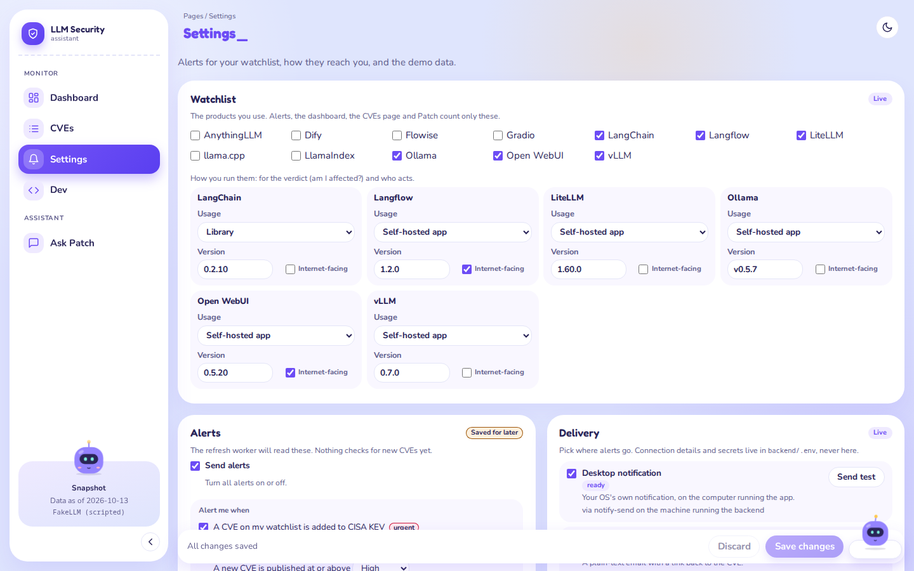
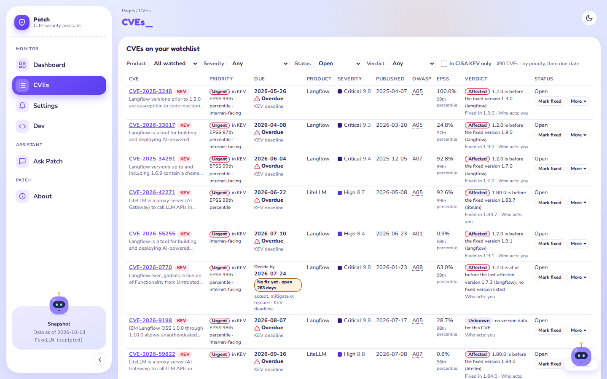
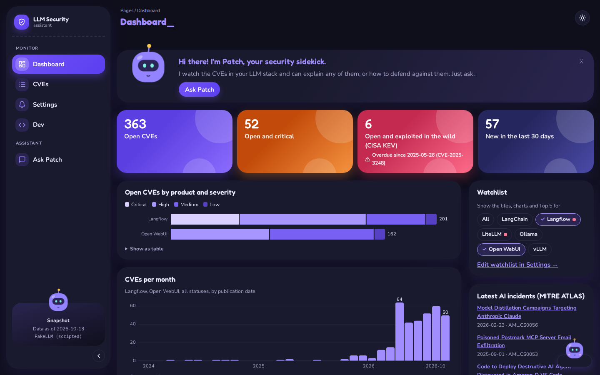
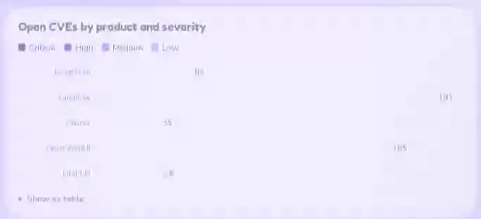
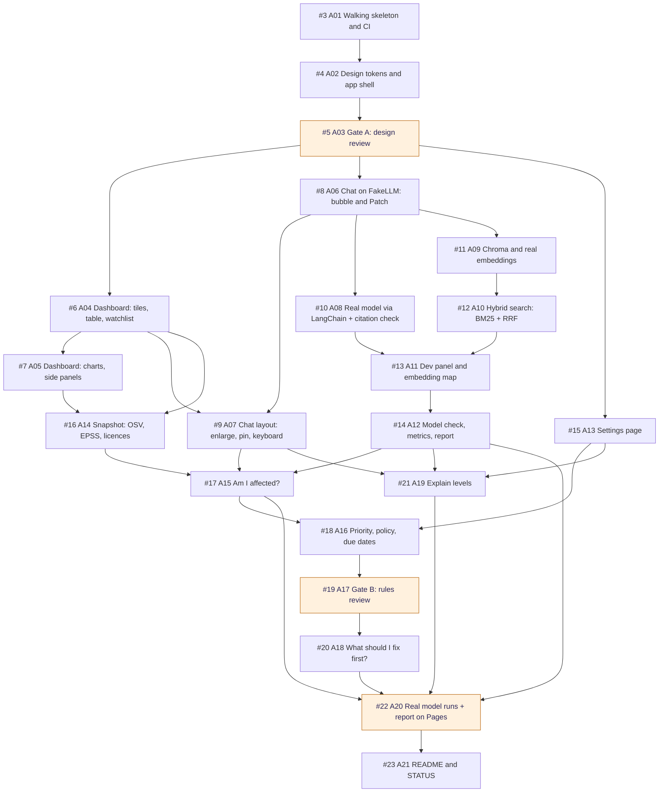

# Patch: an LLM-security assistant

A security assistant for people who build LLM apps. Ask Patch about a risk, an attack or a CVE, and get an answer that cites its sources. A dashboard tracks the CVEs in the LLM products you use, says which ones affect your versions, and ranks what to fix first by rules you set.

Built for the Turing College sprint 2 project: a RAG assistant that rewrites questions before searching, turns them into checked filters, calls tools, and runs in the browser.


> **Status (2026-10-15): spec A is built** and waiting for review in [PR #24](https://github.com/DerykHopley/tc-patch-security/pull/24). It runs on a frozen snapshot of public data (as of 2026-10-13). Real models answered on 2026-10-15: 11 chat models and 4 embedders, compared in the [model-check report](https://derykhopley.github.io/tc-patch-security/). Spec B (live refresh, alerts, web research, deployment) comes next. Details: [STATUS.md](./STATUS.md).

## What it does

- **Chat with Patch.** Retrieval over the knowledge base with query translation (multi-query rewrites, merged by reciprocal rank fusion) and structured retrieval (the model writes metadata filters; the server checks them against fixed lists). Search is hybrid: vectors plus our own BM25 keyword search. Answers cite numbered sources; a citation with no matching source is removed and listed.
- **Six tools:** `search_security`, `lookup_cve` (with KEV, verdict and priority), `explain_weakness` (CWE → OWASP category, ATLAS technique → mitigations), `check_affected` (am I affected, for your version), `prioritise` (what to fix first, from the rules) and `update_watchlist` (which only proposes: you approve, edit or cancel the change in a card). Every call shows as a card under the answer.
- **Am I affected?** You give each watched product a version and how you run it. OSV's affected and fixed versions give a verdict per CVE: affected, not affected or unknown, with the reason.
- **Priority by rules.** KEV, EPSS, severity, the verdict and an internet-facing switch give each open CVE a priority (urgent, high, normal, low) and a due date from your policy. Rules decide; Patch only explains them.
- **Dashboard and CVEs page.** Tiles, charts and the top 5 open CVEs, filtered by product. The CVEs page lists every CVE on your watchlist with filters in the URL. Each status change (fixed, not affected, accepted) goes through a dialog and into a history; not affected needs a justification, accepted a reason and a review date.
- **Explain levels:** simple, normal or deep dive, set in Settings or per question.
- **Page-aware chat:** "What should I fix first?" means the view you're looking at.
- **Token usage and cost** under every answer: tokens in and out, LLM calls, steps, and dollars (from OpenRouter's reported cost).
- **Dev page:** switch the model at runtime (FakeLLM, OpenRouter, or a local OpenAI-compatible server such as Ollama), tune search, watch each retrieval step in a playground, see the index on an embedding map, and run the model check.
- **Alert channels:** desktop, email and ntfy, with test sends. The scheduled refresh that sends real alerts is spec B.
- **A landing page** (B42, [#80](https://github.com/DerykHopley/tc-patch-security/issues/80)): a visitor who isn't signed in first sees what Patch is, the problem it solves and three screenshots in their theme, then **Sign in** or **Request access**. Inside the app it is the **About** page (`/about`). It also has a 20-second launch video, light or dark to match ([#99](https://github.com/DerykHopley/tc-patch-security/issues/99)). Its screenshots are taken from the app on example data by `scripts/landing-shots.sh` ([how](./docs/design/DESIGN.md#516-the-landing-page-b42-80-2026-10-19)).

| The chat, with a tool card | Settings: your watchlist |
|---|---|
|  |  |
| **The CVEs page** | **Dark mode** |
|  |  |

The "Open CVEs by product and severity" chart opening:



Screenshots taken 2026-10-15 from the real app on FakeLLM, with a seeded watchlist (6 products, versions set, 3 CVEs marked fixed). FakeLLM is a scripted stand-in, so the chat shows the app working, not a real model's wording.

## What was proven: the model check

The [model-check report](https://derykhopley.github.io/tc-patch-security/) (on GitHub Pages) compares every model on the same scripted questions, with exact checks and no LLM judge. Run on 2026-10-15. All checked in the runs unless marked.

- **11 chat models:** 6 on OpenRouter, 5 local through Ollama 0.40.4 on an RX 7900 XTX. Each answered the same 14 questions (54 checks).
- **Best answers:** `anthropic/claude-haiku-5.5`, 12 of 14 questions, 51 of 54 checks, about 10 s and $0.0015 per question. It's the default OpenRouter model.
- **Best value:** `openai/gpt-6-luna`, one question behind at about a third of the cost.
- **Best local:** `qwen3.8:27b`, 11 of 14, 50 of 54 checks, free but about 25 s per answer.
- **4 embedders:** `mxbai-embed-large` (Ollama) is the default for real embeddings: hybrid hit rate at 5 of 0.82 and MRR 0.69, and the widest gap between on-topic and off-topic scores. Off-topic threshold 0.58.
- **Hybrid search beats vector search alone** for every embedder: hit rate at 5 up by 0.26 to 0.33.
- **Every model** got the rules' top 3 for "what should I fix first?", the right verdict for "am I affected?", flagged the injection question and wrote no exploit code.
- Most remaining failures are shared by nearly every model, so they point at our checks and tools. They're follow-up issues [#50](https://github.com/DerykHopley/tc-patch-security/issues/50)–[#54](https://github.com/DerykHopley/tc-patch-security/issues/54).
- Total spend for all runs: about $0.40. *Unverified:* summed from the run files, not checked against the OpenRouter bill.

The no-setup defaults stay FakeLLM and the hash embedder, so the app and every test run with no key and no service.

## Course tasks this build meets

The brief is course material and isn't in this repo. In our own words, the optional tasks committed for spec A, and where to check each one:

| Task | What we built | Evidence |
|---|---|---|
| **Hybrid search** (hard) | Our own BM25 keyword search over the same chunks, with the same filters as the vector search, merged with Chroma's results by reciprocal rank fusion. The tokeniser keeps ids like `CVE-2024-8309` and `AML.T0051.001` whole, so exact ids and product names are found. | `backend/app/rag/keyword.py`, `fusion.py`, `pipeline.py`; tests `backend/tests/test_keyword.py`, `test_fusion.py`; the Dev page's playground shows the BM25 and vector lists before fusion; [report: Embedders side by side](https://derykhopley.github.io/tc-patch-security/#embedders) (hybrid against vector only, per embedder) |
| **Evaluation on real models** (hard) | A model check: scripted questions with exact checks (right tools, filters, key fact, real citations, flags, no exploit code, the rules' verdict and top 3, readability by level). A retrieval check: hit rate at 5 and MRR per embedder. A self-contained HTML report, built from saved runs and published. | `backend/app/evals/` (`model_check.py`, `checks.py`, `retrieval.py`, `report.py`); `docs/report-src/` (the runs shown, the findings); tests `backend/tests/test_model_check.py`, `test_report.py`, `test_retrieval_check.py`; [the published report](https://derykhopley.github.io/tc-patch-security/), section [Findings](https://derykhopley.github.io/tc-patch-security/#findings) |
| **Multi-model support** (medium) | One `LLM` seam with three providers: FakeLLM, OpenRouter, and any OpenAI-compatible server on this machine (Ollama, LM Studio, llama.cpp), through LangChain's `ChatOpenAI`. Switch at runtime on the Dev page. Three embedders the same way: hash, OpenRouter, Ollama. | `backend/app/llm/` (`providers.py`, `openai_compat.py`, `fake.py`), `backend/app/rag/embed.py`, `frontend/src/pages/DevPage.tsx`; tests `backend/tests/test_llm_openai.py`, `test_dev.py`, `frontend/e2e/test_dev.py`; [report: Models side by side](https://derykhopley.github.io/tc-patch-security/#models) (11 models) |
| **Prompt-injection protection** (medium) | Layers, not a blocklist. Injection phrasing in the user's message is flagged and logged, never blocked (asking about attacks is the point here). Retrieved text and tool output reach the model wrapped and escaped as data. The model's search filters and the page context are checked against fixed lists; anything else is dropped and listed. Tools are narrow, and status changes need the user's yes. | `backend/app/guard.py`, `page_context.py`, `chat_turn.py`; [CODING_STANDARDS.md](./CODING_STANDARDS.md) (Safety); tests `backend/tests/test_guard.py`, `test_chat_turn.py`, `frontend/e2e/test_chat.py` (the flag notice); report: every model flagged the injection question and wrote no exploit ([Pass or fail](https://derykhopley.github.io/tc-patch-security/#grid), Q6 and Q8) |
| **Token usage and cost** (medium) | Every answer shows tokens in and out, LLM calls, steps and the cost in dollars, summed over all the answer's model calls. The cost is OpenRouter's own `usage.cost`; local models and FakeLLM cost $0. The model check adds cost and time per question and per run. | `backend/app/llm/openai_compat.py`, `backend/app/tools/registry.py` (summing), `frontend/src/chat/Conversation.tsx` (the usage line); tests `backend/tests/test_llm_openai.py`, `test_citations.py`, `frontend/e2e/test_citations.py`; the usage line in [the chat screenshot](docs/media/chat-light.png); [report: At a glance](https://derykhopley.github.io/tc-patch-security/#glance) (quality against cost and time) |
| **Tool-result visualisation** (medium) | Each tool call is a card under the answer: the tool, its arguments, time, and the result drawn for its kind (a CVE card with severity, priority, verdict and EPSS; an OWASP or ATLAS card; a watchlist change), plus the raw result. Errors show in red. Each tool declares its result shape; the frontend's types are generated from it. | `frontend/src/chat/ToolCallCard.tsx`, `frontend/src/toolResults.ts` (generated), `backend/app/tools/registry.py`; tests `backend/tests/test_tool_results.py`, `frontend/e2e/test_chat.py` (A06.6); [the chat screenshot](docs/media/chat-light.png) |

The core of the brief is covered too: RAG over a domain knowledge base, query translation, structured retrieval, six tools, input validation and error handling, and a web UI with sources, tool calls and progress. Stretch tasks (real-time updates, automated knowledge-base updates, remote MCP, auth and rate limiting) are spec B ([#31](https://github.com/DerykHopley/tc-patch-security/issues/31)).

## Run it

Needs Python 3.12+ with [uv](https://docs.astral.sh/uv/), and Node.js with npm. All commands start in the repo root.

To work on the code, turn on the pre-commit hook once per clone: `git config core.hooksPath .githooks`. It refuses a commit with staged conflict markers or a browser-check wait without a reason, in under a second. CI runs the same checks, so the hook only finds them sooner.

### With no key (FakeLLM)

FakeLLM is a scripted stand-in model, and the hash embedder matches words. No key, no network, no GPU.

```bash
cd backend && uv sync && uv run uvicorn app.main:app --reload --port 8000   # state in backend/data/state.json
cd frontend && npm install && npm run dev                                    # http://localhost:5173
```

### With OpenRouter, no GPU

A real chat model and real embeddings, both through OpenRouter. Set a spending cap on the key in OpenRouter's settings.

1. Copy the settings file. `.env` is git-ignored; never commit it.

   ```bash
   cd backend && cp .env.example .env
   ```

2. In `backend/.env`, set:

   ```bash
   LLM_PROVIDER=openrouter
   OPENROUTER_API_KEY=sk-or-...          # your key
   EMBEDDER=openrouter                   # openai/text-embedding-3-small
   INDEX_PATH=data/index-openrouter      # its own index folder, so the free hash index can stay
   ```

   The chat model defaults to `anthropic/claude-haiku-5.5`; change it with `OPENROUTER_MODEL`.

3. Build the search index once. It embeds 1,680 chunks: a paid call, well under a cent.

   ```bash
   uv sync && uv run --env-file .env python -m app.rag.build_index
   ```

4. Start the backend with the settings file, and the frontend as above.

   ```bash
   uv run --env-file .env uvicorn app.main:app --reload --port 8000
   ```

- A missing key, or an index built with another embedder, stops the start-up with a plain message saying what to do.
- Every setting is listed and explained in [backend/.env.example](./backend/.env.example).

### Which settings live where

Since B26 ([#70](https://github.com/DerykHopley/tc-patch-security/issues/70)), what can change while the app runs is set on **Settings**, by the owner; the rest stays in `backend/.env`.

- **On Settings (the owner only):** live or snapshot data and the NVD key (Data card); the quiet hours' time zone (Alerts card); the app address for alert links, the ntfy server, topic and token, and the email (SMTP) details (Delivery card). They apply when you save, with no restart, and the refresh command line uses them too.
- **Secrets on Settings are write-only:** the boxes are masked, the app never sends a saved one back (it says only "Saved" or "Not set"), and **Remove** deletes it. They are kept in the owner's state: `backend/data/state.json` locally (git-ignored), the private bucket when deployed. Start over (the reset on Settings) keeps them.
- **`.env` still wins:** a setting set in `backend/.env` is used, and Settings shows it read-only as "set in the server's environment". To manage one on Settings, delete its line from `.env` and restart once.
- **Stays in `.env` only:** what the app needs before it can read Settings, or what could lock you out if set wrong from a page: `AUTH`, the Clerk keys, `AUTH_ALLOWED_ORIGINS`, `OWNER`, `STORE`/`GCS_BUCKET`, `CORS_ORIGINS`, the paths (`LIVE_PATH`, `INDEX_PATH`, `STATE_PATH`), `SCHEDULER_SECRET`, the model and embedder settings, and the test switches (`FEEDS=fake`, `NOTIFY_DRY_RUN`).
- **The settings behind Settings' words** (B50: the pages say them in words, the names are here):
  - "Set in the server's environment, which wins" under a field: that field's variable is set in `backend/.env` (for example `DATA_MODE`, `ALERT_TZ`, `APP_URL`, `NTFY_TOPIC`, `NVD_API_KEY`). The full list with each one's meaning is [backend/.env.example](./backend/.env.example).
  - **Desktop notification** needs `notify-send` (Linux, from libnotify) or `osascript` (macOS) on the computer running the backend. Settings says "can't show desktop notifications" without one.
  - **Email (SMTP)** needs the mail server and the address to send to: on Settings, or `SMTP_HOST` and `ALERT_EMAIL_TO` (plus `SMTP_PORT`, `SMTP_USER`, `SMTP_PASSWORD`, `ALERT_EMAIL_FROM`, `SMTP_STARTTLS`) in `.env`.
  - **Phone push (ntfy)** needs a topic: on Settings, or `NTFY_TOPIC` (and `NTFY_URL`, `NTFY_TOKEN`) in `.env`.
  - "Live: the made-up test data, not the real feeds": the backend runs with `FEEDS=fake`. Remove it (the default is `FEEDS=real`) and restart.
  - The Dev page: `DEV_PANEL=false` turns it off for everyone (on by default); with sign-in on, the role you give each person decides who else sees it.
- **Tapping a phone alert:** while the app address is `localhost` (or `127.*`, `::1`, `0.0.0.0`), a phone can't open it, so alerts carry no link and a tap opens the message in the ntfy app. Set a LAN, Tailscale or Cloud Run address and a tap opens Patch at the CVE. A test alert from Settings says which happens.

### Sign-in (Clerk)

Off locally and in the tests (`AUTH=off`): one default user, no sign-in, no requests; the landing page is only the About page. On (`AUTH=on`, the Clerk keys in `backend/.env`: [#65](https://github.com/DerykHopley/tc-patch-security/issues/65)), a signed-out visitor first sees the landing page at any address (the form is at `/sign-in`), anyone can make an account (email and password, or an SSO provider such as Google or Discord), and **the owner approves each new account in Patch** before it can use the app (B38, [#81](https://github.com/DerykHopley/tc-patch-security/issues/81)). Every sign-in and sign-up step stays on Patch's page, never Clerk's hosted pages. Why, and what's checked: [DECISIONS.md](./DECISIONS.md) (B31, B38), [docs/SOURCE-CHECKS.md](./docs/SOURCE-CHECKS.md) (Clerk, B31 and B38).

- **A new account asks.** After signing up, a person sees only "Ask to join Patch", with an optional note for you (at most 280 characters). Then "Your request is waiting for the owner". The API refuses them everything else (403) until you approve.
- **You get one alert per request** on the channels you ticked on Settings (e.g. ntfy): "New access request", "From <name>" (the name Clerk has for them, asked with `CLERK_SECRET_KEY`; without the key, their user id), and "(with a note)" if there is one. The note's text never goes in the alert: a stranger's words stay off your lock screen. Tapping it opens Settings at the Requests card (when the app address is reachable from your phone).
- **The Requests card on Settings** (only you see it): everyone who asked, with Approve, Refuse, Undo refusal and Remove. A refusal is final until you undo it: that person can't ask again, so you get at most one alert per account. Remove forgets the request and its note; they can ask again. Approved people get the app the next time they load Patch; Patch sends them no email.
- **Roles** (B45, [#90](https://github.com/DerykHopley/tc-patch-security/issues/90)): next to Approve you pick a role, and you can change it later with Save role. **Viewer** (the default, and for everyone approved before roles): the dashboard, the CVEs, the chat and their own watchlist, no Dev page. **Trusted**: also the Dev page read-only and the search playground. **Reviewer**: also changes the Dev settings, but only their own copy (their chat and playground use it; everyone else keeps yours), with "Back to the owner's settings" to drop it. Only you run the model check and see the Requests card and the server settings. You are `OWNER` in `.env`, never a stored role, so nobody can lock you out or make themselves owner from inside the app. A change applies on the person's next page load, no sign-out needed. Why: [DECISIONS.md](./DECISIONS.md) (B45).
- **What Patch stores:** each person's Clerk user id, their status and role, when and by whom it changed, and the note. No names or emails: the card asks Clerk for those when it opens, with the Clerk secret key (`CLERK_SECRET_KEY` in `backend/.env`, optional; without it the card shows user ids). The key stays on the server.
- **People already using Patch** (signed in before, or with saved settings) were approved once, on the first start with this version: they were invited under the old invite-only setup.
- **Settings in two parts** (B48, [#97](https://github.com/DerykHopley/tc-patch-security/issues/97)). **Yours**, for everyone (you too): Profile, Connected accounts, the watchlist, alerts, Patch's answers, priority and due dates, and Start over (it deletes your own data, decision history included, and says so; B50). **This Patch**, yours only: Requests (first), Refresh runs, Delivery and Data, with the server settings. Everyone else's alerts show in Patch only (Recent alerts, the New badge): no channels, no quiet hours, and one line with your schedule.
- **Anonymous by default** (B48, #77). Patch reads only the user id from Clerk's session token, never a name or email, so you don't need any custom session claims. Anyone can give Patch a display name on Settings → Profile (optional): only their user menu shows it; nobody else sees it. Decision records always say "you" (B50; records made between B48 and B50 keep the name they hold). Start over keeps it.
- **Connected accounts on Settings** (everyone signed in, under Profile): link Google or Discord to the account you're in, so signing in with them lands in the same account even when their email differs. You can unlink one, never the last way to sign in.
- **Your state comes along.** On the first start with sign-in on, the owner (`OWNER`) gets a copy of what you set up with sign-in off (live mode, Settings, the watchlist, alerts), if the owner has nothing saved yet. It never runs again and never overwrites; the default user's state stays as it was.

**The owner's Clerk dashboard steps** (https://dashboard.clerk.com, the Patch application; menu names *unverified* where marked):

1. **SSO connections** (under User & authentication; *unverified*): add the providers you want (the free plan allows 3), e.g. Google and Discord. On a development instance Clerk offers its own shared credentials for them (*unverified* for each provider).
2. **Restrictions → Access mode: Open** (the dashboard's name, *checked* by the owner 2026-10-20; it was Restricted for invitations). Leave the allowlist off.
3. **Protect → Protections → "Challenge suspicious sign-ups": Enabled.** Clerk's bot protection, on every plan, the free one too; on by default for new applications. Patch's sign-up form shows its challenge when Clerk asks for one. If the row says "Setup required", follow it.
4. **Optional: the secret key** (API keys) as `CLERK_SECRET_KEY` in `backend/.env`, for names and emails on the Requests card.
5. **Your own SSO login:** sign in as you, then Settings → Connected accounts → Link Discord (or Google). Afterwards signing in with Discord lands in your own account, as `OWNER`. If Discord was already used to make a separate Clerk account, delete that account in the dashboard's Users page first (*unverified* what Clerk says otherwise).

### Optional: local models through Ollama

Free, and nothing leaves the machine. Needs a GPU for useful speed. The report's local runs used Ollama 0.40.4 on an RX 7900 XTX (24 GB).

```bash
ollama pull qwen3.8:27b         # the best local chat model in the report; gpt-oss:20b is faster
ollama pull mxbai-embed-large   # the default embedder for real embeddings
```

In `backend/.env`: `LLM_PROVIDER=local`, `LOCAL_LLM_MODEL=qwen3.8:27b`, `EMBEDDER=ollama`, `INDEX_PATH=data/index-ollama`. Then build the index and start as above. The local URL must be on this machine (`LOCAL_LLM_URL`, default Ollama's `http://localhost:11434/v1`). You can also switch models at runtime on the Dev page.

### Live data from the real feeds, on a schedule

By default the app runs on the frozen snapshot. Live mode refreshes the CVE data from NVD, the CISA KEV catalogue, EPSS and OSV.dev (spec B, [#36](https://github.com/DerykHopley/tc-patch-security/issues/36)). No key is needed. Switch it on in Settings, Data card (Live, then Save changes). The real feeds are the default (`FEEDS=real`, B28): the Data card says "Live: NVD, CISA KEV, EPSS and OSV.dev". `FEEDS=fake` is for tests and demos only (made-up CVEs, made-up alerts); with it the Data card and the dashboard's freshness card warn "Live: the made-up test data, not the real feeds".

- The optional NVD key (50 requests per 30 s instead of 5; only matters after a long gap) is on the same card. `DATA_MODE=live` and `NVD_API_KEY` in `.env` still work, and win.

- **Check now** on the dashboard runs a refresh. So does the command line: `cd backend && uv run --env-file .env python -m app.refresh`.
- **The schedule:** an hourly systemd user timer runs `python -m app.refresh --schedule`. That run skips (and fetches nothing) until the Settings schedule (every 1, 3, 6, 12 or 24 hours) has passed since the last check, so Settings controls the schedule without touching the timer. Install it from the repo root:

  ```bash
  deploy/systemd/install.sh                          # writes the two units to ~/.config/systemd/user/, reloads systemd
  systemctl --user enable --now patch-refresh.timer  # start the hourly timer
  systemctl --user list-timers patch-refresh.timer   # when it fires next
  journalctl --user -u patch-refresh.service -n 30   # what the last run did
  ```

  The units are in [deploy/systemd/](./deploy/systemd/). For the timer to run while you're logged out: `loginctl enable-linger`.
- A failed fetch (a service down, a timeout, a rate limit) stops the run before anything is written: the data and the last-checked time stay as they were, and the next run covers the gap. The error is in the run log (`GET /refresh`) and the journal.
- The first live start copies the snapshot; the first refresh then fetches everything NVD changed since 2026-10-13, in windows of at most 120 days.
- **One kind of data per live folder.** Each refresh records which feeds wrote the live data. A start, the CLI or the Settings switch on a folder the other kind wrote stops with a message naming the folder: move it aside (e.g. `mv data/live data/live-fake`) or set `LIVE_PATH` to a fresh folder, and the next start copies the snapshot in. A folder from before B28 has no record: it is accepted, and its next refresh records the kind.
- In snapshot mode a scheduled tick skips ("skipped: the data is the frozen snapshot", exit 0), so the timer's unit doesn't show as failed. `python -m app.refresh` by hand still exits 2.

### In a container

One image runs the whole app on one port: the API (under `/api`) and the built frontend, with the search index built in. Needs Docker. Build the index first, then the image, from the repo root:

```bash
(cd backend && EMBEDDER=hash INDEX_PATH=data/index-image uv run python -m app.rag.build_index)   # free, no key
docker build -t patch .
docker run --rm -p 8080:8080 patch                       # http://localhost:8080, FakeLLM
docker run --rm -p 8080:8080 --env-file backend/.env patch   # with your settings (keys stay outside the image)
```

- No key or `.env` is in the image; settings come from environment variables at `docker run`.
- The image records the embedder its index was built with. For a real embedder, build its index into `backend/data/index-image` with that `EMBEDDER`, then pass it to the build: `docker build --build-arg EMBEDDER=ollama -t patch .`. Run the image with another embedder and it stops at start-up with the index-mismatch error. *Unverified:* only the hash index has been run in the image so far.
- Your state lives inside the container and goes when it's removed. Keep it with a volume: `-v patch-data:/app/backend/data`.
- In `--env-file backend/.env`, leave out `INDEX_PATH`, `STATE_PATH` and `FRONTEND_DIR`: the image sets them. A local URL such as Ollama's `localhost` means the container itself, not your machine.

### On Google Cloud Run

One container on Cloud Run, users' state and the live data in Cloud Storage, keys in Secret Manager, an hourly Cloud Scheduler job, Clerk sign-in, at no cost at this use (B13, [#44](https://github.com/DerykHopley/tc-patch-security/issues/44)). Every step, copy-pasteable, with the costs against the free tiers: [DEPLOY.md](./DEPLOY.md). Or run `scripts/deploy-wizard.sh`: it walks through the same steps one at a time. To update it later: `scripts/update-deploy.sh` (asks only for the new version). *Unverified:* written without a Google Cloud account, so none of its `gcloud` commands has run yet; the first deploy ([#45](https://github.com/DerykHopley/tc-patch-security/issues/45)) checks them.

### As an MCP server for other assistants

Patch's knowledge can be used from another assistant, such as Claude Desktop or Claude Code, over MCP (B23, [#61](https://github.com/DerykHopley/tc-patch-security/issues/61)). The client starts the server itself, over stdio:

```bash
cd backend && uv run python -m app.mcp_server   # what the client runs; it waits for MCP messages on stdin
```

- **Four read-only tools:** `search_security`, `lookup_cve`, `explain_weakness` and `check_affected`. `check_affected` takes the version (and optionally the usage) in the call.
- **No one's stack is read or changed.** The server never reads your watchlist, statuses or decisions, and has no tool that changes anything. `lookup_cve` answers "not watched", with no priority.
- **Output is untrusted data,** wrapped as in the chat. Each result lists its sources with their URLs.
- `search_security` uses the chat model to translate the query. Without `--env-file` that's FakeLLM (no key, no cost). With `--env-file .env` it's your model, and each search costs one model call.

Claude Code (use your own absolute path to `backend/`):

```bash
claude mcp add patch -- uv --directory /absolute/path/to/backend run python -m app.mcp_server
```

Claude Desktop, in `claude_desktop_config.json` (Settings → Developer → Edit Config):

```json
{
  "mcpServers": {
    "patch": {
      "command": "uv",
      "args": ["--directory", "/absolute/path/to/backend", "run", "python", "-m", "app.mcp_server"]
    }
  }
}
```

- For your own model, add `"--env-file", ".env"` after `"run"`. It needs `backend/.env` to exist, or the server won't start. Checked: the command starts from another folder and lists the four tools, with and without `--env-file`.
- *Unverified:* the `claude mcp add` syntax and the Desktop menu path were not run here. The human demo checks them: [docs/mcp-demo.md](./docs/mcp-demo.md).
- **Not built:** the deployed server over streamable HTTP, behind Clerk or a token and rate-limited like the app. It's optional and waits on the rate limits ([#43](https://github.com/DerykHopley/tc-patch-security/issues/43)).

### The model check and the report

```bash
cd backend
uv run --env-file .env python -m app.evals model-check   # the model LLM_PROVIDER names; runs saved in data/evals/
uv run --env-file .env python -m app.evals retrieval     # the embedder EMBEDDER names
uv run python -m app.evals fake-report --out /tmp/report.html   # FakeLLM and fake embedders: no key, no network
uv run python -m app.evals --help
```

How the published report is rebuilt: [docs/report-src/README.md](./docs/report-src/README.md).

## Test it

The same checks CI runs ([.github/workflows/ci.yml](./.github/workflows/ci.yml)). No key, no network.

```bash
cd backend && uv run pytest                            # backend tests (prints its own count)
cd frontend && npx tsc -b && npm run lint && npm test  # types, lint (oxlint), unit tests (node --test)
python3 frontend/e2e/check_waits.py                    # no fixed wait in the browser check without a reason
frontend/e2e/run.sh                                    # browser check (Playwright), Firefox and Chromium
frontend/e2e/container.sh                              # builds the image and smoke-tests it (needs Docker)
```

- `frontend/e2e/run.sh` starts its own backend (FakeLLM, a throwaway state file and index) and frontend on two free ports, so it never touches an app on 8000/5173. Extra arguments go to pytest: `run.sh -k a02` still runs both browsers.
- Slow mode: `E2E_LATENCY_MS=300 frontend/e2e/run.sh` delays every API response, to find timing races before CI's slower runner does.
- `frontend/e2e/container.sh` builds the hash index and the image, starts it on a free port with FakeLLM, checks `/health`, the embedder check and that no `.env` got in, then runs a short browser check in Chromium (the dashboard loads, the chat answers). It removes its container and image afterwards.
- First time: `uv run --project frontend/e2e playwright install firefox chromium`.
- Review rules that lint can't check: [CODING_STANDARDS.md](./CODING_STANDARDS.md).

## Stack

- **Backend:** Python, FastAPI, Pydantic, Chroma (in-process, no server), LangChain only at the model seam (`langchain-openai`'s `ChatOpenAI`, [ADR 0001](./docs/adr/0001-thin-langchain.md)), `packaging` and `semver` for version checks.
- **Frontend:** React, TypeScript, Vite, plain SVG charts. Playwright for the browser check.
- **RAG, our own code:** section-aware chunking, BM25, reciprocal rank fusion, filter checks, the agent loop and the citation check. Why not LangChain's retrievers: `SelfQueryRetriever` would pass the model's filters to the store unchecked, and keeping each step our own keeps it explainable and testable.
- **Models:** OpenRouter, or a local OpenAI-compatible server; FakeLLM for tests.
- Why each choice: [DECISIONS.md](./DECISIONS.md).

## Knowledge base

All public and openly licensed, frozen as a snapshot on 2026-10-13. The counts are from `backend/fixtures/manifest.json`.

| Source | What it gives | Downloaded from | Licence | Count |
|---|---|---|---|---|
| OWASP Top 10 for LLM Applications 2025 | The 10 LLM risks and how to prevent them | [GitHub: OWASP/www-project-top-10-for-large-language-model-applications](https://github.com/OWASP/www-project-top-10-for-large-language-model-applications) | CC BY-SA 4.0 | 10 pages |
| OWASP Top 10 2025 (web) | The 10 web risks, and the CWE → category map that links CVEs to OWASP | [GitHub: OWASP/Top10](https://github.com/OWASP/Top10) | CC BY-SA 4.0 | 10 pages, 249 CWEs |
| MITRE ATLAS 5.6.0 | AI attack techniques, mitigations, case studies | [GitHub: mitre-atlas/atlas-data](https://github.com/mitre-atlas/atlas-data) | Apache 2.0 | 262 entries |
| NVD CVE API 2.0 | CVEs for the 12 tracked LLM products | [nvd.nist.gov](https://nvd.nist.gov/developers/vulnerabilities) | Public (US government) | 929 CVEs |
| CISA KEV 2026.10.08 | Which of those CVEs are known to be exploited, and CISA's deadline | [cisa.gov](https://www.cisa.gov/known-exploited-vulnerabilities-catalog) | CC0 1.0 | 9 matches |
| OSV.dev | Affected and fixed versions, from GitHub Advisory Database records | [osv.dev](https://osv.dev) | CC-BY 4.0 | 514 records |
| EPSS | The chance each CVE is exploited in the next 30 days | [first.org/epss](https://www.first.org/epss) | Attribution requested by FIRST | 929 scores |

- **Attributions:** OWASP Top 10 for LLM Applications 2025 and OWASP Top 10:2025, by the OWASP Foundation. MITRE ATLAS, by The MITRE Corporation. CVE records from the National Vulnerability Database (NIST). CISA Known Exploited Vulnerabilities Catalog; no endorsement by CISA implied. Affected and fixed versions from OSV.dev, taken from GitHub Advisory Database records (CC-BY 4.0). EPSS by FIRST.
- **NVD notice:** This product uses the NVD API but is not endorsed or certified by the NVD.
- The dashboard's "Data freshness" card shows the same sources, licences and notices.
- **The 12 tracked products:** Langflow, Open WebUI, Flowise, vLLM, LangChain, Dify, Gradio, Ollama, llama.cpp, LiteLLM, AnythingLLM, LlamaIndex.
- **Text-matched CVEs:** 184 CVEs got their product from description text, not NVD's product data. OSV confirms 36; the other 148 are labelled "possible match".
- 1,680 chunks in the search index. How the sources link and why this domain: [FEASIBILITY.md](./FEASIBILITY.md).

### How the data gets in

- `feasibility/fetch.py` downloaded the raw NVD, KEV, OWASP and ATLAS files; they're kept in `backend/snapshot_raw/`.
- `backend/scripts/build_fixtures.py` builds the frozen snapshot in `backend/fixtures/` from them, offline. With `--fetch` it first re-downloads OSV and EPSS.
- `backend/fixtures/manifest.json` records each source with its URL, licence, attribution, retrieval date and count.
- **To refresh the data:** run `python3 -I feasibility/fetch.py`, copy the new files into `backend/snapshot_raw/`, change `AS_OF` in `build_fixtures.py`, then `cd backend && uv run python -m scripts.build_fixtures --fetch` and rebuild the index. *Unverified:* not re-run since 2026-10-14. Spec B replaces this with a live refresh ([#32](https://github.com/DerykHopley/tc-patch-security/issues/32), [#36](https://github.com/DerykHopley/tc-patch-security/issues/36)).
- **In snapshot mode (the default) the app makes no live calls to these sources.** In live mode with `FEEDS=real`, the refresh calls NVD, KEV, EPSS and OSV.dev at fixed URLs; ATLAS and the OWASP pages stay snapshot data. Answers link back to the original pages: GitHub for OWASP, atlas.mitre.org, nvd.nist.gov and cwe.mitre.org.

### Other data the app uses (not knowledge sources)

- **Your local state:** the watchlist, product versions, CVE statuses and their history, settings, the alert log. One JSON file, `backend/data/state.json` (git-ignored).
- **Embeddings:** the hash embedder runs locally and is free (the default). Real embeddings come from OpenRouter's API (`text-embedding-3-small`) or a local Ollama model (`mxbai-embed-large`). The index is stored locally in `backend/data/`.
- **Optional outside services:** OpenRouter or a local model server for the chat; ntfy, email (SMTP) or the desktop for alerts. Model keys live in `backend/.env` only; the alert channels' secrets in `backend/.env` or, saved on Settings, in the owner's state (never sent back to the browser).

## Documents

Read in this order:

1. [STATUS.md](./STATUS.md): what's built, how to run and test it, what's open, what spec B adds.
2. [DECISIONS.md](./DECISIONS.md): every decision, why, and where its detail lives.
3. [GLOSSARY.md](./GLOSSARY.md): the words used throughout (verdict, priority, due date, open CVE...).
4. [docs/design/DESIGN.md](./docs/design/DESIGN.md): the design: tokens, components, the chat, Patch, every animation, accessibility, a checklist per area.
5. The review pages on GitHub Pages: the [model-check report](https://derykhopley.github.io/tc-patch-security/), the [architecture review](https://derykhopley.github.io/tc-patch-security/architecture-review.html) (six deepenings, all built) and the [retro](https://derykhopley.github.io/tc-patch-security/retro.html) of the agent environment. Their sources: `docs/report/`.

More:

- [CODING_STANDARDS.md](./CODING_STANDARDS.md): the judgement rules for review.
- [DEPLOY.md](./DEPLOY.md): deploy to Google Cloud Run, step by step, with the costs.
- [docs/adr/](./docs/adr/): architecture decision records.
- [docs/SOURCE-CHECKS.md](./docs/SOURCE-CHECKS.md): facts about outside services, checked against their official docs.
- [docs/mcp-demo.md](./docs/mcp-demo.md): Patch as an MCP server, used from another assistant: the demo steps and transcripts.
- [docs/failure-demo.md](./docs/failure-demo.md): how to make a feed or a chat tool fail locally, and what partial success and retry look like (B20).
- [FEASIBILITY.md](./FEASIBILITY.md): the data check behind the domain.
- [ALERTS-PLAN.md](./ALERTS-PLAN.md): the alert design, built in spec B.
- [docs/process-map.html](./docs/process-map.html): the system map and its flows in two tabs: the current build ("Now", as of a named commit) and the prototype's of 2026-10-13, kept for comparison. Download and open it in a browser (GitHub shows HTML as source).
- [docs/research/openrouter-alphadecisions.md](./docs/research/openrouter-alphadecisions.md): OpenRouter's decisions endpoint and Jev, and what it could add.
- [docs/design-examples/README.md](./docs/design-examples/README.md): the designs and layouts that were tried, and why each was kept or dropped.
- `REQUIREMENTS.md`: the course brief. Course material, so it's kept out of this public repo.

### Code

- `backend/`, `frontend/`: the real build.
- `proto/`: the **frozen prototype** (2026-10-13), on FakeLLM. Kept as the reference the real build was checked against; not run in CI. Its spec and layout: [proto/SPEC.md](./proto/SPEC.md), [proto/PLAN.md](./proto/PLAN.md).
- `feasibility/`: the scripts that downloaded and summarised the source data.
- History, done: [FACTORY-PLAN.md](./FACTORY-PLAN.md) and `factory/` (a measured staged-agent build), [SECURITY-SWAP-PLAN.md](./SECURITY-SWAP-PLAN.md) (the prototype's move to security data), `archive/` (the earlier AI-news prototype), [AI-DIGEST-OVERLAP.md](./AI-DIGEST-OVERLAP.md) (links to a related project).

## How it was built: spec A

The real build, [spec A (#2)](https://github.com/DerykHopley/tc-patch-security/issues/2), was split into 21 tickets, built by coding agents in parallel worktrees and merged into the `spec-a` branch. An arrow means "must finish before". Orange tickets needed a person: two review gates and the first real model run. Later additions (A04b, A06b, A15b, A16b, the guardrails and the six architecture deepenings) are in [STATUS.md](./STATUS.md).



## Licence

The data keeps its own licences (table above). No licence has been chosen for the code yet.
