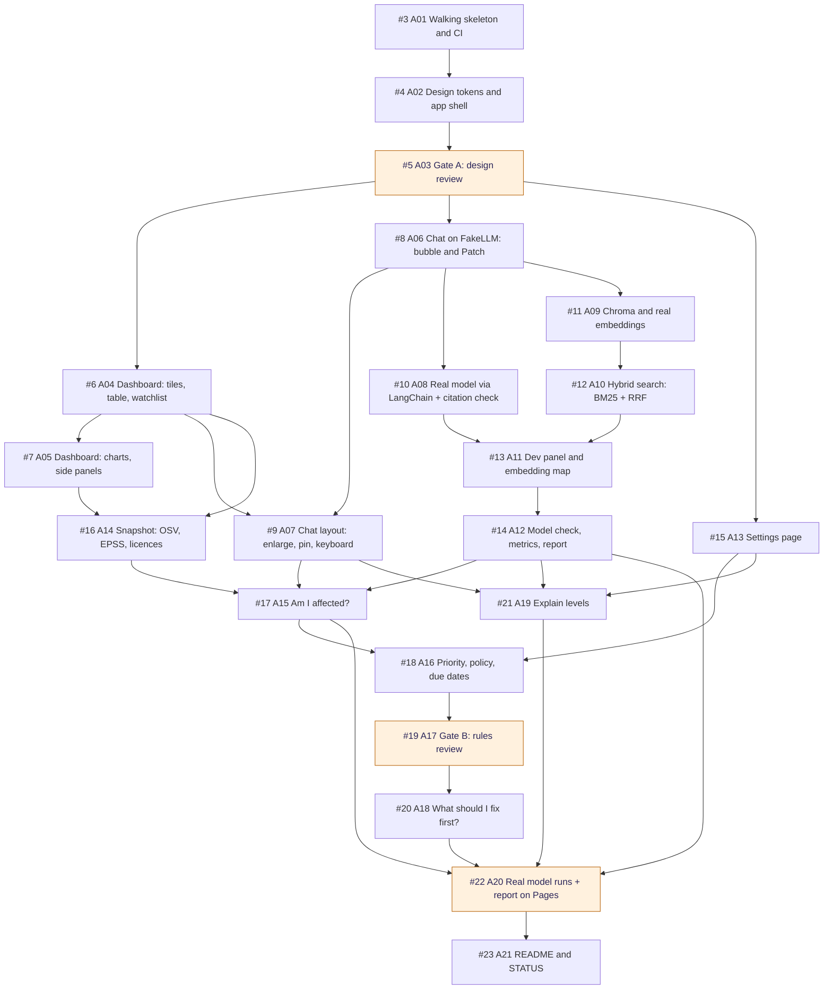

# How Patch was built

Specs split into tickets, built by coding agents in parallel worktrees, with people at the gates. The decisions behind each step: [DECISIONS.md](../DECISIONS.md).

## Spec A

The real build, [spec A (#2)](https://github.com/DerykHopley/tc-patch-security/issues/2), was split into 21 tickets, built by coding agents in parallel worktrees and merged into the `spec-a` branch. An arrow means "must finish before". Orange tickets needed a person: two review gates and the first real model run. Later additions (A04b, A06b, A15b, A16b, the guardrails and the six architecture deepenings) are in [STATUS.md](../STATUS.md).

## Spec B

[Spec B (#31)](https://github.com/DerykHopley/tc-patch-security/issues/31) was built the same way, on the `spec-b` branch: 25 planned tickets (B01 to B25; B17 is this documentation), then the owner's page review and the live app's findings as more tickets, up to B67. Coding agents built each in its own worktree; `scripts/ff-merge.sh` fast-forwarded each into `spec-b` after its checks (no lost commits, no conflict markers, no unpushed work). Human steps were tickets too: the real live run (B07), the deploy (B14), the real-model run (B16), the two MCP demos. What each ticket built: [STATUS.md](../STATUS.md#whats-built). The decisions on the way: [DECISIONS.md](../DECISIONS.md).

## The launch video

The 20-second "Patch in 20 seconds" video on the landing page and About (B47, [#99](https://github.com/DerykHopley/tc-patch-security/issues/99)), in a light and a dark version (`frontend/src/landing/video/`). The build files were throwaway and aren't in the repo; this is the record, written right after it was made.

- **Made with Claude Code** and its `/brag-slim` skill (brag plugin 0.4.0), no video editor. The owner picked one of two cuts ("one claim per scene, hard cuts, played straight" over a playful one) and checked the sound.
- **Real screenshots, not mock-ups.** A throwaway browser-check file ran through `frontend/e2e/run.sh` (its throwaway servers: FakeLLM, a temp state file, never the owner's app), with the example data of `scripts/landing-shots.sh`. Chromium at 1280 × 800, device scale 2, light and dark: the dashboard, the CVEs page, and CVE-2025-3248's page with the chat pinned, before and after "Am I affected by CVE-2025-3248?".
- **The app's own parts.** Each frame is a small React page built with the frontend's Vite. It imports the app's `tokens.css`, `robot.css`, `landing.css`, the `Robot` component (Patch's moods and animations) and the shield icon, so the colours, fonts and robot are the app's in both themes.
- **Every frame a function of time.** `window.__seek(t)` draws the frame at time t and pauses Patch's CSS animations there. Playwright's Chromium captured 1920 × 1080 PNGs at 30 fps: 608 frames per theme.
- **One claim per scene, on the beat:** six scenes of 3 s (the last 5.25 s); each cut falls on a bar of the 80 BPM music.
- **The sound is synthesised in Python** (numpy, scipy), not a stock track: a soft electric-piano chord per scene in A major, a low thump on each cut, plucks for the chips and words, a reverb made from decaying noise, a soft limiter; then normalised to −14 LUFS by ffmpeg.
- **Encoded with ffmpeg:** H.264 at CRF 24 (about 1.5 MB each, the small chat text stays sharp), AAC 128 kb/s, `faststart`. Frame 0 is the poster, so a thumbnail shows the robot; WebP posters at 1280 × 720.
- **Checked before rendering:** stills of every scene and of the cuts were looked at; a ring that clipped a letter and the robot's mood were fixed from them. Found along the way: [#98](https://github.com/DerykHopley/tc-patch-security/issues/98), the landing end card's Patch showing idle, not happy (fixed in B52).

## Stack

- **Backend:** Python, FastAPI, Pydantic, Chroma (in-process, no server), LangChain only at the model seam (`langchain-openai`'s `ChatOpenAI`, [ADR 0001](adr/0001-thin-langchain.md)), `packaging` and `semver` for version checks.
- **Frontend:** React, TypeScript, Vite, plain SVG charts. Playwright for the browser check.
- **RAG, our own code:** section-aware chunking, BM25, reciprocal rank fusion, filter checks, the agent loop and the citation check. Why not LangChain's retrievers: `SelfQueryRetriever` would pass the model's filters to the store unchecked, and keeping each step our own keeps it explainable and testable.
- **Models:** OpenRouter, or a local OpenAI-compatible server; FakeLLM for tests.
- **Spec B's services:** Clerk for sign-in; Tavily's hosted MCP server for web research (through `langchain-mcp-adapters`); the MCP Python SDK for Patch's own server; Google Cloud Run, Cloud Storage, Secret Manager and Cloud Scheduler for the live app; ntfy, Telegram and SMTP for alerts.
- Why each choice: [DECISIONS.md](../DECISIONS.md).
