# Design examples

The history: what was tried and why. The decided design, specified to build from, is in [../design/DESIGN.md](../design/DESIGN.md).

Screenshots of the UI options tried in the prototype (`proto/`), saved 2026-10-13 for the project review. All screenshots show the same app, data and chat; only the layout or the visual design changes. Answers come from the scripted FakeLLM.

Not everything shown here is still in the prototype: the options were narrowed down as we went (see "Where it ended up").

## 1. Where the chat lives (layout)

The question: is the chat its own page, or does it sit on top of the dashboard?

- **Tried first:** four layouts. Tabs (chat as its own page), drawer (slides over the page), bubble (floating button and window), split (page and chat side by side).
- **Removed tabs.** On its own page, the chat can't see the dashboard you were looking at. "Ask about this" on a CVE row should keep the row in view.
- **Merged drawer and split.** They were the same idea: a pin button already turned one into the other. Now it's one "side panel" that floats, or is pinned beside the page.
- **Kept the bubble** as the lighter option.
- **Later: the bubble won, with pinning.** The bubble became the default. The side panel's one unique strength, sitting beside the page, moved onto the bubble: enlarge it, and a Pin button docks it beside the page. So the side panel mode was removed.

| Side panel, floating | Side panel, pinned | Bubble |
|---|---|---|
| 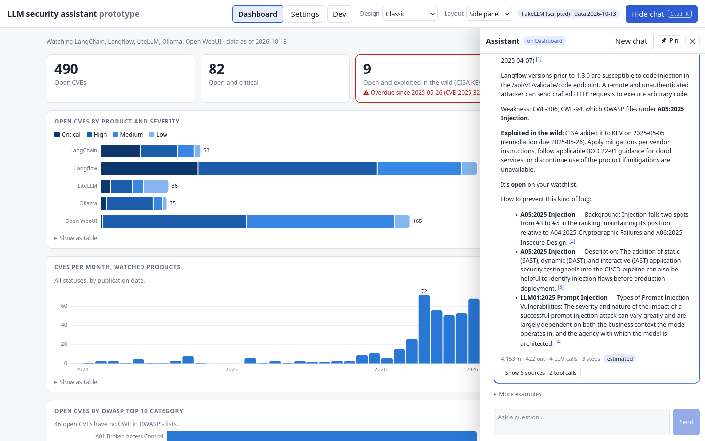 | 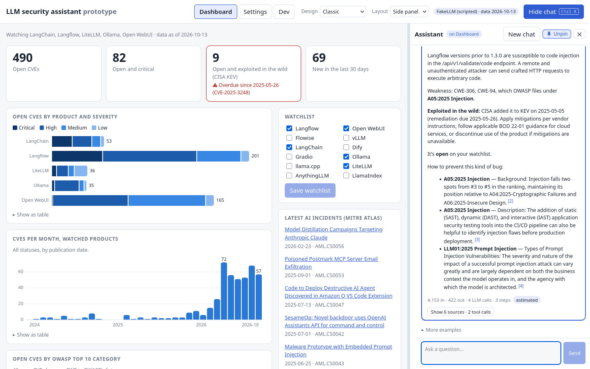 | 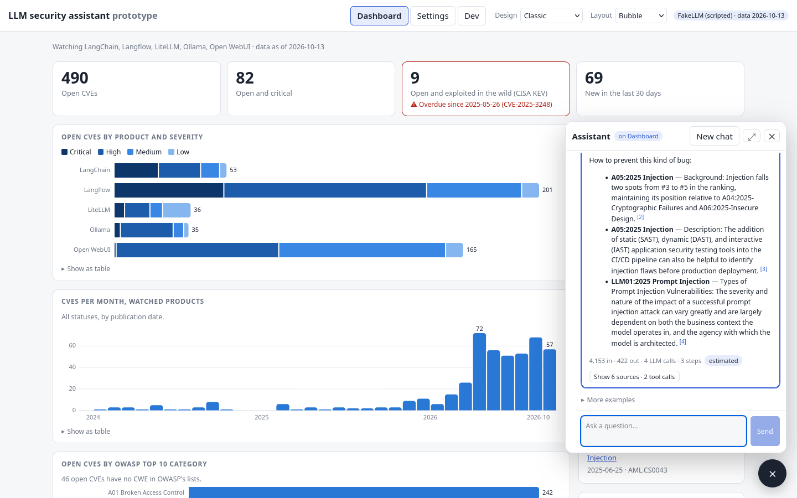 |

## 2. How it looks (design)

The question: what should a security tool feel like? Five designs on one set of tokens, so each one restyles every page, chart and the chat.

### Classic: the baseline

A top bar and plain panels. Easy to read, nothing to learn.

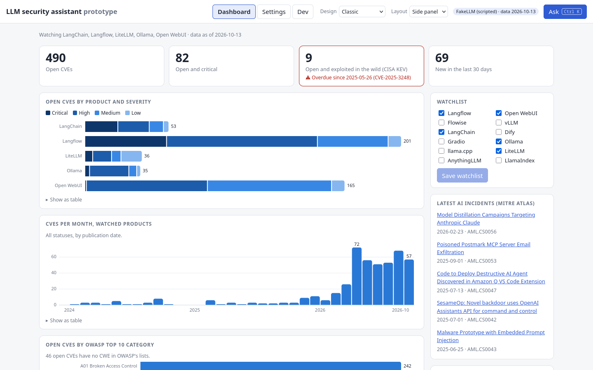

### Glass: polished and dark

After the Vision UI dashboard. Deep navy, glass cards, a left sidebar with icon chips, a breadcrumb top bar.

- Why: looks finished and "pro", and long answers stay readable.
- My pick for the demo.

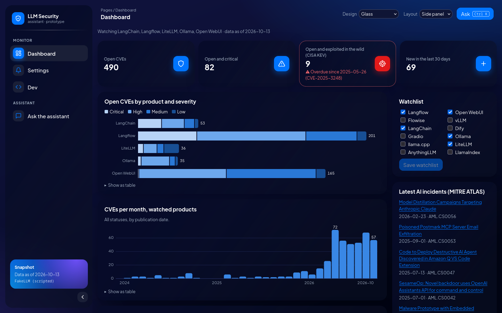
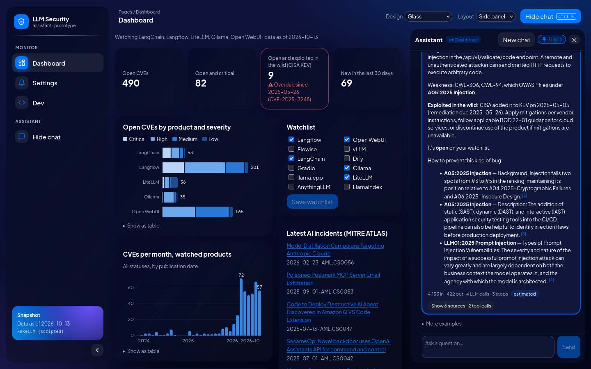

### Neon HUD: fun and animated

After a "futuristic animated dashboard" shot on Dribbble. A glowing icon rail, a drifting grid, panels that boot in, bars that grow, a pulsing KEV tile, a scanline.

- Why: shows how far motion can go. Fits the security theme.
- Trade-off: the monospace font and glow tire the eyes in long answers. Better as a demo mode than for daily use.

- **Later merged into Clean sidebar.** The bar animations and the blinking heading cursor were the parts worth keeping. Clean sidebar now has them, with its calm look. The rest (grid, glow, scanline) went.

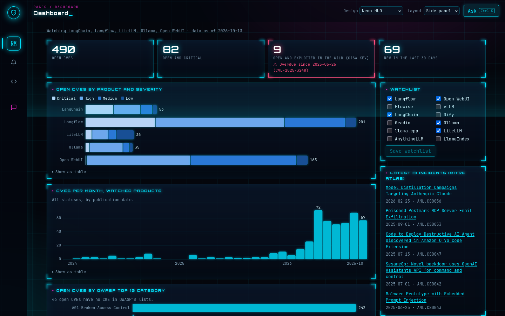
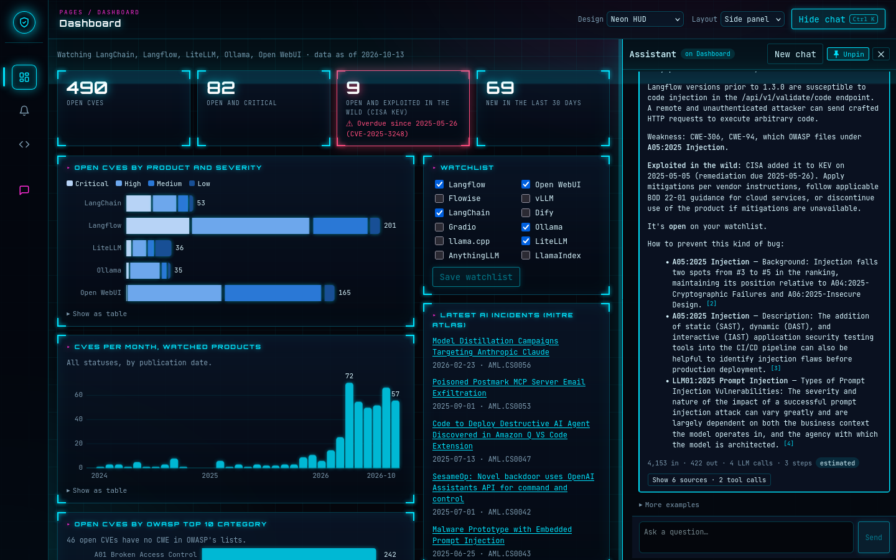

### Clean sidebar: calm and practical

A light or dark sidebar (follows the system) that collapses to an icon rail.

- Why: the safest choice for everyday use. The control to compare the bolder designs against.
- After the merge it has a little motion from Neon HUD: cards fade up, bars grow from the axis, and the page heading has a blinking cursor. A small fix along the way: in the stacked chart, the whole bar now grows from the axis, so its coloured segments no longer split apart mid-animation.

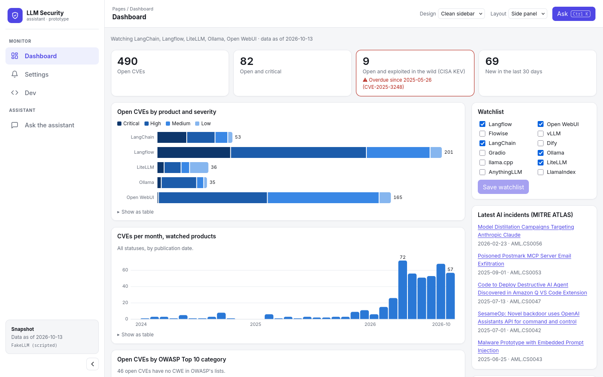

### Playful: light-hearted, with a mascot

After a Figma tennis dashboard: periwinkle background, round cards, candy-coloured tiles. With **Patch**, a robot assistant.

- Patch fronts the chat and reacts to it: bobs and blinks when idle, eyes scan while thinking, waves when an answer lands, shakes on an error.
- Why: a security tool doesn't have to feel scary. A friendly face makes "ask me anything" more inviting.
- Patch is an original SVG drawing. The robots that inspired him were watermarked stock images, so they weren't copied.

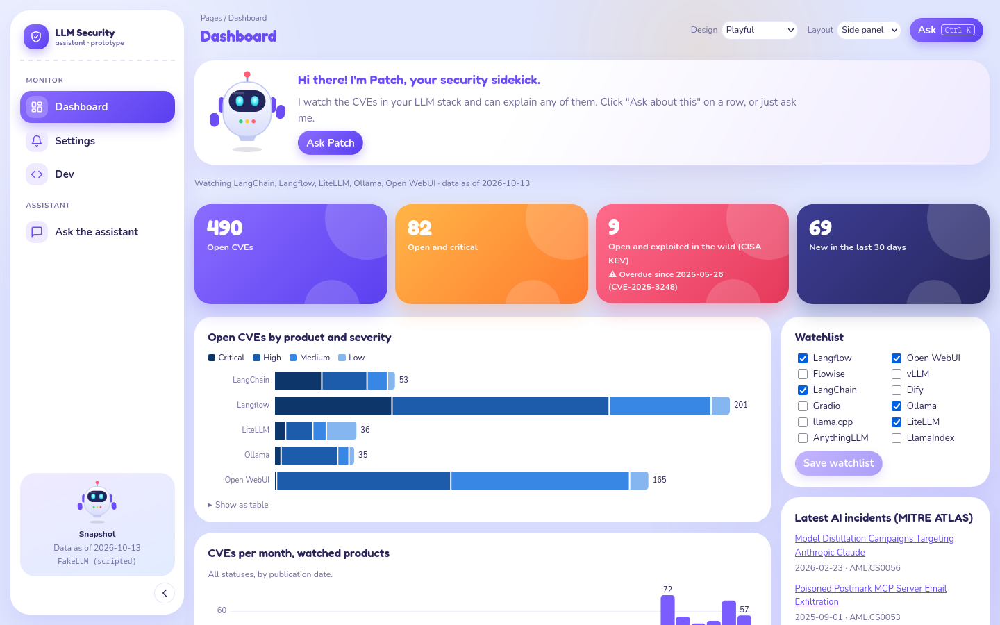
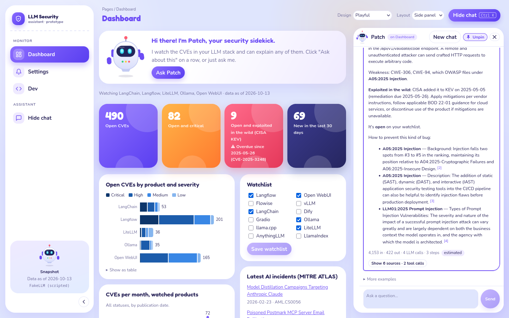

## Where it ended up

- **Layout:** the bubble only. Enlarged, it can be pinned beside the page.
- **Removed:** Classic and Glass. **Merged:** Neon HUD into Clean sidebar.
- **Playful won.** Clean sidebar was kept as an alternative for a while, then removed. What survived from the others:
  - from Neon HUD (via Clean): the growing bars and the blinking heading cursor;
  - from the Clean experiments: Patch as the chat button, and the lesson that tinted tiles looked pasted on in a calm design;
  - a light/dark toggle. Playful's first dark mode was a saturated purple that made text feel buzzy; it became near-black with a hint of indigo. Its candy tiles also got deeper starting colours, because white labels on the bright orange and coral failed contrast (1.8–2.7:1, now 4.9:1 or better).

| Clean (a step on the way), light | Clean (a step on the way), dark | Playful, dark, with the chat open |
|---|---|---|
| 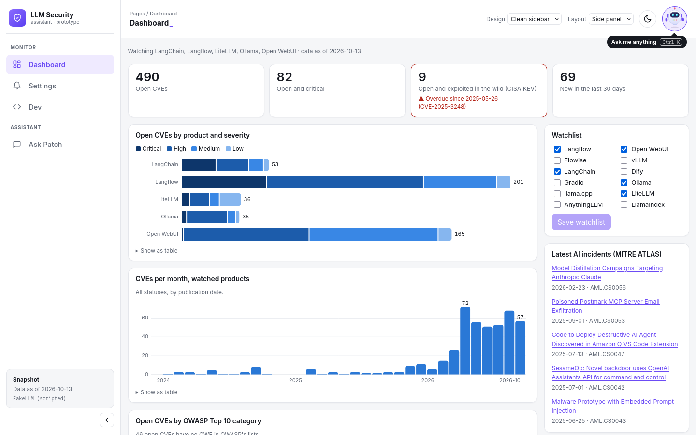 | 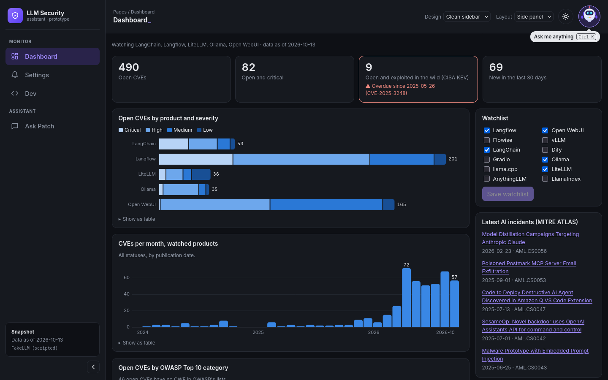 | 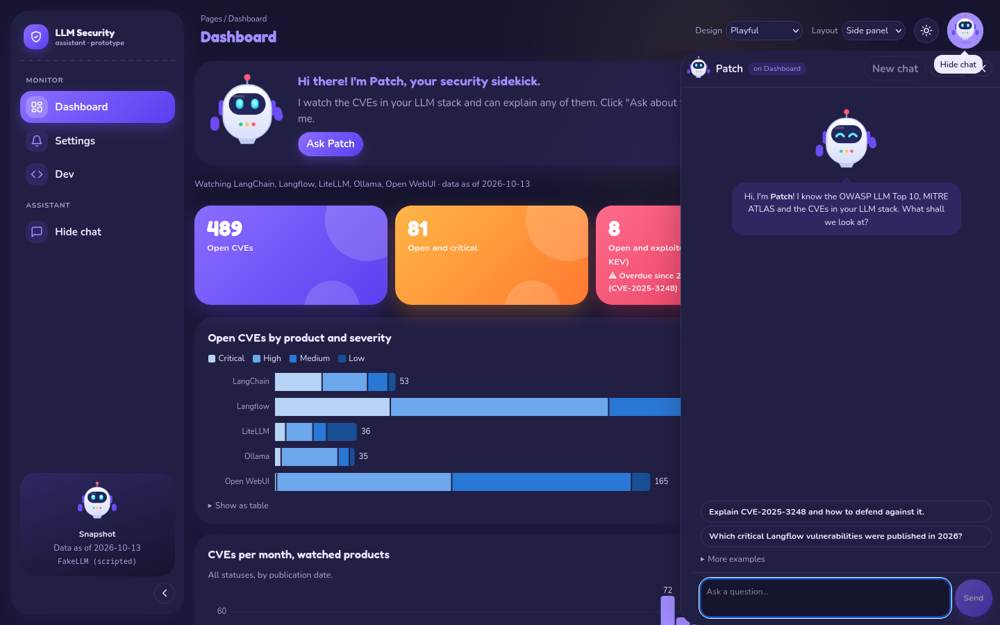 |

## 3. Phones

On phones the sidebar becomes a bottom tab bar, and the chat opens as a full-screen sheet. Shown: Glass, Neon HUD, Playful.

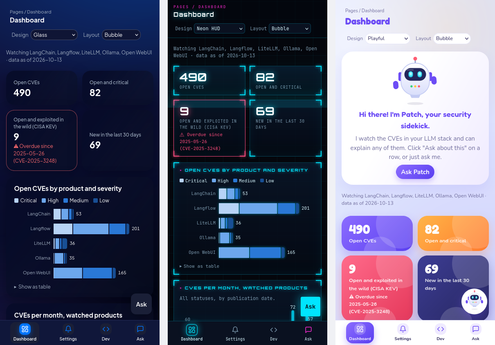

## Things worth mentioning

- **One set of tokens, many looks.** Colours, fonts and radii are CSS variables. A design overrides them, so adding a design didn't touch the dashboard or chat code.
- **Charts kept their colours in every design.** The severity colours were checked for contrast and order once. The designs change the frame around the charts, not the data colours.
- **Reduced motion is respected.** All the Neon and Patch animation turns off with the system setting.
- **Prototyping found a real bug.** The closed side panel sat just off-screen, and in the sidebar designs the page could slide sideways. It was there in Classic too, just never noticed.
- **Checked automatically.** A browser script (Playwright) opens every design at desktop and phone width, uses the pages and the chat, and checks nothing overflows.
