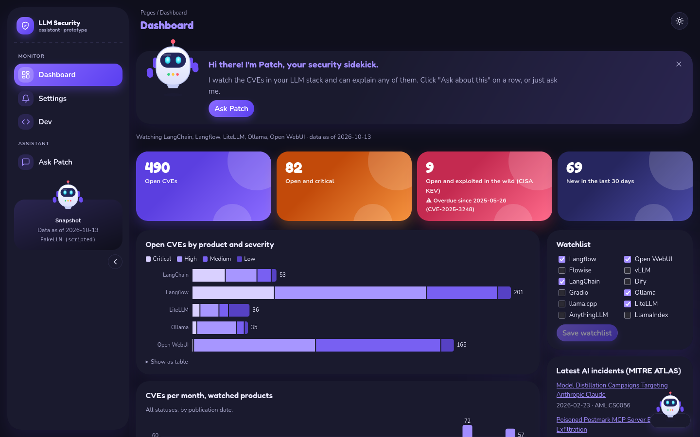
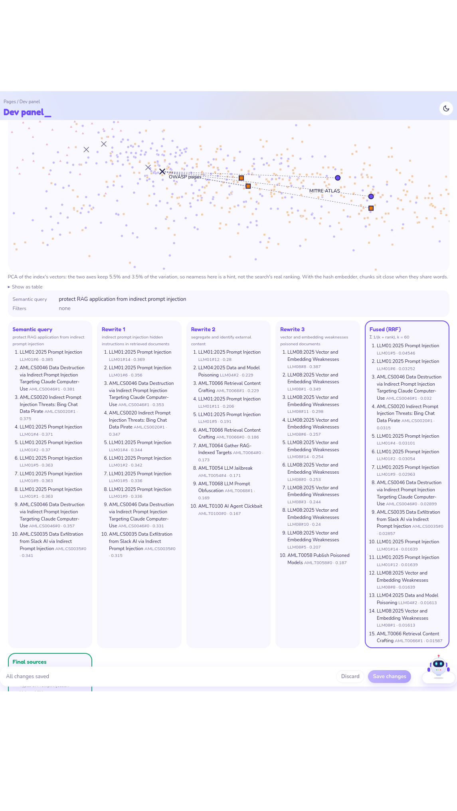
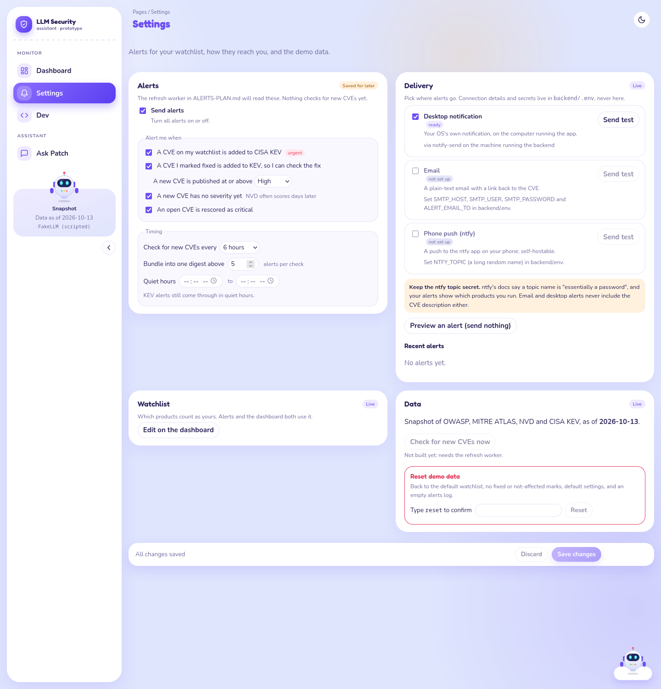
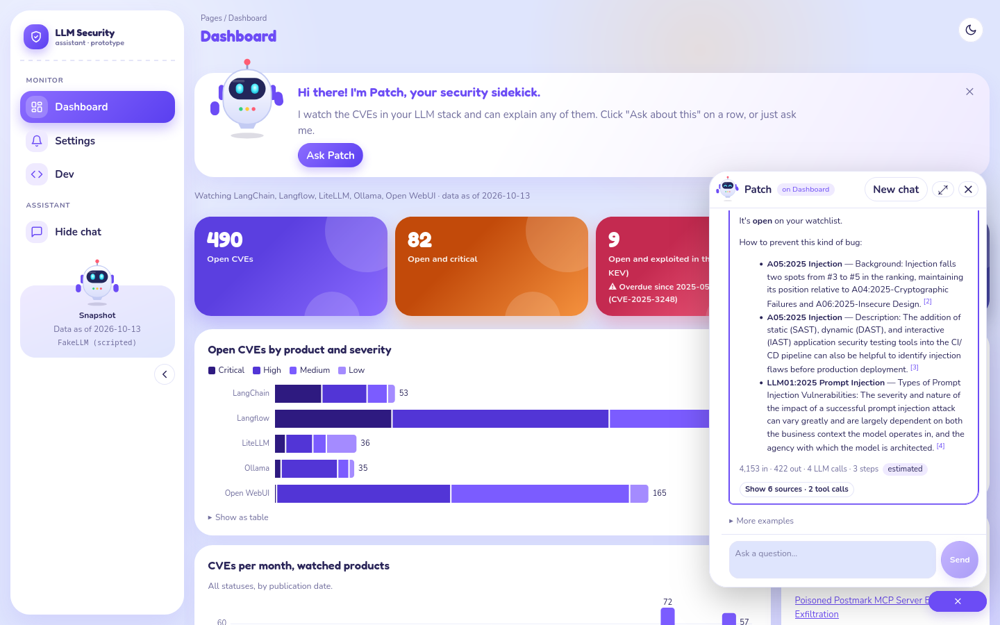
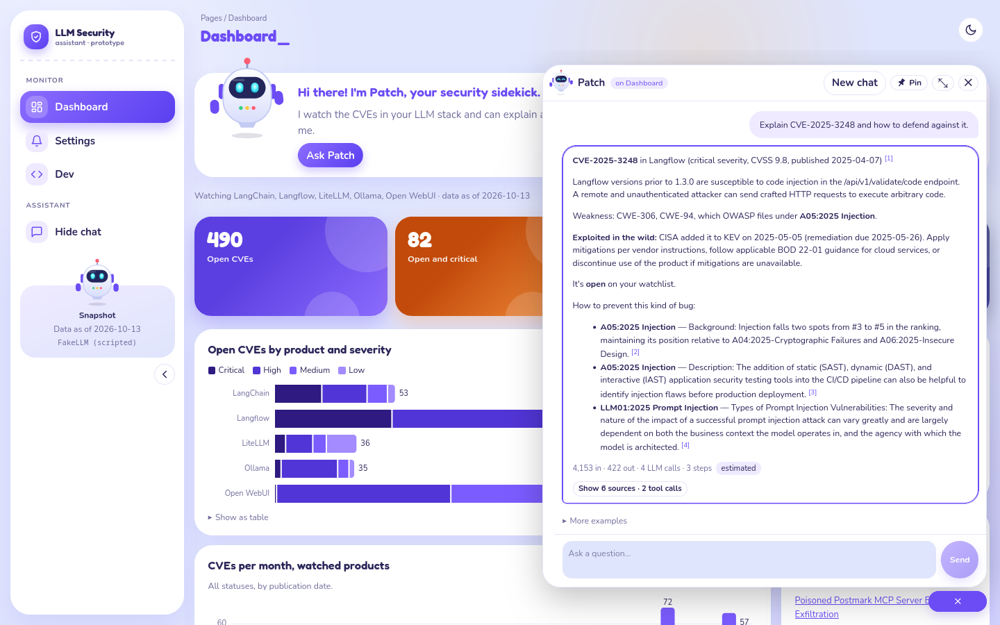
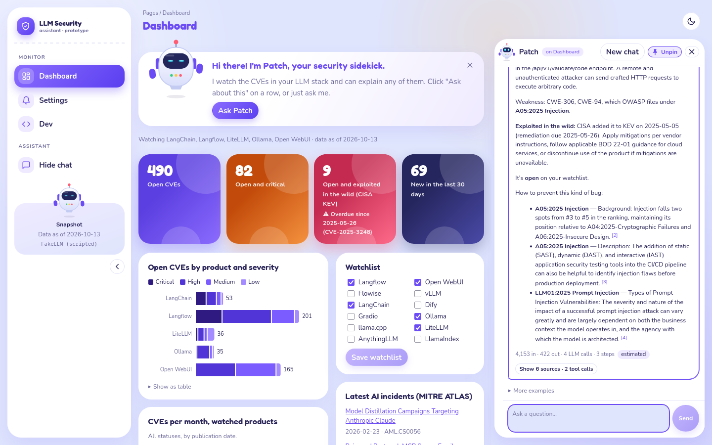
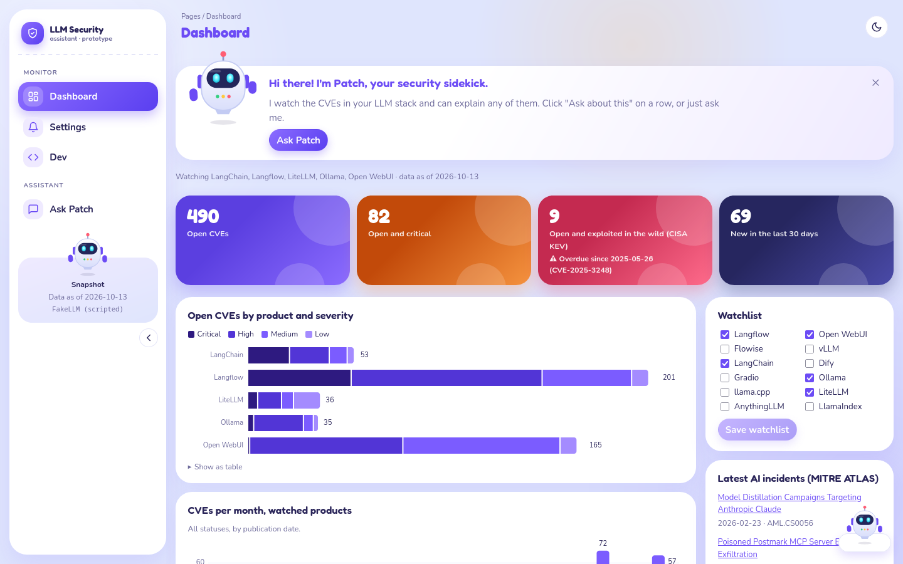
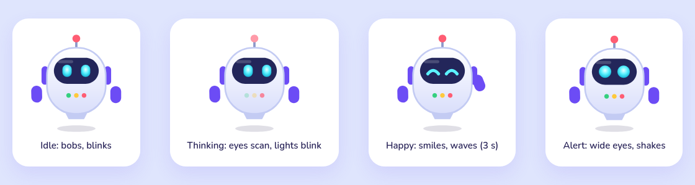
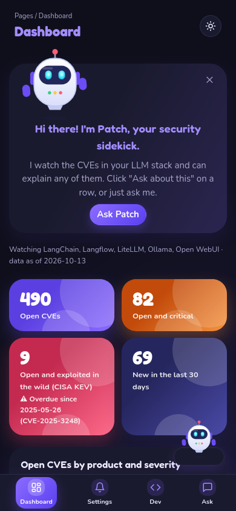

# Design: LLM security assistant ("Playful")

The design of the prototype in `proto/`, written down so it can be built again from tickets. Decided 2026-10-13, after trying six designs and four chat layouts (history: [../design-examples/README.md](../design-examples/README.md)).

- **Source of truth:** the running prototype. Every value here was read from the code on 2026-10-13: `proto/frontend/src/designs.css`, `index.css`, `App.tsx`, `components/Robot.tsx`, `hooks/useMood.ts`, `components/charts.tsx`, `index.html`.
- **Screenshots:** [img/](./img/), taken from the prototype on 2026-10-13.
- **Status marks:** *checked* = verified in this project (by the browser checks, the colour validator or a measurement). *Unverified* = not tested yet.

## 0. Read this first: design is part of every ticket

On another project, tickets were built without the design, and the animations never arrived. This document exists so that doesn't happen again.

- **Design is not a polish phase.** A ticket that adds or changes UI is not done until it matches this document: colours, shapes, motion, dark mode, phone layout, reduced motion.
- **Motion is a feature, not decoration.** The animations in section 7 are part of the spec. A ticket that draws a chart must include the bars growing in. A ticket that builds the chat must include Patch's moods.
- **Build the tokens first.** Section 3 (colours, fonts, radii, shadows) is the first ticket. Everything else uses those tokens, never hard-coded colours.
- **Each section ends with a checklist.** Copy the relevant checklist into the ticket as its acceptance criteria.


---

## 1. Decisions (what we chose, and why)

| Area | Decision | Why | Rejected |
|---|---|---|---|
| Overall look | **Playful**: periwinkle background, big round white cards, candy-coloured tiles, rounded fonts, a robot mascot | A security tool doesn't have to feel scary. Friendly makes "ask me anything" inviting. The user picked it over every alternative. | Classic (plain top bar), Glass (dark navy glass, after Vision UI), Neon HUD (glowing, futuristic), Clean sidebar (calm, minimal). See [design-examples](../design-examples/README.md). |
| Navigation | A **left sidebar** that collapses to an icon rail; a **bottom tab bar** on phones | Room for more pages; the rail gives space back to the page. | Top bar of buttons (Classic). |
| Assistant | **Patch**, an original SVG robot, is the chat button and the face of the chat | Gives the assistant a personality; his mood shows what the chat is doing. | Plain "Ask" button. The stock robots that inspired him were watermarked, so he was drawn from scratch. |
| Chat layout | A **bubble** in the bottom right. Enlarged, it can be **pinned** beside the page. | The chat stays on top of what you're looking at ("Ask about this" keeps the CVE in view). Pinning covers the "side by side" need. | Tabs (chat as its own page: loses the context), drawer and side panel (overlapped with pinning, merged then removed). |
| Motion | Cards fade up, bars grow in, a blinking cursor after the page title, Patch moves | The user liked these most from Neon HUD; they make the dashboard feel alive. | Neon's grid, glow and scanline (too much for long reading). |
| Light and dark | A **toggle** in the top bar; starts from the system setting | Both modes are first-class. | Following the system only (a button can't override that). |
| Dark palette | **Near-black with a hint of indigo**, not saturated purple | Text on saturated purple felt "buzzy" even at good contrast. | The first dark Playful (`#16152f` / `#221f44`). |
| Candy tiles | Gradients **start deep where the text is** and end bright | White labels on bright orange and coral failed contrast (1.8–2.7:1). Now 4.9:1 or better. *Checked.* | Bright-to-deep gradients. |
| Severity colours | **One purple, four depths** (Low light → Critical deep) | Severity is ordered: one hue shows the order. Four candy hues would read as four unrelated groups, and orange/coral would look like warnings. | Blue ramp (off-brand), four candy colours. |
| Tinted stat tiles in a calm design | Not used | Tried on Clean (gradient, then solid); looked pasted on. | — |

---

## 2. Principles

- **Friendly, never noisy.** Round shapes, soft shadows, candy colour on a few things that matter (the four tiles), calm white cards for everything else.
- **One accent: purple.** Links, focus, active states, the series colour of every single-series chart.
- **Colour is never the only cue.** Shapes on the map, a legend on every multi-series chart, a "Show as table" under every chart, icons and labels on alerts.
- **Everything works in light, dark, phone and with reduced motion.** Not as an afterthought: each checklist below includes them.

---

## 3. Tokens (build these first)

Tokens are CSS custom properties on `<html data-design="playful">`. Dark values apply when `<html data-theme="dark">`. Components only ever use tokens.

### 3.1 Colours

| Token | Light | Dark | Used for |
|---|---|---|---|
| `--bg` | `#dfe5fd` | `#0f0f1c` | page background (under the gradients, 3.3) |
| `--surface` | `#ffffff` | `#1a1a2e` | cards, sidebar, chat, inputs |
| `--text` | `#2a2559` | `#ecebff` | body text |
| `--muted` | `#6f6c9c` | `#a9a8cc` | secondary text, axis labels |
| `--border` | `#e4e5f8` | `#2c2b48` | hairlines |
| `--accent` | `#6c4cf5` | `#a28dff` | links, focus, active, page title |
| `--accent-soft` | `#efeaff` | `#2a2550` | soft fills: hover, chips, nested cards |
| `--user` | `#efeaff` | `#2a2550` | the user's chat messages |
| `--ok` | `#12a46b` | `#4fd39a` | success, "final sources" |
| `--error` | `#e5385a` | `#ff7a95` | errors, KEV |
| `--error-soft` | `#ffe8ed` | `#3a1c2a` | error backgrounds |
| `--warn` | `#b8640a` | `#ffb547` | warnings |
| `--warn-soft` | `#fff1de` | `#33281a` | warning backgrounds |
| `--series-1` | `#7b5cff` | `#a28dff` | single-series charts |
| `--grid` | `#eceefb` | `#25243d` | chart gridlines |

Fixed colours (same in both modes):

- **Primary gradient** (primary buttons, active sidebar item, brand mark): `linear-gradient(135deg, #8b6cff, #5a3ff0)`.
- **Purple shadow** used everywhere: `rgba(108, 76, 245, α)`, α between 0.09 and 0.4 (values per component below).

Contrast (*checked*, measured 2026-10-13):

| Pair | Light | Dark |
|---|---|---|
| text on surface | 13.9:1 | 14.5:1 |
| muted on surface | 4.9:1 | 7.4:1 |
| accent on surface | 5.3:1 | 6.3:1 |
| text on page background | 11.1:1 | — |
| **muted on page background** | **3.9:1 (below 4.5, open issue 12.1)** | — |

### 3.2 Chart colours (validated, *checked*)

All validated with the dataviz skill's `validate_palette.js`. Re-run it if any value changes.

**Severity**: an ordinal ramp, one hue. Light: dark = worse. Dark mode: light = worse (more contrast on the dark surface).

| Token | Light | Dark |
|---|---|---|
| `--sev-low` | `#a48bff` | `#5641c4` |
| `--sev-medium` | `#7b5cff` | `#7860f2` |
| `--sev-high` | `#5235d6` | `#a796ff` |
| `--sev-critical` | `#2e1a80` | `#d9d0ff` |

- Light: `--ordinal` on `#ffffff`: monotone, steps ≥ 0.06 apart, lightest step 2.72:1. Dark: on `#1a1a2e`, lightest step 2.40:1.
- Used by the "Open CVEs by product and severity" chart, its legend, and the severity swatches in the CVE table and the chat sources.

**Embedding-map groups**: categorical, candy colours. A scatter, so checked with `--pairs all`.

| Token | Group (shape) | Light | Dark |
|---|---|---|---|
| `--cat-1` | OWASP pages (circle) | `#6c4cf5` | `#8a70ff` |
| `--cat-2` | MITRE ATLAS (square) | `#e2780f` | `#d4761a` |
| `--cat-3` | CVEs (triangle) | `#e0306a` | `#e33e6e` |

- Light: colour-blind separation ΔE ≥ 12.4, normal vision ≥ 17.7. The orange is 2.8:1 on the map surface (just under 3:1): allowed because the shapes and the table view carry the same information.
- Dark: all checks pass, ΔE ≥ 9.5.

Validator commands (from the dataviz skill's folder):

```bash
node scripts/validate_palette.js "#a48bff,#7b5cff,#5235d6,#2e1a80" --mode light --surface "#ffffff" --ordinal
node scripts/validate_palette.js "#5641c4,#7860f2,#a796ff,#d9d0ff" --mode dark --surface "#1a1a2e" --ordinal
node scripts/validate_palette.js "#6c4cf5,#e2780f,#e0306a" --mode light --surface "#f7f5ff" --pairs all
node scripts/validate_palette.js "#8a70ff,#d4761a,#e33e6e" --mode dark --surface "#1e1d36" --pairs all
```

### 3.3 Page background

- Light: three soft glows over `#dfe5fd`, fixed (they don't scroll):
  `radial-gradient(520px 520px at 8% 12%, rgba(255,255,255,.55), transparent 70%)`, `radial-gradient(640px 640px at 96% 88%, rgba(123,92,255,.16), transparent 70%)`, `radial-gradient(360px 360px at 70% 8%, rgba(255,181,71,.16), transparent 70%)`.
- Dark: one faint purple glow over `#0f0f1c`: `radial-gradient(640px 640px at 96% 88%, rgba(123,92,255,.10), transparent 70%)`.

### 3.4 Type

- **Fredoka** (500, 600, 700) for headings, tile numbers, the brand name, the page title. **Nunito** (400, 600, 700, 800) for everything else. Base size 15px.
- Load both in `index.html` (with `preconnect`), not from JavaScript, so the first frame already has the right font.
- Sizes: page title 1.5rem Fredoka in `--accent`; card titles 1.1rem Fredoka 600; tile numbers 2.1rem Fredoka; nested titles (playground columns, "Recent alerts") 0.95rem Fredoka 600; body 15px; meta text 0.82rem `--muted`; code in the system monospace.
- Offline, the fonts fall back to the system sans-serif. *Unverified* how that looks.

### 3.5 Shape and elevation

| Element | Radius | Shadow |
|---|---|---|
| Sidebar (floating card) | 28px | `0 16px 40px rgba(108,76,245,.12)` |
| Cards (`.panel`) | 26px | `0 12px 30px rgba(108,76,245,.09)` |
| Chat bubble window, pinned chat | 26px | (bubble) `0 16px 48px rgba(0,0,0,.24)`; (pinned) `0 12px 30px rgba(108,76,245,.12)` |
| Stat tiles | 24px | `0 12px 26px <tile colour at .3>` |
| Welcome banner | 28px | `0 12px 30px rgba(108,76,245,.1)` |
| Save bar (floating) | 20px | `0 10px 28px rgba(108,76,245,.16)` |
| Chat messages | 20px, with the corner nearest the speaker at 6px | — |
| Nested cards: fieldsets, delivery channels, playground columns, map box, model-check numbers | 18–20px | none |
| Inputs, selects, textareas | 14px | — |
| Buttons | 999px (pill) | primary: `0 6px 14px rgba(108,76,245,.3)` |

- Nested cards have no border. Their fill is `color-mix(in srgb, var(--accent-soft) 35–45%, var(--surface))`.

### Checklist: tokens

- [ ] Every colour in sections 3.1 and 3.2 is a token with light and dark values.
- [ ] No component uses a hard-coded colour except the fixed ones listed (primary gradient, purple shadow, tile gradients, Patch's own colours).
- [ ] Fonts load from `index.html`; no flash of the wrong font on first load.
- [ ] Dark mode is driven by `data-theme` on `<html>`, not by `prefers-color-scheme`, so the toggle can override the system.

---

## 4. Layout and navigation



### 4.1 Shell

- **Sidebar** (left), then the **main column**: top bar, then the page.
- Sidebar, expanded: 250px wide, floating card with 1rem margin. Contents, top to bottom:
  1. Brand: 36px purple-gradient rounded square with a shield icon, "LLM Security", "assistant · prototype". Dashed line under it.
  2. Section label "MONITOR": Dashboard, Settings, Dev (Dev only when the backend allows the dev panel).
  3. Section label "ASSISTANT": "Ask Patch" (opens and hides the chat; shows the unread dot).
  4. At the bottom, the **snapshot card**: Patch (64px) with his head over the card's top edge, "Snapshot", data date, model name.
  5. Collapse button (chevron).
- Sidebar items: pill rows (radius 16px). Icon in a 32px soft-purple rounded square. **Active item**: primary gradient fill, white text, icon square at 22% white, purple shadow.
- **Collapsed rail**: 78px wide, icons only, centred. Section labels become thin lines. Brand name and snapshot card hide. Labels stay in the accessibility tree (visually hidden), so the buttons keep their names. The chevron rotates 180°. Width animates over 0.2s. Remembered per browser.
- **Top bar**: breadcrumb "Pages / Dashboard" (0.75rem muted) above the page title (1.5rem Fredoka, purple, with the blinking cursor, section 7). Right side: the light/dark toggle (36px round, sun in dark mode, moon in light).
- **Content**: max 1280px wide, centred, 1rem padding, 1.2rem gap between cards. Settings and Dev use the same width and gap as the dashboard.

### 4.2 Breakpoints

| Width | Change |
|---|---|
| ≤ 1000px | Dashboard side column drops under the main column |
| ≤ 900px | Settings and Dev: one column of cards |
| ≤ 800px | Sidebar becomes a **bottom tab bar** (fixed, full width, icon over label, "Ask" short label). Page gets 4.4rem bottom padding. Patch's button moves up to 5rem from the bottom. |
| ≤ 700px | Chat (bubble or pinned) becomes a **full-screen sheet**. The pin button hides. |
| ≤ 640px | Stat tiles: 2 columns. Welcome banner stacks (robot over text, centred). |
| ≤ 520px | Slider rows stack (label above the slider). |

- At every width there is **no sideways scrolling** (*checked* at 1400px and 400px for every page, light and dark).

### Checklist: layout

- [ ] Sidebar expands and collapses, remembered after reload; keyboard and screen reader still reach every item when collapsed.
- [ ] Active page is shown in the sidebar and the breadcrumb and title.
- [ ] Bottom tab bar on phones; nothing hidden behind it.
- [ ] No horizontal scroll at 400px or 1400px.

---

## 5. Components

### 5.1 Stat tiles (the four "candy" tiles)

- Grid of 4 (2 on phones), gap 0.75rem. Radius 24px, padding 1rem 1.2rem, white text.
- Two soft white circles (16% white) as decoration: 120px at the top right (−30px, −40px), 80px at the bottom (right 40px, −45px).
- Number 2.1rem Fredoka; label and note 700 weight at 92% white.
- Gradients (135°, deep colour until 35%, then to the bright colour) and label contrast (*checked*):

| Tile | Gradient | Shadow | White text |
|---|---|---|---|
| Open CVEs | `#5b3fe0 35%` → `#8b6cff` | `rgba(108,76,245,.3)` | 6.5:1 |
| Open and critical | `#c24a0a 35%` → `#f5933f` | `rgba(255,138,60,.3)` | 4.9:1 |
| Open and exploited (CISA KEV) | `#c42a50 35%` → `#ff6b8b` | `rgba(229,56,90,.3)` | 5.5:1 |
| New in the last 30 days | `#26265f 35%` → `#4a4aa8` | `rgba(38,38,95,.3)` | 13.8:1 |

- The KEV tile, when there are open KEV CVEs, **wiggles** every 4 seconds (section 7) and shows "Overdue since …" with a warning icon.

### 5.2 Cards (`.panel`)

- White surface, no border, radius 26px, padding 1.1rem 1.3rem, purple shadow.
- Title: 1.1rem Fredoka 600, normal case. Optional status chip on the right ("Live", "Saved for later", "Mock").

### 5.3 Buttons and form controls

- All buttons are pills (999px), weight 700. **Primary** (`type="submit"`): primary gradient, white text, purple shadow. Others: surface fill, 1px border, border turns purple on hover.
- Inputs, selects, textareas: radius 14px. The playground search box is a full pill.
- Checkboxes and radios: purple (`accent-color: var(--accent)`).
- **Sliders**: 6px track in `--accent-soft`, filled part in `--accent`, 16px purple handle with a 3px surface ring and a purple shadow. A purple focus ring (2px, 4px offset) for keyboards. Styled for both Firefox (`::-moz-range-*`) and Chrome/Safari (`::-webkit-slider-*`). Chrome/Safari has no "filled part" (*unverified* how it looks there).

### 5.4 Charts

- Plain SVG drawn at the container's width. Every chart: a title, a legend when it has 2+ series, a hover tooltip on every bar, and "Show as table" under it.
- **Open CVEs by product and severity**: horizontal stacked bars, severity ramp (3.2), 2px gaps between segments, the total at the end of each bar.
- **CVEs per month**: columns in `--series-1`, value labels on the peaks.
- **Open CVEs by OWASP category**: horizontal bars in `--series-1`.
- Gridlines `--grid`, axis labels 11px `--muted`, value labels 11px `--text`.
- Tooltip: `--text` background, `--surface` text, 4px radius, above the pointer.
- Bars **grow in** on load (section 7). Horizontal bars grow from the chart's axis: the chart sets `--x0` (its label width) on the `<svg>`, so a stacked bar grows as one piece.

### 5.5 Embedding map (Dev panel)



- In a soft round box (radius 20px, no border, nested-card fill). Legend chips are pills with counts.
- Points: circle (OWASP), square (ATLAS), triangle (CVE), in `--cat-1/2/3`, drawn at 90% opacity with a ring in the box colour.
- When a search is shown, all non-result points dim to **40%** (light) or **60%** (dark: faded colour on dark goes muddy). The query is an ✕, rewrites are smaller ✕s, results are full-colour with a dark ring, joined to the query by dashed lines.

### 5.6 Search playground (Dev panel)

- The query plan (semantic query, filters) in a soft nested card.
- One column per search step (semantic query, each rewrite, fused, final): soft nested cards, radius 18px, column title in purple Fredoka. **Fused** has a 2px purple inner edge; **Final sources** a 2px green (`--ok`) edge with a green title.

### 5.7 Settings parts



- Fieldsets ("Alert me when", "Timing"): radius 18px, nested-card fill.
- Delivery channels: one soft card each (radius 18px). The "ready" / "not set up" pill hugs its text (it must not stretch).
- Callouts (warning boxes): radius 14px. The reset box: radius 18px, red outline.
- **Save bar**: sticky at the bottom of Settings and Dev, floating as a rounded card 0.8rem above the bottom, with "All changes saved" / "Unsaved changes" on the left and Discard / Save changes on the right. It keeps 96px clear on the right for Patch's button.
- The page heading inside Settings and Dev is hidden: the top bar already names the page.

### 5.8 Welcome banner (dashboard)

- Above the dashboard: white-to-soft-purple card (radius 28px). Patch (110px, waving) on the left, his head rising over the top edge. Title "Hi there! I'm Patch, your security sidekick." (1.25rem Fredoka, purple), one line of help, an "Ask Patch" button.
- A quiet ✕ in the top right (32px round, muted, soft purple on hover). Once closed, it stays closed in that browser.

### Checklist: components

- [ ] Tiles: gradients, circles, contrast as in the table; KEV tile wiggles only when KEV > 0.
- [ ] Every chart has a legend (2+ series), hover tooltips, "Show as table", and the grow-in animation; stacked bars grow as one piece.
- [ ] Map colours and dimming as specified, in both modes.
- [ ] Buttons, inputs, checkboxes, radios and sliders are on-brand in both modes and in Firefox and Chrome.
- [ ] Save bar never hidden behind Patch.
- [ ] Welcome banner closes and stays closed.

---

## 6. The chat



### 6.1 Patch's button (closed chat)

- Bottom right of the page area, 1.25rem from the right and bottom. 84 × 66px.
- A **pill** (30px tall, full width, surface fill, 1px border, purple shadow) with **Patch (58px) standing in front of it**, overlapping its top edge, his shadow on the pill. Patch is in front (z 3), the pill behind (z 2), the unread dot on top (z 4).
- Hover or keyboard focus: the pill's border turns purple.
- Accessible name "Ask Patch". Shows Patch's current mood; **happy when an answer is unread**, with a red unread dot.

### 6.2 Bubble window (open chat)

- Opens above the button: 1.25rem from the right, 3.6rem from the bottom (just above the pill). 400 × 600px max (shrinks to the space). Radius 26px.
- Opens with a **pop** (section 7).
- While it's open, **Patch steps off the button**: the button is just the pill, purple, with a white ✕ ("Close the chat").
- **Header**: Patch (34px, showing the mood), "Patch", a chip "on Dashboard" (the page underneath), New chat, **Make larger**, ✕.
- **Empty chat**: Patch (92px, waving) tucked behind a soft purple speech bubble: "Hi, I'm Patch! I know the OWASP LLM Top 10, MITRE ATLAS and the CVEs in your LLM stack. What shall we look at?" Below: 1–2 suggested questions for the current page, and "More examples" (folded).
- **Messages**: user on the right in `--user`, assistant on the left on the surface. Each answer can open "Show N sources · N tool calls": tabs (Sources, Tool calls, Query plan) inline under the answer. Citations `[1]` open those details and scroll to the source.



### 6.3 Enlarge and pin

- **Make larger**: 640px wide, full height minus 5rem. Only now does **Pin** appear in the header.
- **Pin**: docks the chat beside the page. Page | 6px divider | chat. Default chat width 440px, min 320px, max 60% of the window. Drag the divider, or focus it and use ← / → (24px steps). The divider turns purple on hover and focus.
- Pinned chat: radius 26px card with a margin; Patch's button hides. Esc does not close it. The header shows **Unpin** (pressed state, purple).
- **Unpin**: floats it back as the enlarged bubble.
- Pinned is remembered; a pinned chat opens pinned after reload. The page underneath is not rebuilt when pinning or unpinning (it keeps its scroll and filters).



### 6.4 Keyboard and other entry points

- **Ctrl/Cmd+K** opens the chat on any page. **Esc** closes the bubble (not a pinned chat).
- "Ask Patch" in the sidebar and the welcome banner's button open it too.
- "Ask about this" on a CVE row opens the chat over the dashboard and sends "Explain CVE-… and how to defend against it."

### 6.5 Phones

- The chat is a full-screen sheet (bubble or pinned). No pin button. Patch's button sits above the bottom tab bar.

### Checklist: chat

- [ ] Patch on the pill, in front, with shadow; mood and unread dot as specified.
- [ ] Open: pop animation, Patch steps off, pill turns purple with ✕, window sits just above the pill.
- [ ] Header, greeting, suggestions, inline details as specified.
- [ ] Pin only on the enlarged bubble; divider by mouse and keyboard; Esc rules; remembered; page not rebuilt.
- [ ] Ctrl/Cmd+K, Esc, "Ask about this".
- [ ] Phone: full-screen sheet, no pin.

---

## 7. Motion

All motion is part of the spec. **It stops with `prefers-reduced-motion: reduce`** (*checked* in CSS; *unverified* by a browser test), except two small transitions listed in 12.1.

### 7.1 Page motion

| What | Animation | Duration, easing | Delay | Repeats |
|---|---|---|---|---|
| Stat tiles, dashboard cards | fade up: from `opacity 0`, `translateY(6px)` | 0.45s, `cubic-bezier(0.2, 0.8, 0.2, 1)` | tiles 0 / 0.05 / 0.1 / 0.15s; main column 2nd card 0.12s, 3rd 0.24s; side column 0.12s | once, on load |
| Horizontal bars | grow from `scaleX(0)`, origin = the chart's axis (`--x0`) | 0.9s, same curve | 0.2s | once |
| Columns | grow from `scaleY(0)`, origin = bottom of each bar | 0.9s, same curve | 0.2s | once |
| Page title cursor | an "_" after the title, blinks | 1.1s, `steps(1)` | — | forever |
| KEV tile | wiggle: rotate −1.2° (91%), +1.2° (94%), −0.6° (97%), still otherwise | 4s, ease-in-out | — | forever |
| Bubble window | pop: from `opacity 0`, `translateY(8px) scale(0.98)` | 0.16s, ease | — | on open |
| Sidebar collapse | width 250 ↔ 78px; chevron rotates 180° | 0.2s, ease | — | on toggle |
| Pin icon | rotates from 35° to 0° when pinned | 0.15s, ease | — | on toggle |
| Patch's pill | background and border colour | 0.15s | — | on hover / open |



### 7.2 Patch's motion

See section 8.3.

### Checklist: motion

- [ ] Every row of 7.1 and 8.3 is implemented with these timings.
- [ ] Charts animate on first load of the page, not on hover or resize.
- [ ] Stacked bars grow as one piece (no gaps opening between segments).
- [ ] With reduced motion: nothing moves (tiles, cards, bars, cursor, KEV wiggle, bubble pop, Patch, sidebar width, pin icon). *Open issue in the prototype:* the last two still run (12.1).

---

## 8. Patch



### 8.1 Drawing

An original SVG (`viewBox="0 0 120 130"`, height = width × 1.08). Parts, back to front:

| Part | Shape | Colour |
|---|---|---|
| Shadow | ellipse at (60, 124), 26 × 4.5 | `rgba(42,37,89,.16)` |
| Antenna | line (60,22)→(60,11), 3px, round cap; light: circle r 5 at (60, 8) | stem `#8d97c9`; light `#ff5d73` |
| Hands | two 14 × 22 rounded rects (r 7) at x 2 and 104, y 70 | `#6c4cf5` |
| Ears | two 9 × 24 rounded rects at x 15 and 96, y 44 | `#6c4cf5` |
| Body | 76 × 86 rounded rect (r 36) at (22, 20), 2px stroke | gradient `#ffffff` → `#d9defb` (top to bottom), stroke `#c3cbf3` |
| Visor | 58 × 34 rounded rect (r 17) at (31, 33); a 20 × 4 highlight at (36, 36), 18% white | `#23265a` |
| Eyes | idle/thinking: two 12 × 16 rounded rects (r 6) at x 42, 66, y 42. Happy: two arcs (`M41 54 q7 -9 14 0`, `M65 54 q7 -9 14 0`), 4px stroke. Alert: two circles r 8 at (48, 50), (72, 50). | radial gradient `#e6fdff` → `#5cf2ff` → `#13b6d6`; happy arcs `#5cf2ff` |
| Chest lights | three circles r 3 at (50/60/70, 82) | `#35d07f`, `#ffc93c`, `#ff5d73` |
| Thruster | `M46 105 h28 l-4 8 h-20 z` | `#c3cbf3` |

- Patch is decorative (`aria-hidden`); the button or text next to him carries the meaning.
- Gradient ids must be unique per instance (several Patches can be on one page).
- The same drawing in light and dark mode (*checked*, img/patch-moods-dark.png).

### 8.2 Where he appears, and how he overlaps

He always **overlaps what he sits on**, so he looks like he's in the scene, not pasted on.

| Place | Size | Overlap |
|---|---|---|
| Chat button | 58px | stands **in front** of the pill, overlapping its top edge, shadow on the pill |
| Chat header | 34px | sits in the title row |
| Empty-chat greeting | 92px | sits **behind** the speech bubble (bubble in front, 2.1rem overlap); always waving |
| Welcome banner | 110px | head rises **over the banner's top edge** (−2.4rem); always waving |
| Sidebar snapshot card | 64px | head pokes **over the card's top edge** (−2.6rem) |

### 8.3 Moods

| Mood | When | Looks | Motion |
|---|---|---|---|
| **Idle** | otherwise | round eyes | body bobs up 5px (3s, ease-in-out, forever); shadow shrinks to 80% / 60% opacity in time with the bob; hands drift up 3px and tilt −6° (3s; right hand 0.4s later); eyes blink (squash to 10% at 96% of a 4.5s cycle) |
| **Thinking** | an answer is on its way | round eyes | eyes **scan** ±4px (1.1s, forever); antenna light **blinks** to `#ffd6dc` (0.5s, `steps(2)`); chest lights pulse to 25% opacity one after another (0.9s, delays 0 / 0.15 / 0.3s) |
| **Happy** | for **3 seconds** after an answer arrives; on the chat button while an answer is unread | smiling arc eyes | right hand **waves**: up 14–16px, rotating +10° ↔ −22° (1.1s, forever) |
| **Alert** | the last message is an error | wide round eyes | body **shakes** ±3px (0.5s, twice) |

- Mood logic lives in one hook (`useMood`) used by the chat header and the chat button, so they always agree.
- "Waving" is also a fixed style for the greeting and the banner, whatever the mood.

### Checklist: Patch

- [ ] Drawing matches 8.1; unique gradient ids.
- [ ] Every placement in 8.2 with its size and overlap.
- [ ] All four moods with their triggers and motion; header and button always agree.
- [ ] Reduced motion stops all of Patch's movement.

---

## 9. Light and dark

- A sun/moon button in the top bar switches between them.
- Start: `?theme=light|dark` in the URL wins, then the saved choice, then the system setting.
- The choice sets `data-theme` on `<html>`; dark tokens hang off that.
- Everything has a dark value: tokens, chart colours, map dimming, the page glow. The candy tiles and Patch stay the same in both.



### Checklist: theme

- [ ] Toggle switches instantly, is remembered, and overrides the system.
- [ ] Every page checked in both modes (dashboard, settings, dev, chat open, chat pinned).

---

## 10. Accessibility

- **Contrast**: section 3.1 and 5.1 values (*checked*). Open issues in 12.1.
- **Colour is never alone**: map shapes, chart legends, "Show as table" under every chart and the map, KEV has a label and an icon, the unread dot sits on a named button.
- **Keyboard**: everything reachable; visible focus (purple ring on sliders and the divider, purple border on Patch's pill); Ctrl/Cmd+K and Esc; divider moves with arrow keys.
- **Screen readers**: collapsed sidebar keeps its labels (visually hidden); Patch is `aria-hidden`; buttons have names ("Ask Patch", "Close the chat", "Make larger", "Pin: dock the chat beside the page", "Unpin: float the chat over the page", "Switch to dark mode", "Close Patch's welcome", "Collapse the sidebar").
- **Reduced motion**: section 7.

---

## 11. Remembered state and URL parameters

| Key (localStorage) | Meaning |
|---|---|
| `theme` | `light` or `dark` |
| `pinned` | `1` when the chat is pinned |
| `splitWidth` | pinned chat width in px |
| `sidenavCollapsed` | `1` when the sidebar is a rail |
| `helloHidden` | `1` when the welcome banner was closed |

- All reads and writes are wrapped so a blocked storage (private windows) never breaks the app.
- URL: `?theme=light|dark`. Old links: `?layout=split` pins the chat; other `?layout=` and all `?design=` values are ignored.

---

## 12. Known gaps

### 12.1 Open issues (found 2026-10-13, not fixed yet)

- **Muted text on the page background is 3.9:1** (light mode), under 4.5:1. Affects the "Watching … · data as of …" line and the breadcrumb. Fix: darken `--muted` slightly, or put those lines on the surface.
- **Primary button text** is 3.7:1 against the light end of the gradient (`#8b6cff`), 6.2:1 at the dark end. Fix: start the gradient deeper, like the tiles.
- **Two transitions ignore reduced motion**: the sidebar width (0.2s) and the pin icon rotation (0.15s).

### 12.2 Unverified

- Browser checks run in **Firefox only**. Chrome and Safari not checked (slider styling differs there).
- Offline font fallback not looked at.
- Uses modern CSS (`:has()`, `color-mix()`): fine in current browsers, not in old ones.

---

## 13. How this was checked

- `proto/frontend/e2e/check_ui.py` (Playwright, Firefox): 35 checks, all passing on 2026-10-13. Covers the dashboard, settings, dev panel, chat (bubble, enlarge, pin, unpin, keyboard), light and dark, phone width, sidebar collapse, the welcome banner, Patch as the button.
- Chart colours: the dataviz skill's validator (commands in 3.2).
- Contrast: measured with the WCAG formula (values in 3.1 and 5.1).
- It does **not** yet check animations or reduced motion. Worth adding in the real build: one test that the bars and Patch animate, one that nothing animates with reduced motion.
