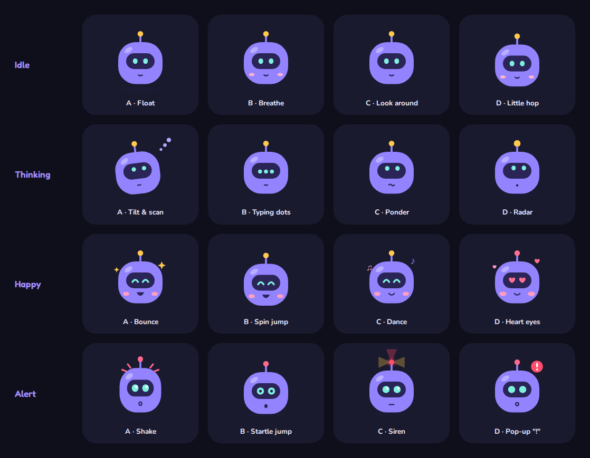

# Design: Patch, the LLM-security assistant ("Playful")

The design of the prototype in `proto/`, written down so it can be built again from tickets. Decided 2026-10-13, after trying six designs and four chat layouts (history: [../design-examples/README.md](../design-examples/README.md)).

- **Source of truth:** the running prototype. Every value here was read from the code on 2026-10-13: `proto/frontend/src/designs.css`, `index.css`, `App.tsx`, `components/Robot.tsx`, `hooks/useMood.ts`, `components/charts.tsx`, `index.html`.
- **Screenshots:** [img/](./img/), taken from the prototype on 2026-10-13.
- **Status marks:** *checked* = verified in this project (by the browser checks, the colour validator or a measurement). *Unverified* = not tested yet.

## 0. Read this first: design is part of every ticket

On another project, tickets were built without the design, and the animations never arrived. This document exists so that doesn't happen again.

- **Design is not a polish phase.** A ticket that adds or changes UI is not done until it matches this document: colours, shapes, motion, dark mode, phone layout, reduced motion.
- **Motion is a feature, not decoration.** The animations in section 7 are part of the spec. A ticket that draws a chart must include the bars growing in. A ticket that builds the chat must include Patch's moods.
- **Build the tokens first.** Section 3 (colours, fonts, radii, shadows) is the first ticket. Everything else uses those tokens, never hard-coded colours.
- **Each section ends with a checklist.** Copy the relevant checklist into the ticket as its acceptance criteria.


---

## 1. Decisions (what we chose, and why)

| Area | Decision | Why | Rejected |
|---|---|---|---|
| Overall look | **Playful**: periwinkle background, big round white cards, candy-coloured tiles, rounded fonts, a robot mascot | A security tool doesn't have to feel scary. Friendly makes "ask me anything" inviting. The user picked it over every alternative. | Classic (plain top bar), Glass (dark navy glass, after Vision UI), Neon HUD (glowing, futuristic), Clean sidebar (calm, minimal). See [design-examples](../design-examples/README.md). |
| Navigation | A **left sidebar** that collapses to an icon rail; a **bottom tab bar** on phones | Room for more pages; the rail gives space back to the page. | Top bar of buttons (Classic). |
| Assistant | **Patch**, an original SVG robot, is the chat button and the face of the chat | Gives the assistant a personality; his mood shows what the chat is doing. | Plain "Ask" button. The stock robots that inspired him were watermarked, so he was drawn from scratch. |
| Chat layout | A **bubble** in the bottom right. Enlarged, it can be **pinned** beside the page. | The chat stays on top of what you're looking at ("Ask about this" keeps the CVE in view). Pinning covers the "side by side" need. | Tabs (chat as its own page: loses the context), drawer and side panel (overlapped with pinning, merged then removed). |
| Motion | Cards fade up, bars grow in, a blinking cursor after the page title, Patch moves | The user liked these most from Neon HUD; they make the dashboard feel alive. | Neon's grid, glow and scanline (too much for long reading). |
| Light and dark | A **toggle** in the top bar; starts from the system setting | Both modes are first-class. | Following the system only (a button can't override that). |
| Dark palette | **Near-black with a hint of indigo**, not saturated purple | Text on saturated purple felt "buzzy" even at good contrast. | The first dark Playful (`#16152f` / `#221f44`). |
| Candy tiles | Gradients **start deep where the text is** and end bright | White labels on bright orange and coral failed contrast (1.8–2.7:1). Now 4.9:1 or better. *Checked.* | Bright-to-deep gradients. |
| Severity colours | **One purple, four depths** (Low light → Critical deep) | Severity is ordered: one hue shows the order. Four candy hues would read as four unrelated groups, and orange/coral would look like warnings. | Blue ramp (off-brand), four candy colours. |
| Tinted stat tiles in a calm design | Not used | Tried on Clean (gradient, then solid); looked pasted on. | — |

---

## 2. Principles

- **Friendly, never noisy.** Round shapes, soft shadows, candy colour on a few things that matter (the four tiles), calm white cards for everything else.
- **One accent: purple.** Links, focus, active states, the series colour of every single-series chart.
- **Colour is never the only cue.** Shapes on the map, a legend on every multi-series chart, a "Show as table" under every chart, icons and labels on alerts.
- **Everything works in light, dark, phone and with reduced motion.** Not as an afterthought: each checklist below includes them.

---

## 3. Tokens (build these first)

Tokens are CSS custom properties on `<html data-design="playful">`. Dark values apply when `<html data-theme="dark">`. Components only ever use tokens.

### 3.1 Colours

| Token | Light | Dark | Used for |
|---|---|---|---|
| `--bg` | `#dfe5fd` | `#0f0f1c` | page background (under the gradients, 3.3) |
| `--surface` | `#ffffff` | `#1a1a2e` | cards, sidebar, chat, inputs |
| `--text` | `#2a2559` | `#ecebff` | body text |
| `--muted` | `#605d8c` (was `#6f6c9c`, fault 12.1) | `#a9a8cc` | secondary text, axis labels |
| `--border` | `#e4e5f8` | `#2c2b48` | hairlines |
| `--accent` | `#6c4cf5` | `#a28dff` | links, focus, active, page title |
| `--accent-soft` | `#efeaff` | `#2a2550` | soft fills: hover, chips, nested cards |
| `--user` | `#efeaff` | `#2a2550` | the user's chat messages |
| `--ok` | `#0d7b50` | `#4fd39a` | success, "final sources" |
| `--error` | `#cf1b3e` | `#ff7a95` | errors, KEV |
| `--error-soft` | `#ffe8ed` | `#3a1c2a` | error backgrounds |
| `--warn` | `#9c5508` | `#ffb547` | warnings |
| `--warn-soft` | `#fff1de` | `#33281a` | warning backgrounds |
| `--series-1` | `#7b5cff` | `#a28dff` | single-series charts |
| `--grid` | `#eceefb` | `#25243d` | chart gridlines |

Fixed colours (same in both modes):

- **Primary gradient** `--gradient-primary` (primary buttons, active sidebar item, brand mark): `linear-gradient(135deg, #7454f7, #5a3ff0)`. Started at `#8b6cff` in the prototype (fault 12.1). Text on it is `--on-primary` (`#ffffff`).
- **Purple shadow** used everywhere: `rgba(108, 76, 245, α)`, α between 0.09 and 0.4 (values per component below).
- **Patch's colours** (§8.1): body `#9483FF`, visor `#2A2457`, eyes `#7FF0DD`, antenna light `#FFC94D`, and the cheeks and extras listed there.

Contrast (*checked*: WCAG 2 formula, 2026-10-14, after the fixes; the browser check A02.3 re-measures muted and the gradient):

| Pair | Light | Dark |
|---|---|---|
| text on surface | 13.9:1 | 14.5:1 |
| text on page background | 11.1:1 | 16.2:1 |
| muted on surface | 6.1:1 | 7.4:1 |
| **muted on page background** | **4.9:1** (was 3.9:1) | 8.3:1 |
| **muted on `--accent-soft`** (chips, nested fills, snapshot card) | **5.2:1** (was 4.2:1) | 6.2:1 |
| accent on surface | 5.3:1 | 6.3:1 |
| accent on page background (the page title: 1.5rem bold, large text, needs 3:1) | 4.2:1 | 7.1:1 |
| **white on the primary gradient**, light end / deep end | **4.8:1 / 6.2:1** (was 3.7 / 6.2) | same (fixed colours) |

### 3.2 Chart colours (validated, *checked*)

All validated with the dataviz skill's `validate_palette.js`. Re-run it if any value changes.

**Severity**: an ordinal ramp, one hue. Light: dark = worse. Dark mode: light = worse (more contrast on the dark surface).

| Token | Light | Dark |
|---|---|---|
| `--sev-low` | `#a48bff` | `#5641c4` |
| `--sev-medium` | `#7b5cff` | `#7860f2` |
| `--sev-high` | `#5235d6` | `#a796ff` |
| `--sev-critical` | `#2e1a80` | `#d9d0ff` |

- Light: `--ordinal` on `#ffffff`: monotone, steps ≥ 0.06 apart, lightest step 2.72:1. Dark: on `#1a1a2e`, lightest step 2.40:1.
- Used by the "Open CVEs by product and severity" chart, its legend, and the severity swatches in the CVE table and the chat sources.

**Embedding-map groups**: categorical, candy colours. A scatter, so checked with `--pairs all`.

| Token | Group (shape) | Light | Dark |
|---|---|---|---|
| `--cat-1` | OWASP pages (circle) | `#6c4cf5` | `#8a70ff` |
| `--cat-2` | MITRE ATLAS (square) | `#e2780f` | `#d4761a` |
| `--cat-3` | CVEs (triangle) | `#e0306a` | `#e33e6e` |

- Light: colour-blind separation ΔE ≥ 12.4, normal vision ≥ 17.7. The orange is 2.8:1 on the map surface (just under 3:1): allowed because the shapes and the table view carry the same information.
- Dark: all checks pass, ΔE ≥ 9.5.

Validator commands (from the dataviz skill's folder):

```bash
node scripts/validate_palette.js "#a48bff,#7b5cff,#5235d6,#2e1a80" --mode light --surface "#ffffff" --ordinal
node scripts/validate_palette.js "#5641c4,#7860f2,#a796ff,#d9d0ff" --mode dark --surface "#1a1a2e" --ordinal
node scripts/validate_palette.js "#6c4cf5,#e2780f,#e0306a" --mode light --surface "#f7f5ff" --pairs all
node scripts/validate_palette.js "#8a70ff,#d4761a,#e33e6e" --mode dark --surface "#1e1d36" --pairs all
```

### 3.3 Page background

- Token `--page-glow` (the glows), drawn over `--bg` on `body` with `background-attachment: fixed`.
- Light: three soft glows over `#dfe5fd`, fixed (they don't scroll):
  `radial-gradient(520px 520px at 8% 12%, rgba(255,255,255,.55), transparent 70%)`, `radial-gradient(640px 640px at 96% 88%, rgba(123,92,255,.16), transparent 70%)`, `radial-gradient(360px 360px at 70% 8%, rgba(255,181,71,.16), transparent 70%)`.
- Dark: one faint purple glow over `#0f0f1c`: `radial-gradient(640px 640px at 96% 88%, rgba(123,92,255,.10), transparent 70%)`.

### 3.4 Type

- **Fredoka** (500, 600, 700) for headings, tile numbers, the brand name, the page title. **Nunito** (400, 600, 700, 800) for everything else. Base size 15px.
- Load both in `index.html` (with `preconnect`), not from JavaScript, so the first frame already has the right font.
- Tokens: `--font-display` (Fredoka), `--font-body` (Nunito), `--font-mono` (system monospace).
- Sizes: page title 1.5rem Fredoka in `--accent`; card titles 1.1rem Fredoka 600; tile numbers 2.1rem Fredoka; nested titles (playground columns, "Recent alerts") 0.95rem Fredoka 600; body 15px; meta text 0.82rem `--muted`; code in the system monospace.
- Offline, the fonts fall back to the system sans-serif. *Unverified* how that looks.

### 3.5 Shape and elevation

Token names chosen in A02 (DESIGN.md gave none); values unchanged from the prototype.

| Element | Radius | Shadow |
|---|---|---|
| Sidebar (floating card) | `--radius-sidebar` 28px | `--shadow-sidebar` `0 16px 40px rgba(108,76,245,.12)` |
| Sidebar items (pill rows) | `--radius-item` 16px | active: `--shadow-active` `0 8px 18px rgba(108,76,245,.35)` |
| Brand mark | `--radius-input` 14px | `--shadow-brand` `0 6px 14px rgba(108,76,245,.35)` |
| Snapshot card | `--radius-snapshot-card` 22px | — |
| Cards (`.card`, `.panel` in the prototype) | `--radius-card` 26px | `--shadow-card` `0 12px 30px rgba(108,76,245,.09)` |
| Chat bubble window, pinned chat | `--radius-card` 26px | (bubble) `--shadow-bubble` `0 16px 48px rgba(0,0,0,.24)`; (pinned) `--shadow-pinned` `0 12px 30px rgba(108,76,245,.12)` |
| Stat tiles | `--radius-tile` 24px | `0 12px 26px <tile colour at .3>` |
| Welcome banner | `--radius-banner` 28px | `--shadow-banner` `0 12px 30px rgba(108,76,245,.1)` |
| Save bar (floating) | `--radius-save-bar` 20px | `--shadow-save-bar` `0 10px 28px rgba(108,76,245,.16)` |
| Chat messages | `--radius-message` 20px, with the corner nearest the speaker at `--radius-message-tail` 6px | — |
| Nested cards: fieldsets, delivery channels, playground columns, map box, model-check numbers | `--radius-nested` 18px (the prototype used 18–20px) | none |
| Inputs, selects, textareas | `--radius-input` 14px | — |
| Buttons | `--radius-pill` 999px | primary: `--shadow-primary` `0 6px 14px rgba(108,76,245,.3)` |

- Nested cards have no border. Their fill is `--nested-fill`: `color-mix(in srgb, var(--accent-soft) 40%, var(--surface))` (the prototype used 35–45%).

### Checklist: tokens

- [ ] Every colour in sections 3.1 and 3.2 is a token with light and dark values.
- [ ] No component uses a hard-coded colour except the fixed ones listed (primary gradient, purple shadow, tile gradients, Patch's own colours listed in §8.1).
- [ ] Fonts load from `index.html`; no flash of the wrong font on first load.
- [ ] Dark mode is driven by `data-theme` on `<html>`, not by `prefers-color-scheme`, so the toggle can override the system.

---

## 4. Layout and navigation


### 4.1 Shell

- **Sidebar** (left), then the **main column**: top bar, then the page.
- Sidebar, expanded: 250px wide, floating card with 1rem margin. Contents, top to bottom:
  1. Brand: 36px purple-gradient rounded square with a shield icon, **"Patch"**, and under it the small line "LLM-security assistant" (one name everywhere, B32, 2026-10-18; it read "LLM Security" / "assistant" before). Name and line align left, also on the centred loading and sign-in cards. One component (`frontend/src/components/Brand.tsx`) draws it on all three. Dashed line under it. *Checked* by the browser check B32.1 (sidebar), B32.2 (sign-in), B32.3 (loading screen).
  2. Section label "MONITOR": Dashboard, CVEs, Settings, Dev (Dev only when the backend allows the dev panel). CVEs added 2026-10-14 (A04b).
  3. Section label "ASSISTANT": "Ask Patch" (opens and hides the chat; shows the unread dot). Until the chat ticket (A06) it is a placeholder: named, reachable by keyboard, `aria-disabled`, described as "Coming soon".
  4. At the bottom, the **snapshot card**: Patch (64px) with his head over the card's top edge, "Snapshot", data date, model name.
  5. Collapse button (chevron).
- Sidebar items: pill rows (radius 16px). Icon in a 32px soft-purple rounded square. **Active item**: primary gradient fill, white text, icon square at 22% white, purple shadow.
- **Collapsed rail**: 78px wide, icons only, centred. Section labels become thin lines. Brand name and snapshot card hide. Labels stay in the accessibility tree (visually hidden), so the buttons keep their names. The chevron rotates 180°. Width animates over 0.2s. Remembered per browser.
- **Top bar**: breadcrumb "Pages / Dashboard" (0.75rem muted) above the page title (1.5rem Fredoka, purple, with the blinking cursor, section 7). Right side: the light/dark toggle (36px round, sun in dark mode, moon in light).
- **Content**: max 1280px wide, centred, 1rem padding, 1.2rem gap between cards. CVEs, Settings and Dev use the same width and gap as the dashboard.
- **Paths** (A04b): each page has one: `/` (Dashboard), `/cves`, `/settings`, `/dev`. A sidebar click is a new history entry, so Back returns; a reload stays on the page.

### 4.2 Breakpoints

| Width | Change |
|---|---|
| ≤ 1000px | Dashboard side column drops under the main column |
| ≤ 900px | Settings and Dev: one column of cards |
| ≤ 800px | Sidebar becomes a **bottom tab bar** (fixed, full width, icon over label, "Ask" short label): Dashboard, CVEs, Settings, Dev, Ask. Page gets 4.4rem bottom padding. Patch's button moves up to 5rem from the bottom. |
| Phone (≤ 800px), or chat pinned and table ≤ 760px | The CVE table's rows become **stacked cards** (§5.9). With the chat pinned it is measured on the table's card (a container query). Any other window keeps the table: at 820–1050px with the sidebar open the card is 525–755px, and a table that scrolls sideways inside its card is better there than cards (review, 2026-10-15). |
| ≤ 700px | Chat (bubble or pinned) becomes a **full-screen sheet**. The pin and Make larger buttons hide. |
| ≤ 640px | Stat tiles: 2 columns. Welcome banner stacks (robot over text, centred). |
| ≤ 520px | Slider rows stack (label above the slider). |

- The shell (A02) builds the ≤ 800px tab bar. The other rows belong to the dashboard, settings, dev and chat tickets, which build what they change.
- At every width there is **no sideways scrolling** (*checked* at 1400px and 400px for every page, light and dark).

### Checklist: layout

- [ ] Sidebar expands and collapses, remembered after reload; keyboard and screen reader still reach every item when collapsed.
- [ ] Active page is shown in the sidebar and the breadcrumb and title.
- [ ] Bottom tab bar on phones; nothing hidden behind it.
- [ ] No horizontal scroll at 400px or 1400px.

---

## 5. Components

### 5.1 Stat tiles (the four "candy" tiles)

- Grid of 4 (2 on phones), gap 0.75rem. Radius 24px, padding 1rem 1.2rem, white text.
- Two soft white circles (16% white) as decoration: 120px at the top right (−30px, −40px), 80px at the bottom (right 40px, −45px).
- Number 2.1rem Fredoka; label and note 700 weight at 92% white.
- Gradients (135°, deep colour until 35%, then to the bright colour) and label contrast (*checked*):

| Tile | Gradient | Shadow | White text |
|---|---|---|---|
| Open CVEs | `#5b3fe0 35%` → `#8b6cff` | `rgba(108,76,245,.3)` | 6.5:1 |
| Open and critical | `#c24a0a 35%` → `#f5933f` | `rgba(255,138,60,.3)` | 4.9:1 |
| Open and exploited (CISA KEV) | `#c42a50 35%` → `#ff6b8b` | `rgba(229,56,90,.3)` | 5.5:1 |
| New in the last 30 days | `#26265f 35%` → `#4a4aa8` | `rgba(38,38,95,.3)` | 13.8:1 |

- The KEV tile, when there are open KEV CVEs, **wiggles** every 4 seconds (section 7) and shows "Overdue since …" with a warning icon.
- Each tile is a **link to the CVEs page with its filter** (A04b): open → `/cves`; open and critical → `?severity=CRITICAL`; open and in KEV → `?kev=1`; new in 30 days → `?status=all&since=<first of the 30 days>`. No underline; the global focus ring shows by keyboard.

### 5.2 Cards (`.panel`)

- White surface, no border, radius 26px, padding 1.1rem 1.3rem, purple shadow.
- Title: 1.1rem Fredoka 600, normal case. Optional status chip on the right ("Live", "Saved for later", "Mock").

### 5.3 Buttons and form controls

- All buttons are pills (999px), weight 700. **Primary** (`type="submit"`): primary gradient, white text, purple shadow. Others: surface fill, 1px border, border turns purple on hover.
- Inputs, selects, textareas: radius 14px. The playground search box is a full pill.
- Checkboxes and radios: purple (`accent-color: var(--accent)`).
- **Sliders**: 6px track in `--accent-soft`, filled part in `--accent`, 16px purple handle with a 3px surface ring and a purple shadow. A purple focus ring (2px, 4px offset) for keyboards. Styled for both Firefox (`::-moz-range-*`) and Chrome/Safari (`::-webkit-slider-*`). Chrome/Safari has no "filled part": the track there is a gradient up to `--fill`, set inline by the slider (A11, *checked* by the browser check in Chromium).

### 5.4 Charts

- Plain SVG drawn at the container's width. Every chart: a title, a legend when it has 2+ series, a hover tooltip on every bar, and "Show as table" under it.
- **Open CVEs by product and severity**: horizontal stacked bars, severity ramp (3.2), 2px gaps between segments, the total at the end of each bar.
- **CVEs per month**: columns in `--series-1`, value labels on the peaks.
- **Open CVEs by OWASP category**: horizontal bars in `--series-1`.
- Gridlines `--grid`, axis labels 11px `--muted`, value labels 11px `--text`.
- Tooltip: `--text` background, `--surface` text, 4px radius, above the pointer.
- Bars **grow in** on load (section 7). Horizontal bars grow from the chart's axis: the chart sets `--x0` (its label width) on the `<svg>`, so a stacked bar grows as one piece.
- **Two series**: `--cat-1` circles, then `--cat-2` squares (the 3.2 order), so the shape tells them apart as well as the colour. `--cat-2` is 3.0:1 on the light surface: fine for marks, never for text (*checked*, 2026-10-15). Labels and values stay in `--text` or `--muted`.
- **The model-check report** (`backend/app/evals/charts.py`, A20) is a static page, so its charts differ in three ways: no grow-in (a report is read, not watched); a native `<title>` tooltip instead of the app's tooltip; and a fixed viewBox with a minimum width, so on a narrow screen the chart scrolls inside its card ("Scroll sideways" hint) rather than shrinking its text below about 10px.

### 5.5 Embedding map (Dev panel)


- In a soft round box (`--radius-nested` 18px since A11, as §3.5 lists the map box; no border, nested-card fill). Legend chips are pills with counts.
- Points: circle (OWASP), square (ATLAS), triangle (CVE), in `--cat-1/2/3`, drawn at 90% opacity with a ring in the box colour.
- When a search is shown, all non-result points dim to **40%** (light) or **60%** (dark: faded colour on dark goes muddy). The query is an ✕, rewrites are smaller ✕s, results are full-colour with a dark ring, joined to the query by dashed lines.

### 5.6 Search playground (Dev panel)

- The query plan (semantic query, filters) in a soft nested card.
- One column per search step (semantic query, each rewrite, fused, final): soft nested cards, radius 18px, column title in purple Fredoka. **Fused** has a 2px purple inner edge; **Final sources** a 2px green (`--ok`) edge with a green title.

#### 5.6.1 Model card: the OpenRouter model (Dev panel, A11.10, 2026-10-15)

- With OpenRouter picked, "OpenRouter model" is a **native `<select>`** (§5.3: radius 14px, surface fill, border purple on hover, the global focus ring) of the models this key may use that take tools, cheapest input first. A native select: keyboard, screen readers and phones work as the platform does, and both themes come from the tokens.
- **Option text**: `id (default) · $1.00 / $5.00 per M tokens · 12/14 in the model check`. "(default)" only on the env default; the score only when a finished model check exists; a variable price reads "price unknown" (never $0), a zero price "free". The last option is **"Other…"**.
- **Under the select**, in `.meta` text: the picked model in full (name, price, score or "not in a model check yet", context size), tied to the select by `aria-describedby`. On a phone (400px) the closed select cuts its option's text; this line is where you read it. Then one line on what the list is.
- **Other…** shows a "Model id" text field (mono, as the local model's) and moves focus to it. Its value is the current id: picking Other changes nothing until you type. A saved id not in the list opens as Other with its value and a note "Not in the list for this key: OpenRouter's guardrail may refuse it."
- **Loading**: the select is disabled, `aria-busy`, with one option "Loading the models this key may use…". **No list** (no key, OpenRouter unreachable or refusing): the plain text field as before, with a `role="note"` line giving the reason.
- The select takes the row's width (`flex: 1 1 12rem`, `min-width: 0`): long options never widen the card. Nothing animates. *Checked* by the browser check A11.10 in both themes at 400px and 1400px, by keyboard; the option words by `npm test`.

#### 5.6.2 The Dev page for anyone but the owner (B29, 2026-10-16)

- The choices are the owner's and apply to everyone (B09), so anyone else reads them. The page intro becomes one line, `role="note"`: "These are the owner's choices: the chat and search use them for everyone. Only the owner can change them."
- **Model** and **Agent and search** cards: a `<dl>` instead of the form, one row per choice with the form's labels (`dev/ownersChoices.ts`): label in `--muted` on the left, value in `--text`, weight 600, on the right, a 1px `--border` line under each row; on a phone a long value wraps under its label. Not a disabled form: a disabled fieldset is drawn at 55% and its text drops under 4.5:1.
- No save bar, no Reset, no Find models. The playground, the model check and the retrieval check each say in one `.meta` line that only the owner can run them, and why; the saved runs, the index, the map and the report stay. Nothing animates. *Checked* by the browser check B29.5 (both themes, 400px and 1400px, Firefox and Chromium) and the words by `npm test` B29.4.

### 5.7 Settings parts


- Fieldsets ("Alert me when", "Timing"): radius 18px, nested-card fill.
- Delivery channels: one soft card each (radius 18px). The "ready" / "not set up" pill hugs its text (it must not stretch).
- Callouts (warning boxes): radius 14px. The reset box: radius 18px, red outline.
- **Save bar**: sticky at the bottom of Settings and Dev, floating as a rounded card 0.8rem above the bottom, with "All changes saved" / "Unsaved changes" on the left and Discard / Save changes on the right. It keeps 96px clear on the right for Patch's button. On phones (≤ 800px) 96px leaves too little room and the bar wrapped to two rows, so there it floats just above Patch's button instead (A13, 2026-10-14; the browser check A13.6 checks it never overlaps his button at 400px and 1400px).
- Text on the soft status fills ("Saved for later" chip, "urgent" tag, error messages) is `--text`, with the warn or error colour as an edge: `--warn` on `--warn-soft` is 3.9:1 and `--error` on the surface 4.2:1, both under 4.5:1 for small text (A13, 2026-10-14). Since the review fixes (2026-10-15) the light `--error`, `--warn` and `--ok` are darker (`#cf1b3e`, `#9c5508`, `#0d7b50`), so they also pass as text: `--error` 5.4:1 on the surface and 4.6:1 on `--error-soft`, `--warn` 5.1:1 on `--warn-soft`, `--ok` 5.3:1 on the surface (checked by the browser check A02.3, both modes). The edge rule stays.
- The page heading inside Settings and Dev is hidden: the top bar already names the page.
- **Show Patch's welcome (2026-10-16)**: a switch at the end of the "Patch's answers" card (Settings has no theme or appearance card; the banner is Patch's, so it sits with Patch's other choice). Same look as "Send alerts" (`.switch-row`): "Show Patch's welcome on the dashboard", and under it "Remembered in this browser, not saved to the server. Applies at once." (`aria-describedby`). It shows the current value: on unless the banner was closed (§5.8). Off hides the banner, on brings it back on the next visit to the dashboard, no reload. A per-browser convenience (§11), so it applies at once and is not part of the save bar: it never makes the bar say "Unsaved changes", and needs no API. With storage blocked it still works for the session. Nothing animates. *Checked* by the browser check W.1 to W.5 (both themes, 400px and 1400px, Space by keyboard, blocked storage).
- **Layout (2026-10-16)**: the Watchlist across the top, then two packed columns, grouped by meaning: left Alerts, Refresh runs, Delivery; right Patch's answers, Priority and due dates, Data. Each column stacks its cards with the 1.2rem gap, so a short card never leaves a hole. Two real column containers, not CSS `columns`: DOM order = reading order = Tab order (Watchlist, the left column, the right). At ≤ 900px one column in that same order. Why and the measurements: DECISIONS.md, 2026-10-16. *Checked* by SL.1, SL.2.
- **Delivery's setup blocks (2026-10-16)**: Alert links, Phone push (ntfy) and Email (SMTP) are native `<details>`, folded by default, under the channel rows (which stay in view with their tick box, pill and Send test). Each block is one nested card (nested fill, radius 18px); its summary is the header: a chevron, the name in bold, then its state: "set up" / "not set up" / "set in the server's environment" (alert links: "phones can open it" / "this computer only"), plus "· unsaved changes" while it holds an edit. `--text` on the nested fill. Folded, its fields stay in the page, so edits survive folding. Ticking a channel that isn't set up opens its block; a failed save opens the blocks it names (else the ones with unsaved edits) and focuses the first field. Keyboard: Tab reaches each summary, Enter or Space opens and folds, the focus ring is the accent outline. Nothing animates: the chevron turns with no transition, so reduced motion needs nothing extra (scene SL.10). *Checked* by SL.3 to SL.10 (light, dark, 400px, 1400px).
- **Watchlist card (A15b, 2026-10-15)**: the first card, across both columns. The fixed product list as checkboxes (by name, in a grid that wraps), then "How you run them" and one fieldset per ticked product, in watch order (as every Settings fieldset: nested-card fill, radius 18px, no border; legend = the product in `--text`): Usage, Version (placeholder by ecosystem: `e.g. 0.3.27`, `3.1.0`, `v0.12.3`), Internet-facing. Products without version data say so ("No version data for Dify…", "…only code commits…"). It saves with the page's save bar: one Save changes saves the watchlist and the other settings, Discard brings both back. A rejected save (a version that doesn't fit the ecosystem, an unknown product) shows its plain message inside the card (`role="alert"`) and the bar keeps "Unsaved changes". A failed save of the other settings (B20) does the same in each card with unsaved edits: "Not saved: … Your changes are still here; Save changes tries again." The edits stay. A change made by Patch (`update_watchlist`) shows in the card at once; unsaved picks stay. At 400px the fieldsets stack in one column. *Checked* by the browser check A15b.1, A15b.8.

- **The owner's server settings (B26, 2026-10-16)**: shown to the owner only; anyone else sees none of them. Each sits in the card it changes, as an ordinary Settings fieldset, saved by the page's save bar: **Data source** on the Data card (Snapshot / Live radios, then the optional NVD API key); **Quiet hours are in** (a time zone select, every IANA zone, "UTC" first) in the Alerts card's Timing; **Alert links**, **Phone push (ntfy)** and **Email (SMTP)** fieldsets on the Delivery card, under the channel list, each folded in its setup block since 2026-10-16 (above). A **secret** is a masked box (`type=password`) that never shows what's saved; the line under it says only "Saved. Type a new one to replace it.", "Not set.", "Saved when you save." or "Removed when you save." (that one with the warn edge), and a saved one has **Remove** (then **Keep** to undo), both link buttons with the secret's name for screen readers. A setting set in the server's environment is disabled with "Set in the server's environment (NAME), which wins." under it. The app address shows what tapping an alert does, as a line with a status edge (`--ok` when a phone can open the address, `--warn` when not) and `--text` inside; "Use this page's address" fills it in. The time zone starts as the browser's while nothing is saved (and no quiet hours are saved yet), with "Your browser's time zone. Saved with your quiet hours". A test alert's preview adds what a tap does. Address and secret boxes take the rest of their row, at least 12rem, so on a phone they wrap under their label; no new motion. *Checked* by the browser check B26.9 to B26.13 (light, dark, 400px, keyboard, reduced motion).
- **Where live data comes from (B28, 2026-10-16)**: in the owner's Data source fieldset, under the Live radio and before the NVD key, one line (`.feeds-line`, radius 14px, 0.85rem, `--text`, the §5.7 edge rule). Real feeds (`FEEDS=real`, the default): "Live: NVD, CISA KEV, EPSS and OSV.dev" with a 3px `--ok` edge, no fill. Fake feeds: "Live: the made-up test data (FEEDS=fake)", bold, on `--warn-soft` with a 3px `--warn` edge, a warning that can't be missed. Shown in both modes, so the owner sees it before switching to Live. Owner only, like the rest of the fieldset. Static text: not focusable, nothing animates. *Checked* by B28.7 (light, dark, 400px and 1400px: the colours, the 3px edge, contrast at least 4.5:1, inside the card, no sideways scroll), the words by `src/feeds.test.ts` (B28.6).

### 5.8 Welcome banner (dashboard)

- Above the dashboard: white-to-soft-purple card (radius 28px). Patch (110px, idle in a variant picked on page load, §8.3) on the left, his head rising over the top edge. Title "Hi there! I'm Patch, your security sidekick." (1.25rem Fredoka, purple), one line of help, an "Ask Patch" button.
- A quiet ✕ in the top right (32px round, muted, soft purple on hover). Once closed, it stays closed in that browser, until "Show Patch's welcome on the dashboard" on Settings (§5.7) turns it back on. The ✕ and the switch share one value (`frontend/src/welcome.ts`): closing the banner turns the switch off.

### 5.9 CVEs page and the "Top 5 open CVEs" card (A04b, 2026-10-14)

- **CVEs page**: one card, "CVEs on your watchlist", at the page's full width (no side column). Filters (product, severity, status, "In CISA KEV only"), a "Published since …" chip with a ✕ when a tile set it, the count and sort order, the table, "EPSS by FIRST", paging.
- **Filters in the URL**: `?product=langflow&severity=CRITICAL&status=open&kev=1&since=2026-09-14`. Defaults (all watched, any severity, open) add nothing. A filter change replaces the URL (Back doesn't step through filters); malformed values are ignored. A dashboard link may carry several products (`?product=langflow,ollama`, A15b): the Product select then shows them as one more option, "Langflow + Ollama"; picking another option replaces it. The select itself still picks one product.
- **New since last check (B05, 2026-10-15)**: rows the user's previous check found new get a **"New"** chip after the id (and the KEV chip): `--text` on `--accent-soft` with a 1px `--ok` edge (the §5.7 edge rule; the word says it, so colour is never the only cue), title "New since the last check: the last refresh added it". A checkbox **"New since last check"** after "In CISA KEV only" filters to them (`new=1` in the URL, by the same rules as the other filters). It shows in live mode only, or when a link set it (so it can be cleared); the snapshot never changes, so nothing is new there. Before the first check nothing is new. Keyboard: Space on the focused box. Stacked cards (phones): the chip stays next to the id. The chat header's chip says "New since last check". No animation of its own. *Checked* by B05.6–B05.10 (light and dark, 400px and 1400px, chip contrast at least 4.5:1, keyboard, the URL and a reload).
- **Table columns**: CVE (id, KEV chip, possible-match chip, two-line summary), product, severity, published, OWASP, EPSS, status with the row actions stacked under it (Mark fixed, Not affected or Reopen, Ask about this).
- **Verdict (A15)**: a Verdict filter (in the URL as `verdict=`) and a Verdict column before status: a chip (Affected: `--error` edge on `--error-soft`; Not affected: `--ok` edge; Unknown: `--border` edge; text `--text`), the reason, "Fixed in …", "Who acts: …". On open rows whose verdict is not affected, a "Mark not affected?" button (green edge) replaces the plain "Not affected" action: a suggestion only the user clicks. The pager keeps 96px clear on the right for Patch's button.
- **Watchlist (dashboard, A15b, 2026-10-15)**: editing moved to the Settings card (§5.7). The dashboard's first side card, still titled "Watchlist", is a **product filter**: a fieldset "Show the tiles, charts and Top 5 for" with an "All" pill and one toggle pill per watched product, in watch order. Pills are buttons with `aria-pressed`: picked = `--accent` edge on `--accent-soft` and a ✓ in `--accent` (hidden from screen readers), so the state isn't told by colour alone; 2rem high, a target big enough to tap. Products with open CVEs in CISA KEV get a dot in `--error` after the name, and their accessible name and title say so ("Langflow: open CVEs in CISA KEV"). Picking narrows the tiles, the three charts and the Top 5 card to those products; picking every product is the same as All. Then "Edit watchlist in Settings →".
  - **In the URL only**: `/?product=langflow,ollama`. All adds nothing; nothing is remembered in the browser, so a fresh dashboard shows every watched product. A change replaces the URL. Unknown or unwatched products are ignored and dropped from the URL, so a product removed from the watchlist (on Settings or by Patch) drops out of the filter.
  - **Links carry it**: each tile and "See all CVEs →" adds `product=…`, so the CVEs page shows the tile's number.
  - **One truth**: the watchlist is in the backend's state; Settings and Patch's `update_watchlist` both announce a change, and the dashboard reloads at once.
  - **Patch knows it**: the page context sends `{page: "dashboard", product: "langflow,ollama"}`; the chat header's chip says "on Dashboard · Langflow + Ollama". "What should I fix first?" ranks within those products.
- **Narrow (phones ≤ 800px, or the chat pinned and the table ≤ 760px)**: each row is a stacked card: radius 18px (`--radius-nested`), `--accent-soft` fill, 0.6rem apart. The id and summary on top, then a grid of labelled cells (product, severity, published, OWASP, EPSS; label 0.7rem muted uppercase), then status and the actions on one wrapping line. The header row hides; each cell names itself. *Checked* at 400px and with the chat pinned at 1400px: no sideways scroll, every action in view.
- **Top 5 open CVEs** (dashboard, 4th card of the main column): the CVEs page's first 5 rows in its order (id, KEV chip, priority chip, product, severity, "Due …" with the overdue mark, the reasons on their own muted line), then "See all CVEs →" to `/cves`. Both sort by priority (A16).
- **Priority and due date (A16)**: two columns after CVE. **Priority**: a chip with the word (Urgent: `--error` edge on `--error-soft`; High: `--warn` edge on `--warn-soft`; Normal: `--accent` edge on `--accent-soft`; Low: `--border` edge; text `--text`, like the verdict chip), the reasons under it ("in KEV · EPSS 99th percentile"). **Due**: your due date (bold), "Overdue" with the warning icon (icon in `--error`, word in `--text`) on its own line, "by your policy: …" (muted), and the KEV deadline as its own muted fact ("CISA KEV deadline …"). The count line says "by priority, then due date". The KEV tile's "Overdue since …" is against your due date. Settings has a "Priority and due dates" card: days per level, the KEV-deadline switch, the EPSS threshold.
- **Decisions (A16b, 2026-10-14)**: every status change opens the **decision dialog** (native `<dialog>`, modal): a card on `--surface` (radius `--radius-card`, `--shadow-bubble`) over the page dimmed with `--text` at 45%; title "Accept the risk of CVE-…", "Mark CVE-… not affected", "Mark CVE-… fixed" or "Reopen CVE-…"; named fields; Cancel and a primary submit button on the right; a server error in the dialog (`role="alert"`, `--error` edge on `--error-soft`). Focus goes to the first field, Tab and Shift+Tab wrap inside it, Esc closes it without saving, focus returns to the button that opened it. No animation. At 400px it fits the window.
  - **Accept**: Reason (required), Review date (required, a date input, default the as-of date + 90 days, after the as-of date), Compensating control (optional).
  - **Not affected**: the **justification picker**, a fieldset "Why isn't it affected? (required)" (nested-card fill, radius 18px) with the five VEX justifications as radios, then Note (optional). "Mark not affected?" opens it with "Vulnerable code not present" picked and the verdict's reason as the note; the user confirms.
  - **Fixed, Reopen**: Note (optional), focused.
  - **Row actions**: open → Mark fixed, Not affected (or the suggestion), Accept risk; accepted → Mark fixed, Reopen; review due → Accept again, Mark fixed, Not affected, Reopen; fixed or not affected → Reopen. Status filter gains "Accepted" (`status=accepted`).
  - **Under the status**: the current decision in 0.75rem (accepted: "Review on …" or "Review was due …", the reason, "Control: …"; not affected: the justification and note; fixed or reopened: the note). Review due adds a **"Review due"** chip next to the status (`--text` on `--warn-soft` with a `--warn` edge).
  - **History**: a `<details>` "History (n)" (accent, bold; named "History of CVE-…: n decisions") under the actions; open, an ordered list, oldest first: date and time in UTC (muted), the status in bold, its facts, "by owner, on the CVEs page" or "in the chat". Stacked cards: full width.
  - **No fix yet**: in the Due cell of an open CVE with no fixed version, "Decide by" (muted, small) above the date, then a **"No fix yet · open N days"** chip (`--text` on `--warn-soft`, `--warn` edge; a rounded box, radius 14px, when it wraps) instead of "Overdue", and "accept, mitigate or replace · by your policy: …". The Top 5 card says "Decide by …" with the same chip; the KEV tile says "No fix yet, decide by …" when its CVE has no fix. Patch's CVE card says "decide by" and shows the chip, and an accepted CVE's reason and review date.

### 5.10 Data freshness and Check now (B02, 2026-10-15)

- The dashboard's last side card, "Data freshness" (`frontend/src/components/Freshness.tsx`). In the head, a status chip (§5.2): **Live** (`live`: `--accent` on `--accent-soft`) or **Snapshot** (`mock`: `--text` on `--border`). The sidebar's card says "Live data" or "Snapshot" the same way.
- Under the head, one muted line: "Last checked 2026-10-15 09:00 UTC.", "Not checked yet: the live data is still the snapshot." or, in snapshot mode, "A frozen snapshot, as of 2026-10-13." Times are in UTC, as in the backend's messages and run log, so every place says the same time.
- **Check now** (live mode only): a plain pill (§5.3), 2.25rem high. While the check runs it says **"Checking…"** with a **spinner** before the word, is disabled and `aria-busy`, at full strength (not the 50% of a disabled button: the word must stay readable). The spinner is a 0.9rem ring in `--accent-soft` with an `--accent` arc, hidden from screen readers; the word tells the state, so with reduced motion (the ring stands still) nothing is lost.
- Then **one line** in an `<output>` (a status region, so a screen reader hears it), `--text` on a soft fill with a 3px coloured left edge (the §5.7 edge rule), radius 14px:
  - Ran: "Done: 2 new CVEs, 1 updated, 1 added to KEV." (zero counts left out) or "Done: nothing new since the last check." `--ok` edge on `--accent-soft`.
  - Refused: "Checked less than 5 minutes ago. The next check is allowed at 09:05 UTC." or "A check is running already. …" `--warn` edge on `--warn-soft`.
  - Failed: "The check failed (EPSS: …). The data is unchanged." `--error` edge on `--error-soft`.
  - Partial (B20): "Done in part: 1 updated, 1 added to KEV." `--warn` edge on `--warn-soft`. Never "Done" when a feed failed.
- **Partial or failed banner (B20, 2026-10-15)**: under the last-checked line, while the last run (from the run log, so it survives a reload) was partial or failed. `--text` on `--warn-soft` with a 3px `--warn` edge (partial) or on `--error-soft` with an `--error` edge (failed), radius 14px. A bold line, "3 of 4 sources updated at 09:00 UTC · NVD didn't answer · next try 09:05 UTC" (failed: "No source updated at … · … didn't answer · the data is unchanged · next try …"); a list of each failed feed's reason ("NVD: …", wrapping, never wider than the card); and **Retry**, a plain pill (2rem). Retry runs Check now; inside 5 minutes the server refuses and the line says when. The last-checked line says "Not checked in full yet: some sources updated (below)." when no run has had every feed answer. Nothing in it moves.
- **Made-up data warning (B28, 2026-10-16)**: in live mode on the fake feeds, right under the last-checked line, the Data card's warning line (§5.7): "Live: the made-up test data (FEEDS=fake)", bold, `--text` on `--warn-soft` with a 3px `--warn` edge, radius 14px. Not shown for the real feeds, in snapshot mode, or to anyone but the owner (`data.feeds` is null for them). Nothing in it moves. *Checked* by B28.8 (light, dark, 400px, 1400px), the reduced-motion scene `b28_9_feeds_warning`.
- After a check that ran, the dashboard loads again (the watchlist-changed event), so the tiles, charts, Top 5 and the last-checked line show the new data at once.
- The sources list follows, as before: name, count, licence, retrieved, attribution, and NVD's notice, in both modes.
- *Checked* (B20) by the browser check B20.11 (light and dark, 400px and 1400px, Retry by keyboard, the banner text's contrast at least 4.5:1, the 3px edge) and the reduced-motion scene `b20_14_partial_and_try_again`; the words by `src/freshness.test.ts` (B20.10).
- *Checked* by the browser check B02.9 and B02.10 against the live pair (light and dark, 400px and 1400px, Enter on the focused button, the line's contrast at least 4.5:1) and the reduced-motion scene `b02_9_check_now`; the words by `npm test` (`src/freshness.test.ts`).

### 5.11 Recent alerts (B04, 2026-10-15)

- The dashboard's side card "Recent alerts" (`frontend/src/components/AlertsLog.tsx`), just above "Data freshness". It lists the last 20 entries of the alerts log, newest first; one check's entries keep the order they were sent, so KEV and new CVEs sit above the overdue reminders. The same list is Settings' "Recent alerts" under Delivery.
- **Each entry**: the title in bold (`--text`); for one alert it is a link to `#cve=CVE-…`, the same link the notification opens (the banner with "Explain it", §6.4). Then one muted line: the reason and the time in UTC ("In CISA KEV · 2026-10-15 09:00 UTC"; "Digest · …"; "Test alert · …"). A digest adds its counts as a second muted line ("1 in CISA KEV · 2 new · 12 due soon · 263 overdue"), never the ids. Entries are separated by a 1px `--border` line.
- **Per-channel results**: one small pill per channel, 0.75rem, text `--text`, the tone as a 1px edge (the §5.7 edge rule): sent = `--ok` edge on `--accent-soft`; not set up or failed = `--error` edge on `--error-soft`, with the error as its title; recorded only (dry run, preview) = `--border` edge, no fill. The words say the result ("ntfy: sent", "email: not set up", "ntfy: failed (network down)"), so colour is never the only cue. No channel picked: one pill "No channel picked: recorded only". Another user's alert (B09: only the owner's alerts go to the channels): one pill "In the app only: alerts go to the owner’s channels", same muted style.
- Empty: "No alerts yet." plus, live, "A check sends them when something on your watchlist needs you." or, in snapshot mode, "The snapshot never changes, so only test alerts from Settings appear here."
- Then "Alert settings →" (bold link, like the watchlist card's), to Settings.
- After Check now the card loads again (the data-changed event), so the new alerts show at once.
- No motion of its own: the card fades in with the other dashboard cards (§7.1), which reduced motion already stops.
- *Checked* by the browser check B04.12 against the live pair (a busy check as one digest; one alert's link opening the banner; light and dark, 400px and 1400px, Enter on Check now and on the Settings link, a result pill's contrast at least 4.5:1, no sideways scroll); the words by `npm test` (`src/alertsLog.test.ts`).

### 5.12 Refresh runs and the paused schedule (B19, 2026-10-16)

- **Settings' "Refresh runs" card** (`frontend/src/components/RefreshRuns.tsx`), after Alerts, chip Live. A "Schedule" fieldset (§5.7) with "Check for new CVEs every" (moved here from Alerts' Timing) and **Pause the schedule**, a checkbox with its meaning under it ("No scheduled check starts. Check now and Patch's check still work."). Both save with the page's save bar. Under it the schedule line from the server (`.meta`): "Every 6 hours · next scheduled check from 2026-10-15 14:50 UTC.", "… the next scheduled check runs at the next tick.", or, paused, "Schedule paused: no scheduled check starts. Check now and Patch still check." in `--text` on `--warn-soft` with a 3px `--warn` edge (§5.7). Snapshot mode: "Every 6 hours, in live mode. The snapshot never changes."
- **"Last 20 runs"** (`h3`), newest first, one line each, separated by 1px `--border`. Each is a native `<details>`: the summary (keyboard and screen readers as the platform does; a ▸/▾ in `--muted` as the marker) has the **result chip** (OK `--ok` edge on `--accent-soft`; Partial `--warn` on `--warn-soft`; Failed `--error` on `--error-soft`; "Skipped: too soon" `--border` edge, no fill; text always `--text`, 0.75rem bold), the trigger in bold (Check now, Schedule, Patch, Command line), and the start in UTC with the duration ("· 2.4 s"); then one muted line: "2 new · 1 updated · 1 added to KEV · 4 alerts sent" (zeros left out; "Nothing new"; a failed run "Nothing written"; a skip "Next allowed 09:05 UTC · asked 3 times").
- **Opened**: a nested-fill box (radius 14px) with each feed's step ("NVD: answered", "NVD: didn't answer (…)", bold), the new CVEs as `#cve=…` links, an alerts error if any, and "Wrote live version 3 · finished …" (or "Wrote nothing: the data is unchanged"). A skip says why. Long errors wrap; nothing is wider than the card at 400px.
- Empty: "No runs yet. Check now on the dashboard, the schedule or Patch starts one." (live) or "The snapshot never changes, so nothing runs."
- **Dashboard (§5.10)**: while paused, under the last-checked line, "Schedule paused" (bold, `--text` on `--warn-soft`, 3px `--warn` edge) and **Resume**, a plain pill (2rem; "Resuming…", `aria-busy`), which saves the setting; the result line then says "Schedule resumed: a check every 6 hours.". In live mode, "Schedule and refresh runs →" links to `/settings#schedule`, which scrolls the schedule into view.
- **Patch's check_updates card (§6.2)**: one muted line with the same schedule words.
- Nothing moves: no animation of its own, so reduced motion changes nothing (scene `b19_9_runs_and_paused`).
- *Checked* by the browser check B19.6–B19.8, B19.10 (light and dark, 400px and 1400px, a run opened by keyboard, Resume by keyboard, chip and paused-line contrast at least 4.5:1, the 3px edge, no sideways scroll); the words by `npm test` (`src/refreshRuns.test.ts`).

### 5.13 Sign-in screen and user menu (B10, 2026-10-16)

Only with sign-in on (`AUTH=on`). Off (locally, the tests) neither exists and nothing of Clerk's loads.

- **Sign-in screen** (`frontend/src/auth/SignInScreen.tsx`, `styles/signin.css`): a signed-out visitor sees only this, never the shell. On the page background and glow (§3.3), one card in the middle: `--surface`, radius `--radius-card`, `--shadow-card`, max 26rem wide, centred text. Inside, top to bottom:
  1. **Patch**, 110px, idle in a variant picked on page load, his head over the card's top edge (−3rem), as on the welcome banner (§8.2).
  2. The **brand** as in the sidebar (§4.1), centred, with its dashed line under it.
  3. **"Sign in to Patch"** (`h1`, 1.5rem Fredoka, `--accent`) and one muted line: "Patch is invite-only. Sign in with the email address your invitation went to."
  4. **Clerk's form** (`<SignIn>`, hash routing, its sign-up steps for an SSO sign-in inside it under `#/create`, B31): its colours, font and input radius come from our tokens, read from the page so they follow the theme switch (`--accent`, `--on-primary`, `--surface`, `--text`, `--muted`, `--border`, `--error`, `--font-body`, `--radius-input`). Its own card shadow, border and heading are off: our card is the frame. Clerk's footer ("Secured by Clerk", and the development-instance banner) stays: the free plan keeps it.
  5. While Clerk loads, "Loading sign-in…" (a status region). If it can't load (Clerk's loader gives up after 15 s), an error line with a 3px `--error` edge on `--error-soft` (§5.7): "Sign-in didn't load. Check your connection, then reload the page." and **Reload**.
- **The view follows the address Clerk sends to (B31, #78).** No step ever leaves for Clerk's hosted pages.
  - **An invitation link** (`?__clerk_ticket=…`): the heading is **"Join Patch"**, the line "You're invited. Finish signing up below.", and Clerk's sign-up form (`<SignUp>`) in place of the sign-in form, styled the same.
  - **A sign-up without an invitation** (`#/create`, no ticket): in place of the form, Patch's own message as an error line (3px `--error` edge on `--error-soft`, §5.7, as "Sign-in didn't load"): "This account isn't invited to Patch. Ask the owner for an invitation." and **Back to sign-in** (back to the form's first step). It's an alert, so a screen reader says it when it appears. Heading and line stay as for sign-in; Patch stays idle. Clerk's own refusals inside its form say the same sentence.
- The light/dark switch (§9) sits in the top right corner, as in the top bar.
- Motion: the card fades up once (0.45s, §7.1); Patch idles (§8.3). With reduced motion nothing moves (scenes `b10_15_sign_in_screen`, `b31_11_not_invited`).
- At 400px the card fills the width less 1rem each side; nothing scrolls sideways.
- **User menu** (`frontend/src/components/UserMenu.tsx`): in the top bar, before the light/dark switch. A 36px round button with the primary gradient, `--on-primary` initials (Fredoka 600, first letters of the first two words of the name), and the purple shadow; named "Your account: <name>". It opens a small card under it, right-aligned: `--surface`, 1px `--border`, radius `--radius-nested`, `--shadow-card`; the name (bold), the email (muted, 0.85rem) when it differs, then **Sign out** (a plain pill; "Signing out…" while it runs). It pops in like the bubble (0.16s). Esc or a click outside closes it; Esc puts the focus back on the button. Long names and emails wrap. After sign out, the sign-in screen.
- *Checked* by the browser check B10.12–B10.15 (sign-in off: no menu, no Clerk; the screen with Clerk unreachable: Patch over the edge, 400px and 1400px, light and dark, Reload by keyboard, no API call but `/health`) and B31.9–B31.11 (the not-invited message at 400px dark and 1400px light, Back to sign-in by keyboard, no navigation to `accounts.dev`; "Join Patch" for an invitation link). Clerk's sign-up form and the SSO round trip are *unverified* until the owner's check on #78. The form with real Clerk, and the user menu, are checked only by B10.16, which needs the Clerk test instance (#65): *unverified* until it runs, including whether Clerk's element names for the card and heading (`cardBox`, `card`, `header`) still match.

### 5.14 Loading screen (#69, 2026-10-16)

What everyone sees until `/health` answers: it says whether sign-in is on, so neither the app nor the sign-in screen can show before it. Deployed with no warm instance, the first visit is a Cloud Run cold start (its time *unverified*, #45). Without this screen the page stayed blank. Why the choices: DECISIONS.md, 2026-10-16.

- **Where**: `frontend/src/components/LoadingScreen.tsx`, `styles/loading.css`; the wait itself is `frontend/src/healthWait.ts`.
- **Layout**: the sign-in screen's frame (§5.13). On the page background and glow (§3.3), one card in the middle: `--surface`, radius `--radius-card`, `--shadow-card`, max 26rem wide, centred text. Inside, top to bottom:
  1. **Patch**, 110px, idle in a variant picked on page load, his head over the card's top edge (−3rem, §8.2).
  2. The **brand** as in the sidebar (§4.1), with its dashed line under it.
  3. The **status line** (an `<output>`, so a status region; 1.5rem Fredoka 700, `--accent`). Not a heading: the app's `h1` is what the browser checks wait on.
  4. **Starting**: "Waking Patch up…" and one muted line: "The server can take a few seconds to start after a quiet spell."
  5. **Offline**, once a try gets no answer in 15 s: "Backend offline — retrying", then an error line with a 3px `--error` edge on `--error-soft` (§5.7): "Patch's server didn't answer. Next try in N s." (counting down; "Trying again…" while a try is on its way) and **Retry** (a plain pill, never disabled). Tries repeat by themselves after 2, 4, 8, 16 s, then every 30 s; the app appears as soon as one answers.
- A `/health` that **fails outright** (refused, an error status) is not this screen: the app shows, saying "Backend offline", as before.
- No theme switch: the screen follows the saved or system theme, set before the first paint (§9).
- Motion: the card fades up (0.45s, §7.1), 0.2s late, so a `/health` that answers at once never flashes it. Patch idles (§8.3). With reduced motion nothing moves (scene `b69_12_loading_screen`).
- At 400px the card fills the width less 1rem each side; nothing scrolls sideways.
- *Checked* by the browser check B69.7 to B69.12 (late, hung past the timeout and failing `/health`; recovers by itself and with Retry; Retry by keyboard; 400px and 1400px, light and dark; Ctrl+K the moment the shell appears after a late `/health`) and the unit tests B69.1 to B69.6 (the timeout and backoff, on a fake clock).

### Checklist: components

- [ ] Settings layout (§5.7): Watchlist across the top, two packed columns (left Alerts, Refresh runs, Delivery; right Patch's answers, Priority and due dates, Data) with no holes; Tab follows that order; one column in the same order at ≤ 900px, no sideways scroll at 400px.
- [ ] Delivery's setup blocks (§5.7): folded by default, each summary naming the block and its state; channel rows stay visible; Enter and Space open and fold, focus visible; ticking a channel that isn't set up opens its block; a failed save opens its block and focuses the field; edits survive folding; nothing animates; light and dark, 400px and 1400px.

- [ ] Loading screen (#69): shows at once, before `/health` answers, with Patch idling over the card's edge and a status line; offline after 15 s with the countdown and Retry (by keyboard, focus kept); recovers by itself; an outright failure shows the app's "Backend offline"; light and dark, 400px and 1400px, nothing moves with reduced motion; Ctrl+K works the moment the app appears.

- [ ] Sign-in (B10): signed out, only the sign-in screen (Patch over the card's edge, brand, heading, invite line, Clerk's form in our tokens), loading and failed states, the theme switch; at 400px nothing scrolls sideways; signed in, the user menu with name, email and Sign out, Esc and outside click close it; nothing of Clerk's with sign-in off.

- [ ] Refresh runs (B19): schedule and Pause in one fieldset, saved with the bar; the schedule line from the server; the last 20 runs newest first, the result in words with its edge, trigger, UTC time and duration, counts; each opens by keyboard to each feed's step; skips count up; fits at 400px. The dashboard says "Schedule paused" with Resume.

- [ ] Recent alerts (B04): the last 20, reason and time in UTC, per-channel results in words, one alert links to `#cve=…`, a digest says counts only.
- [ ] Tiles: gradients, circles, contrast as in the table; KEV tile wiggles only when KEV > 0.
- [ ] Every chart has a legend (2+ series), hover tooltips, "Show as table", and the grow-in animation; stacked bars grow as one piece.
- [ ] Map colours and dimming as specified, in both modes.
- [ ] Buttons, inputs, checkboxes, radios and sliders are on-brand in both modes and in Firefox and Chrome.
- [ ] Save bar never hidden behind Patch.
- [ ] Patch's colours are the fixed ones in §8.1 (body `#9483FF`, visor `#2A2457`, eyes `#7FF0DD`, light `#FFC94D`, cheeks, extras), the same in both modes; no token changes them.
- [ ] Welcome banner closes and stays closed; Settings' "Show Patch's welcome on the dashboard" shows the current value, brings it back without a reload, stays out of the save bar, and works with storage blocked (for the session).
- [ ] Tiles link to the CVEs page with their filter; the count there matches the tile.
- [ ] Dashboard product filter (A15b): toggle pills with `aria-pressed`, a tick as well as colour, in the URL only, carried by the tile links and "See all CVEs"; the watchlist is edited on Settings, in a card that shares the save bar.
- [ ] CVEs page: full width; filters in the URL survive a reload; stacked cards when narrow; row actions always in view.
- [ ] Dev page for anyone but the owner (B29): the owner's choices as a read-only list with the note line; no save bar, Reset, Find models or Run buttons, each run's card says why; text 4.5:1; fits at 400px.
- [ ] Dev page OpenRouter model (A11.10): a native select with price, score and "(default)" per option; the picked model in full under it; "Other…" opens a focused text field; a saved id not listed shows as Other, unchanged; a loading state; no list = the text field and the reason; never wider than its card at 400px.
- [ ] Data freshness (B02): Live or Snapshot chip; the last-checked line in UTC; Check now only in live mode, "Checking…" with the spinner while it runs (readable, `aria-busy`); one result line in a status region with its edge colour; the NVD notice and attributions in both modes.
- [ ] Partial or failed banner (B20): what updated, what didn't, the next try in UTC; each failed feed's reason; Retry by mouse and keyboard; edge colour by tone; fits at 400px; survives a reload.
- [ ] Decision dialog (A16b): named fields, focus trapped, Esc closes, focus back on the opener, server errors inside it, fits at 400px, nothing moves with reduced motion; the justification picker has all five; accepted rows show reason, review date and control; review due shows its chip; the history opens by keyboard; "No fix yet · open N days" replaces "Overdue" (CVEs page, Top 5, Patch's card).

---

## 6. The chat


### 6.1 Patch's button (closed chat)

- Bottom right of the page area, 1.25rem from the right and bottom. 84 × 66px.
- A **pill** (30px tall, full width, surface fill, 1px border, purple shadow) with **Patch (68px) standing in front of it**, overlapping its top edge, his shadow on the pill. His top is 8px above the button, as it was at 58px, so he covers no more of the page; the extra size goes down onto the pill (changed 2026-10-16: 58px looked a bit small). Patch is in front (z 3), the pill behind (z 2), the unread dot on top (z 4).
- Hover or keyboard focus: the pill's border turns purple.
- Accessible name "Ask Patch". Shows Patch's current mood; **happy when an answer is unread**, with a red unread dot.

### 6.2 Bubble window (open chat)

- Opens above the button: 1.25rem from the right, 3.6rem from the bottom (just above the pill). 400 × 600px max (shrinks to the space). Radius 26px.
- Opens with a **pop** (section 7).
- While it's open, **Patch steps off the button**: the button is just the pill, purple, with a white ✕ ("Close the chat").
- **Header**: Patch (34px, showing the mood), "Patch", a chip "on Dashboard" (the page underneath), New chat, **Make larger**, ✕.
- **Page chip (A18)**: shows the whole page context Patch gets, joined by " · ": "on CVEs · Langflow · High or worse · Unknown · CVE-2025-3248" (product, severity "or worse", a status other than open, verdict, "In KEV", "Since …", the selected CVE). `--text` on `--accent-soft` (`--accent` text is 4.48:1 in light mode); it wraps instead of cutting off. Its title repeats it in a sentence. Nothing in it moves.
- **Selected CVE (A18)**: "Ask about this" on the CVEs page selects that row for this visit: an `--accent` edge on the first cell and a "Selected" chip (`--text` on `--accent-soft`, `--accent` edge) next to the id. Leaving the page clears it.
- **Fix-first card (A18)**: `prioritise`'s tool card. Title "N open · {view} · in the rules' order", then a numbered list in the rules' order (never re-sorted): id, priority chip, severity, KEV, "Review due", "No fix yet · open N days" or the overdue mark; under it the product, the reasons and "due" (or "decide by") date. A status filter that doesn't apply is listed as "Not applied: …".
- **Web research (B08)**: `research_web`'s tool card. Title "Web search: “{query}”" (exactly what was sent); then "N results · via Tavily's MCP server" (or "Tavily's search API (the MCP server didn't answer)"), "· N flagged", "· N searches left today"; then a list: the source number, the title as a link (new tab), and the web facts. The header keeps the tool name, status and time in ms, like every tool card.
- **What's new (B06)**: `check_updates`' tool card. Title "Checked the feeds · 2026-10-15 09:00 UTC" when this call ran a check, "Last check · …" when it was refused (then the refusal line, "Checked less than 5 minutes ago. The next check is allowed at 09:05 UTC.", in `--muted`), "Not checked yet" before any check, and "A frozen snapshot, as of 2026-10-13: nothing to check" in snapshot mode. Then "N new · N updated · N added to KEV · N rescored · N alerts for you"; a failed check says so in the tool-error red, and a partial one (B20) says "Partial: {feed: error}. The rest was written." in `--muted`. Two short lists, at most 10 rows each, headed "New CVEs" and "Alerts for you" ("(first 10 of 278)" when cut): the source number, the id in bold, then chips (product, severity, KEV, the priority chip or "Not watched"; for an alert, its reason: "Added to CISA KEV", "New", "Now critical", "Due soon", "Overdue"…, and "held for quiet hours"). The rows wrap at 400px. With new CVEs, a link "See the new CVEs on the CVEs page" (`/cves?new=1`, B05's filter) opens the page in the app. After a check that ran, the dashboard loads again, as after Check now. Nothing moves. Source numbers (here and in the Sources tab) are `--text` on `--accent-soft`: `--accent` on it is 4.48:1 in light mode.
- **Web facts (B08)**, on the card's results and on each web source in the Sources tab: a chip "Web result, unverified" (`--text` on `--surface` with a `--muted` edge: apart from knowledge sources, not a warning), "Flagged: instructions ignored" when the page's text tries to give instructions (`--text` on `--warn-soft` with a `--warn` edge, like "Possible match"), and the site and date ("no date given" when Tavily gives none). A flagged page is shown, never hidden: its snippet stays as data. Under the answer, the flag note (warn): "A web result tries to give instructions. It's shown as data, and Patch ignored it." Nothing in either moves. Long URLs and titles wrap; nothing is wider than the chat at 400px.
- **Dropped page context (A18)**: under an answer, "Page context not used (not a valid value): severity=EXTREME" in `--text` on `--warn-soft` with a `--warn` edge. The app never sends such values; it shows when a request was crafted.
- **Explain-level switch** (A19), a row under the header's buttons: "Explain level" and three pills (radios: Simple, Normal, Deep dive) showing the saved level. Picked pill: `--text` on `--accent-soft` with an `--accent` edge. Another level applies to the next question only ("next question only" note, muted italic), then the switch goes back to the saved level. Each answer shows the level it used as a small chip (`--muted` on `--accent-soft`) before the usage line.
- **Empty chat**: Patch (58px, in front, as on the chat button; idle in a variant picked on page load, §8.3) on the top-left corner of a soft purple speech bubble, in front of it, with only the first line of text beside him: "Hi, I'm Patch! I know the OWASP LLM Top 10, MITRE ATLAS and the CVEs in your LLM stack. What shall we look at?" Below: 1–2 suggested questions for the current page, and "More examples" (folded).
- **Messages**: user on the right in `--user`, assistant on the left on the surface. Each answer can open "Show N sources · N tool calls": tabs (Sources, Tool calls, Query plan) inline under the answer. Citations `[1]` open those details and scroll to the source.
- **A step that didn't finish (B20, 2026-10-15)**: its tool card keeps the `--error` edge; the status says "Didn't finish" (not "Error") and the error line "didn't finish: search_security timed out before it answered." Below it **Try again**, a plain pill (2rem; "Trying again…" with the Check now spinner, readable, `aria-busy`) and "Runs this step only." (muted). Done: the status says "OK on retry", the card turns to the `--ok` edge, and a note in `--text` on `--accent-soft` with a 3px `--ok` edge says the answer above was written without it. A step that can't pass on a retry (a bad argument, an unknown id, the web research limit) says "Error" and has no Try again. The answer text keeps what worked and names the missing step. A failed send puts the message back in the box. *Checked* by the browser check B20.12, B20.13 (light and dark, 400px and 1400px, keyboard, contrast) and the scene `b20_14_partial_and_try_again`.
- **A limit or the spending cap (B11, 2026-10-16)**: a chat limit (429) or the model's spending cap (402) is not a fault, so it gets no red bubble. Instead one quiet line under the question, right-aligned with it: the server's sentence in `--muted`, 0.85rem, no fill, no edge, wrapping ("You've sent 10 messages in the last minute, the most allowed. Try again at 09:01 UTC."). It is an `<output>` (role status), so a screen reader says it politely, not as an alert. Patch stays idle (no shake), the question goes back in the box (B20), and nothing moves. *Checked* by the browser check B11.6 (light and dark, 400px and 1400px, 4.5:1 contrast).
- **Under each answer** (A08): the citation check's note, quiet (`--muted`, italic, no fill; unlike the warning-coloured flag note): "No sources cited." when a sourced answer cites none, "Removed citation [9]: no matching source." when the check took one out. Then the usage line: tokens in and out, LLM calls, steps, and the cost in dollars to two significant figures ("$0.00061"; "$0" for local models and FakeLLM).


### 6.3 Enlarge and pin

- **Make larger**: 640px wide, full height minus 5rem. Only now does **Pin** appear in the header.
- **Pin**: docks the chat beside the page. Page | 6px divider | chat. Default chat width 440px, min 320px, max 60% of the window. Drag the divider, or focus it and use ← / → (24px steps). The divider turns purple on hover and focus.
- Pinned chat: radius 26px card with a margin; Patch's button hides. Esc does not close it. The header shows **Unpin** (pressed state, purple).
- **Unpin**: floats it back as the enlarged bubble.
- Pinned is remembered; a pinned chat opens pinned after reload. The page underneath is not rebuilt when pinning or unpinning (it keeps its scroll and filters).


### 6.4 Keyboard and other entry points

- **Ctrl/Cmd+K** opens the chat on any page. **Esc** closes the bubble (not a pinned chat).
- "Ask Patch" in the sidebar and the welcome banner's button open it too.
- "Ask about this" on a CVE row opens the chat over the CVEs page (header chip "on CVEs") and sends "Explain CVE-… and how to defend against it."

### 6.5 Phones

- The chat is a full-screen sheet (bubble or pinned). No pin button and no Make larger: the sheet is already full screen. Patch's button sits above the bottom tab bar.

### 6.6 A change Patch proposes (B21, 2026-10-15)

- When you ask Patch to watch or unwatch a product, change a CVE's status or a product's details, it **proposes** the change. The card sits **under the answer** (not folded into the details), so the next step is in view (`frontend/src/chat/ProposalCard.tsx`, `styles/proposals.css`).
- The card: `--nested-fill`, radius 18px, a 3px left edge (`--accent` while proposed, `--ok` when done, `--muted` when cancelled or expired). A state chip in words, `--text` on `--accent-soft` ("Proposed", "Done"; "Cancelled" and "Expired" on `--border`), then "Patch proposes a change" (muted). The title says what: "Mark CVE-2024-8309 fixed", "Add vLLM to your watchlist". Then "Why: …" when the model gave a reason.
- **Before → after** on one line that wraps: the before in `--muted`, an arrow hidden from screen readers, the after in bold. Screen readers hear "Before: Open After: Fixed".
- Under it, while proposed: "Nothing has changed yet. Approve it by 21:40 UTC, or ask Patch again later." (the 1-hour expiry, in UTC as elsewhere).
- Buttons (§5.3 pills): **Approve** (primary), **Edit** (only for a status or product details; a watch has nothing to correct), **Cancel**. While a request runs, all three are off and Approve says "Approving…" with `aria-busy`: a double click sends one request (and the backend returns the first result anyway).
- **Edit** opens the form inside the card: for a status, a Status select and the CVE decision dialog's own fields (`DecisionFields`: justification radios, note, reason, review date, compensating control, with the same limits); for product details, usage, version, internet-facing. Focus goes to the first field; Save changes or Back return focus to Approve.
- After the action, one line in an `<output>` (the §5.10 line rule: `--text` on a soft fill, the tone as the edge): "Done: Marked CVE-2024-8309 as fixed. See CVE-2024-8309 on the CVEs page" (`--ok` edge; the link opens `/cves?product=…&status=all` in the app, the chat stays open; a watchlist change links to Settings), "Cancelled: nothing was changed." or "Expired: …" (`--warn` edge). A refused approve (stale, expired) shows the backend's sentence as an alert (`--error` edge).
- No animation: nothing moves, with or without reduced motion. Light and dark come from the tokens.
- In the Tool calls tab, the update_watchlist card says "Proposed: {title}" and the before → after.
- **A proposed decision** (B22, from the research workflow's `propose_decision`) is the same card, plus "It rests on:" between the before → after and the buttons: one line per cited source, its number (`.source-n`), its title as a link (new tab), and a chip in words: "Knowledge base" (`--surface`, `--border` edge) or "Web result, unverified" (the web sources' chip, §6.2 web research). The flagged page is never listed: it can't be cited. In the CVEs page history, the record adds "Sources: [1] …; [3] … (web result, unverified)". *Checked* by B22.9 (light and dark, 400px and 1400px, chip contrast at least 4.5:1, the links before the buttons in Tab order) and the reduced-motion scene `b22_9_proposed_decision`.
- *Checked* by the browser check B21.9 (light and dark, 400px and 1400px, keyboard, the chip's and the line's contrast at least 4.5:1) and the reduced-motion scene `b21_9_proposal_card`.

### 6.7 Buttons on tool cards (B24, 2026-10-16)

- Tool cards end with the next step as buttons (`frontend/src/chat/CardActions.tsx`, `styles/cardActions.css`). Plain pills (§5.3, 2rem tall, 0.82rem) in a row that wraps. Each sends a structured action to `POST /chat/action`, never free text.
- **Which card has which**: the fix-first card: "Open in CVEs page" (a link under the list, the card's filters, open CVEs, in the app), and per row **Ask about this** and **Mark accepted…** (open rows only). The lookup and am-I-affected cards: **Watch this product** (a product not watched), **Set my version…**, **Mark not affected…** (open or accepted CVEs). A product's am-I-affected card: Set my version…. The search card (new: its sources, number, title, kind, severity, KEV): **Show only CVEs** and **Only critical**, with "Searches again with that filter." (muted).
- Screen readers hear what each button acts on: "Mark not affected… CVE-2024-8309", "Set my version… LangChain", "Ask about this: CVE-2025-3248".
- **A change** only proposes (§6.6). "Watch this product" makes its proposal card at once; a "…" button opens a small form under the row first (`aria-expanded`; the version, or the decision dialog's `DecisionFields`), on `--surface`, with **Propose** (primary) and **Back**. Focus goes to the form's first field; Back returns it to the button; a new proposal card shows under the row, with focus on its Approve. "It's already so" is a line in an `<output>`: `--text` on `--accent-soft` with an `--accent` edge.
- **A refine** acts at once: the search runs again with the filter, and its result is a new message at the end of the chat: the chips of what was applied ("Only CVEs", "Only critical"; `--text` on `--accent-soft` with an `--accent` edge), "Searched again with this filter: N sources. Patch didn't write a new answer: ask him to explain these." (muted), then the search card, open, with the refines not applied yet. Focus moves to the chips. The answer above is unchanged.
- **Ask about this** asks "Explain CVE-… and how to defend against it." at the saved level, with the CVE in the page context (A18), as on the CVEs page.
- No animation: nothing moves, with or without reduced motion (the refine button's spinner is the Check now one, still with reduced motion). Light and dark come from the tokens.
- *Checked* by the browser check B24.7 to B24.10 (light and dark, 400px and 1400px, keyboard, the buttons' and the chips' contrast at least 4.5:1, no sideways scroll) and the reduced-motion scene `b24_11_card_actions`.

### Checklist: chat

- [ ] Patch on the pill, in front, with shadow; mood and unread dot as specified.
- [ ] Open: pop animation, Patch steps off, pill turns purple with ✕, window sits just above the pill.
- [ ] Header, greeting, suggestions, inline details as specified.
- [ ] Pin only on the enlarged bubble; divider by mouse and keyboard; Esc rules; remembered; page not rebuilt.
- [ ] Ctrl/Cmd+K, Esc, "Ask about this".
- [ ] A step that didn't finish (B20): "Didn't finish" on its card, Try again for that step only, "OK on retry" and the note; the answer names the missing step; a failed send keeps the message in the box.
- [ ] A limit or the spending cap (B11): a quiet muted line under the question with the retry time, no red bubble, Patch idle, the question kept in the box, 4.5:1 in light and dark, no sideways scroll at 400px.
- [ ] Phone: full-screen sheet, no pin, no Make larger.
- [ ] A proposed change (§6.6): card under the answer, before → after, Approve/Edit/Cancel by keyboard, nothing changes until Approve, one request per double click.
- [ ] Web research (B08): the research card (query, results, time) and the web facts on each web source ("Web result, unverified", site, date, "Flagged" on an injection page), in light and dark at 4.5:1, at 400px with no sideways scroll, links by keyboard, still with reduced motion (checks B08.10 to B08.13).
- [ ] What's new (B06): the check_updates card (when, counts, new CVEs and alerts with source numbers, the CVEs link), the refused and snapshot titles, the dashboard loading again after a check, in light and dark at 4.5:1, at 400px with no sideways scroll, the link by keyboard (checks B06.5, B06.6). The card has no motion of its own.
- [ ] Buttons on tool cards (B24, §6.7): a change makes a proposal card and changes nothing until Approve; a refine adds a new message with its chips; each button named with what it acts on; forms open and close by keyboard with focus kept; in light and dark at 4.5:1, at 400px with no sideways scroll, still with reduced motion (checks B24.7 to B24.11).
- [ ] A proposed decision (B22, §6.6): "It rests on:" with each cited source and its chip ("Knowledge base", "Web result, unverified"), in light and dark at 4.5:1, at 400px inside the chat, links then buttons by keyboard, still with reduced motion (check B22.9).

---

## 7. Motion

All motion is part of the spec. **It stops with `prefers-reduced-motion: reduce`**: one global rule turns off every animation and transition (*checked* by the browser check A02.10: no running animations, cursor still, sidebar jumps to the rail). With normal motion, A02.9 checks that the cursor blinks and the sidebar width passes through in-between values.

### 7.1 Page motion

| What | Animation | Duration, easing | Delay | Repeats |
|---|---|---|---|---|
| Stat tiles, dashboard cards | fade up: from `opacity 0`, `translateY(6px)` | 0.45s, `cubic-bezier(0.2, 0.8, 0.2, 1)` | tiles 0 / 0.05 / 0.1 / 0.15s; main column 2nd card 0.12s, 3rd and 4th (Top 5 open CVEs) 0.24s; side column 0.12s | once, on load |
| CVEs page card | the same fade up | 0.45s, same curve | 0s | once, on load (not on a filter change) |
| Horizontal bars | grow from `scaleX(0)`, origin = the chart's axis (`--x0`) | 0.9s, same curve | 0.2s | once |
| Columns | grow from `scaleY(0)`, origin = bottom of each bar | 0.9s, same curve | 0.2s | once |
| Page title cursor | an "_" after the title, blinks | 1.1s, `steps(1)` | — | forever |
| KEV tile | wiggle: rotate −1.2° (91%), +1.2° (94%), −0.6° (97%), still otherwise | 4s, ease-in-out | — | forever |
| Bubble window | pop: from `opacity 0`, `translateY(8px) scale(0.98)` | 0.16s, ease | — | on open |
| Sign-in card (§5.13) | the cards' fade up | 0.45s, the cards' curve | 0s | once, on load |
| Loading card (§5.14) | the cards' fade up | 0.45s, the cards' curve | 0.2s | once, on load |
| User menu card (§5.13) | the bubble's pop | 0.16s, ease | — | on open |
| Sidebar collapse | width 250 ↔ 78px; chevron rotates 180° | 0.2s, ease | — | on toggle |
| Pin icon | rotates from 35° to 0° when pinned | 0.15s, ease | — | on toggle |
| Patch's pill | background and border colour | 0.15s | — | on hover / open |
| Check now spinner (§5.10) | rotate 360° | 1s, linear | — | while a check runs |


### 7.2 Patch's motion

See section 8.3.

### Checklist: motion

- [ ] Every row of 7.1 and 8.3 is implemented with these timings.
- [ ] Charts animate on first load of the page, not on hover or resize.
- [ ] Stacked bars grow as one piece (no gaps opening between segments).
- [ ] With reduced motion: nothing moves (tiles, cards, bars, cursor, KEV wiggle, bubble pop, Patch, sidebar width, pin icon). Fixed in the real build (12.1). Checked by one shared check, `frontend/e2e/reduced_motion.py`: a ticket that adds motion adds a `@scene` in its own test file (review, 2026-10-15; scenes per file since the spec B retro, 2026-10-16).

---

## 8. Patch


### 8.1 Drawing

The **squircle robot** from the design canvas "Robot Style Explorations" (2026-10-14, A06b). The canvas's four artboards are saved in [patch/](./patch/) (reference only), so the design doesn't depend on a private link. `viewBox="0 0 160 170"`, height = width × 170 / 160. Parts, back to front:

| Part | Shape | Colour |
|---|---|---|
| Shadow | ellipse, ry 5, under the body (cy 148–160, rx 42–50 by variant) | `#2A2457`, 12% (14% where it animates) |
| Antenna | line (80,42)→(80,22), 5px, round cap; light: circle r 7 at (80, 19) | stem `#9483FF`; light `#FFC94D` (heart eyes `#FF6F91`, alert `#FF6B8E`, siren `#FF4D6D`) |
| Body | 112 × 106 rounded rect, **rx 44**, at (24, 40) | `#9483FF` |
| Highlight | ellipse 11 × 6 at (50, 60), rotated −32° | white, 35% |
| Visor | 72 × 40 rounded rect, rx 20, at (44, 68) | `#2A2457` |
| Eyes | by variant: ovals 6 × 7 at (67/93, 88); scanning dots; three typing dots; arcs (happy); hearts; wide circles r 9 with a highlight or a pupil (alert) | `#7FF0DD` |
| Cheeks | ellipses at (44/116, 122) on some variants | `#FFB3CF` (idle), `#FF9EC0` (happy) |
| Mouth | by variant: small smile, flat line, wavy "hmm", dot, open smile, grin, "o" | `#2A2457` |
| Extras (outside the body) | thought dots, radar pings, sparkles, music notes, floating hearts, alarm lines, the siren beam and halo, the "!" badge | `#B4A9FF`, `#FFC94D`, `#9483FF`, `#FF9EC0`, `#FF6F91`, `#FF6B8E`, `#FF4D6D` |

- **Fixed colours**: all of the above are the same in light and dark mode, and are the only literal colours outside the tokens besides those in §3.1 and §5.1 (see the token checklist). The purple body stands out on both page backgrounds and surfaces (*checked*, img/patch-moods-dark.png).
- Patch is decorative (`aria-hidden`); the button or text next to him carries the meaning.
- He uses no gradients or other ids, so several Patches on one page can't clash (the browser check asserts ids stay unique).
- Each `svg.robot` says what it shows: `data-mood` and `data-variant`.

### 8.2 Where he appears, and how he overlaps

He always **overlaps what he sits on**, so he looks like he's in the scene, not pasted on.

| Place | Size | Overlap | Shows |
|---|---|---|---|
| Chat button | 68px | stands **in front** of the pill, overlapping its top edge, shadow on the pill; top 8px above the button (changed 2026-10-16: was 58px) | his mood |
| Chat header | 34px | sits in the title row | his mood (the same animation as the button) |
| Empty-chat greeting | 58px | **in front of** the speech bubble, over its top-left corner; floats so only the first line of text sits beside him, the rest runs under him (changed 2026-10-15: at 92px behind the bubble, the squircle was half hidden) | idle, picked on page load |
| Welcome banner | 110px | head rises **over the banner's top edge** (−2.4rem) | idle, picked on page load |
| Sidebar snapshot card | 64px | head pokes **over the card's top edge** (−2.6rem) | idle, picked on page load |

- Thought dots, sparkles, notes, hearts, the "!" badge and the siren beam reach outside the 160 × 170 box (the spin jump rises 30 units, the beam 33 above the light). No container around Patch cuts him off, and his extras never cover the unread dot or the header's buttons; the open pill's ✕ never meets him (he steps off). *Checked* for all 16 variants through their whole animation at 400px and 1400px, in both themes, Firefox and Chromium (A06b.6).

### 8.3 Moods

| Mood | When | Option A | Option B | Option C | Option D |
|---|---|---|---|---|---|
| **Idle** | otherwise | **Float**: hovers up 7px (2.6s); shadow shrinks to 80% (2.6s); antenna sways ±10° (1.8s); blink (4s) | **Breathe**: sits, squishes to 103.5% × 96.5% (3.2s); light glows 35–100% (3.2s); slow blink (6s); cheeks | **Look around**: eyes glance −7px then +7px while the body leans ±3° (5s); blink (4s) | **Little hop**: rests, then squash, hop up 16px, land (3s, last 30%); shadow shrinks with it; blink; cheeks |
| **Thinking** | an answer is on its way | **Tilt & scan**: tilted −7°, eyes scan ±3px (1.6s); three thought dots and the light pulse 25–100% (1.2s, delays 0 / 0.2 / 0.4s); flat mouth | **Typing dots**: the eyes become three dots that rise 5px in turn (1.2s, delays 0 / 0.15 / 0.3s); floats 5px (2.6s) | **Ponder**: rocks ±6° (3s); eyes up; light pulses; wavy "hmm" mouth | **Radar**: two rings ping out from the light to 3.4× (1.8s, 0.9s apart); blink; dot mouth |
| **Happy** | for **3 seconds** after an answer arrives; on the chat button while an answer is unread | **Bounce**: squash and stretch, up 8px (1s); antenna wiggles (0.45s); two sparkles pulse; arc eyes, open smile | **Spin jump**: squash, leap 30px with a full turn, land (2.2s); shadow shrinks; arc eyes | **Dance**: sways ±6px and ±10° (0.9s); antenna wiggles; ♪ ♫ rise and fade (1.8s, 0.9s apart); grin | **Heart eyes**: heart eyes beat to 125% then 115% (1.2s); two hearts rise (1.8s); floats 6px; pink light |
| **Alert** | the last message is an error | **Shake**: stretched tall, trembles ±3px (0.5s); alarm lines; wide eyes, "o" mouth | **Startle jump**: squash, jolt up 24px, land (2.4s); pinprick pupils | **Siren**: the light flashes red/yellow (0.6s), a three-beam light turns (1.2s), the halo pulses (0.6s); wide eyes | **Pop-up "!"**: a red "!" badge pops in and out (2.6s) as he freezes tall and his eyes widen to 110% |

All animations repeat forever, with the canvas's keyframes and easings (`styles/robot.css`).

- **The random rule**: each time Patch **enters** a mood he gets one of its four at random. While he stays in it he keeps it, so a re-render never makes him flicker. The pick lives in the one mood source, `usePatch` (the chat button and the header read it, so they always agree). Its random source is injectable: tests pick a known variant.
- **Places without a mood** (the greeting, the banner, the snapshot card) show idle, in one variant picked at random on page load.
- **Reduced motion**: nothing moves. Each variant shows its still pose (the canvas drawing), which keeps its face: arc eyes or heart eyes for happy, wide eyes and the "!" badge or the beam for alert, the typing dots for thinking. Animated shadows and the halo rest at their first keyframe's opacity (*checked*, the shared reduced-motion scene a06b_7).



### Checklist: Patch

- [ ] Drawing matches 8.1 and the artboards in [patch/](./patch/); ids unique per instance; `aria-hidden`.
- [ ] Every placement in 8.2 with its size and overlap; extras never cut off and never on the unread dot or the header's buttons.
- [ ] All four moods with their triggers; all 16 variants with the canvas keyframes; a new pick only on entering a mood; header and button always agree.
- [ ] Reduced motion stops all of Patch's movement and keeps each variant's face.
- [ ] The same drawing in light and dark mode.

---

## 9. Light and dark

- A sun/moon button in the top bar switches between them.
- Start: `?theme=light|dark` in the URL wins, then the saved choice, then the system setting.
- The choice sets `data-theme` on `<html>`; dark tokens hang off that.
- Everything has a dark value: tokens, chart colours, map dimming, the page glow. The candy tiles and Patch stay the same in both.


### Checklist: theme

- [ ] Toggle switches instantly, is remembered, and overrides the system.
- [ ] Every page checked in both modes (dashboard, settings, dev, chat open, chat pinned).

---

## 10. Accessibility

- **Contrast**: section 3.1 and 5.1 values (*checked*). Open issues in 12.1.
- **Colour is never alone**: map shapes, chart legends, "Show as table" under every chart and the map, KEV has a label and an icon, the unread dot sits on a named button.
- **Keyboard**: everything reachable; visible focus (purple ring on sliders and the divider, purple border on Patch's pill); Ctrl/Cmd+K and Esc; divider moves with arrow keys. Each chart is **one Tab stop**: Tab lands on its bar last focused (the first at the start), arrow keys, Home and End move between its bars with their tooltips, and the next Tab leaves the chart (a roving tabindex; review, 2026-10-15).
- **Screen readers**: collapsed sidebar keeps its labels (visually hidden); Patch is `aria-hidden`; buttons have names ("Ask Patch", "Close the chat", "Make larger", "Pin: dock the chat beside the page", "Unpin: float the chat over the page", "Switch to dark mode", "Close Patch's welcome", "Collapse the sidebar").
- **Reduced motion**: section 7.

---

## 11. Remembered state and URL parameters

| Key (localStorage) | Meaning |
|---|---|
| `theme` | `light` or `dark` |
| `pinned` | `1` when the chat is pinned |
| `splitWidth` | pinned chat width in px |
| `sidenavCollapsed` | `1` when the sidebar is a rail |
| `helloHidden` | `1` when the welcome banner was closed or switched off on Settings; `0` (or absent) shows it |

- All reads and writes are wrapped so a blocked storage (private windows) never breaks the app. The welcome choice also keeps its last value in memory, so with storage blocked the Settings switch still holds until a reload.
- URL: `?theme=light|dark`. Old links: `?layout=split` pins the chat; other `?layout=` and all `?design=` values are ignored.
- Paths: `/`, `/cves`, `/settings`, `/dev` (A04b). The CVEs page's filters: `product`, `severity`, `status`, `kev=1`, `since=YYYY-MM-DD`, `new=1` (§5.9). The dashboard's product filter: `/?product=langflow,ollama` (A15b; URL only, never in localStorage). Alert links stay `#cve=CVE-…` on any path.

---

## 12. Known gaps

### 12.1 Faults found 2026-10-13 (fixed in the real build 2026-10-14, A02)

- **Muted text on the page background is 3.9:1** (light mode), under 4.5:1. Affects the "Watching … · data as of …" line and the breadcrumb. **Fixed:** `--muted` is `#605d8c`: 4.9:1 on the page background, 5.2:1 on `--accent-soft`.
- **Primary button text** is 3.7:1 against the light end of the gradient (`#8b6cff`), 6.2:1 at the dark end. **Fixed:** the gradient starts at `#7454f7`: 4.8:1 and 6.2:1.
- **Two transitions ignore reduced motion**: the sidebar width (0.2s) and the pin icon rotation (0.15s). **Fixed:** the reduced-motion rule covers all transitions, so the pin icon (built with the chat) is covered too.

### 12.2 Unverified

- The prototype's browser checks ran in Firefox only. The real build's run in **Firefox and Chromium** (`frontend/e2e/run.sh`). Safari not checked.
- Offline font fallback not looked at.
- Uses modern CSS (`:has()`, `color-mix()`): fine in current browsers, not in old ones.

---

## 13. How this was checked

- `proto/frontend/e2e/check_ui.py` (Playwright, Firefox): 35 checks, all passing on 2026-10-13. Covers the dashboard, settings, dev panel, chat (bubble, enlarge, pin, unpin, keyboard), light and dark, phone width, sidebar collapse, the welcome banner, Patch as the button.
- Chart colours: the dataviz skill's validator (commands in 3.2).
- Contrast: measured with the WCAG formula (values in 3.1 and 5.1).
- The real build's browser check (`frontend/e2e/test_shell.py`, Firefox and Chromium) covers tokens, contrast, the shell, both themes, 400px and 1400px, and motion with and without reduced motion.
- `frontend/e2e/test_chat.py` (A06, A06b) covers Patch (the squircle drawing, unique ids, all 16 variants with the canvas keyframes and faces, the random pick only on entering a mood, his motion envelope against every place's clipping and nearby controls, placements and overlaps, the four moods and their triggers, the unread dot), the bubble window (position above the pill, pop, header, greeting, suggestions), inline details and citations, the flag notice, keyboard, both themes at 400px and 1400px, and that nothing in the chat moves with reduced motion. The open pill uses the primary gradient, not `--accent`: white on dark-mode `--accent` would be 2.6:1. The prototype's check did **not** check animations or reduced motion. Worth adding in the real build: one test that the bars and Patch animate, one that nothing animates with reduced motion.
- `frontend/e2e/test_cves_page.py` (A04b) covers the CVEs page: navigation and paths, the table at full width (moved A04.7 and A04.11 checks), filters in the URL and reload, the tile links (count matches the tile), the "Top 5 open CVEs" card, the alert link on `/cves`, stacked cards at 400px, row actions in view with the chat pinned at 1400px, fade-up delays, reduced motion, light and dark.
- `frontend/e2e/test_priority.py` (A16) covers priority and due dates: the Priority and Due columns and their order, the KEV deadline as its own fact, internet-facing and the verdict moving a CVE, the Top 5 and the KEV tile, the policy card (save, out-of-order days, threshold), the `lookup_cve` card, chip contrast for all four levels in light and dark at 400px and 1400px (pinned too), reduced motion and the keyboard.
